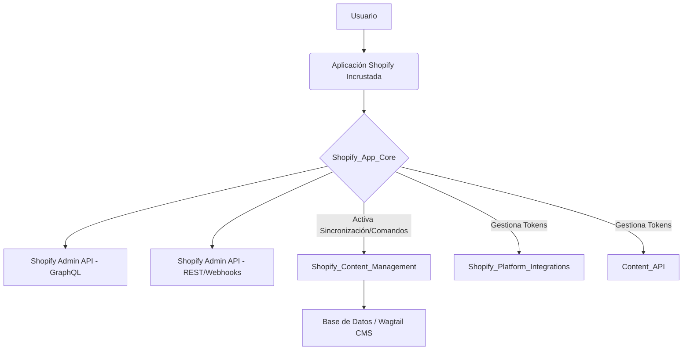

# Módulo Core de la Aplicación Shopify

El módulo `Shopify_App_Core` es el corazón de la integración de la aplicación con la plataforma Shopify. Gestiona la configuración de la tienda, la autenticación, la comunicación con la API de Shopify y el flujo general de la aplicación incrustada. Este módulo proporciona la base para que otras funcionalidades, como la gestión de contenido, interactúen de forma segura y eficiente con una tienda Shopify.

## Propósito y Funcionalidad Principal

Este módulo se encarga de:

*   **Configuración de la Tienda**: Almacena y gestiona la información esencial de la tienda Shopify, incluidos los tokens de acceso y los ámbitos.
*   **Autenticación y Autorización**: Implementa los flujos de autenticación de Shopify, incluida la verificación de la aplicación incrustada (App Home) y el ciclo de vida del token (intercambio y refresco).
*   **Comunicación con la API de Shopify**: Facilita la interacción con la API de administración de GraphQL de Shopify, gestionando tokens de acceso y posibles errores.
*   **Vistas de la Aplicación Incrustada**: Define las vistas para la interfaz de usuario incrustada dentro del panel de administración de Shopify, permitiendo redirecciones seguras y la ejecución de comandos.
*   **Sincronización de Contenido**: Proporciona mecanismos para iniciar la importación de contenido de Shopify a Wagtail y la ejecución de comandos de gestión.
*   **Middleware**: Ofrece middleware para ajustar el comportamiento de la aplicación en entornos específicos, como el proxy local de Shopify CLI.

## Arquitectura General

El módulo `Shopify_App_Core` está diseñado para ser la capa de comunicación y control central para la aplicación Shopify. Interactúa con otros módulos de la siguiente manera:

*   **`Shopify_Content_Management`**: El módulo core inicia las sincronizaciones de contenido y los comandos de gestión que son procesados por el módulo de gestión de contenido. Las vistas en `Shopify_App_Core` activan las tareas en cola definidas en `Shopify_Content_Management`.
*   **`Shopify_Platform_Integrations`**: Se utiliza para la gestión de metaobjetos y webhooks. El módulo core gestiona los tokens de acceso necesarios para estas integraciones.
*   **`Content_API`**: El módulo core gestiona los tokens de acceso utilizados por la `Content_API` para interactuar con Shopify.

## Sub-módulos y Componentes

El módulo `Shopify_App_Core` se organiza en los siguientes sub-módulos lógicos para gestionar sus diversas responsabilidades:

*   [Configuración y Modelos de la Tienda](Shopify_App_Core/Shopify_App_Core_Shop_Configuration_and_Models.md): Gestiona la persistencia de la configuración de la tienda y la validación de formularios.
*   [Vistas y Lógica de Autenticación](Shopify_App_Core/Shopify_App_Core_Views_and_Authentication.md): Maneja los flujos de autenticación, la verificación de la aplicación incrustada y las redirecciones.
*   [Manejo de Errores de Shopify](Shopify_App_Core/Shopify_App_Core_Shopify_Error_Handling.md): Define excepciones específicas para errores de integración con Shopify.
*   [Servicio GraphQL de Shopify](Shopify_App_Core/Shopify_App_Core_Shopify_GraphQL_Service.md): Proporciona una interfaz para ejecutar consultas GraphQL en la API de administración de Shopify.
*   [Middleware Core](Shopify_App_Core/Shopify_App_Core_Core_Middleware.md): Incluye middleware específico para la aplicación Shopify.
*   [Pruebas Unitarias](Shopify_App_Core/Shopify_App_Core_Unit_Tests.md): Contiene las pruebas para los componentes principales del módulo.
