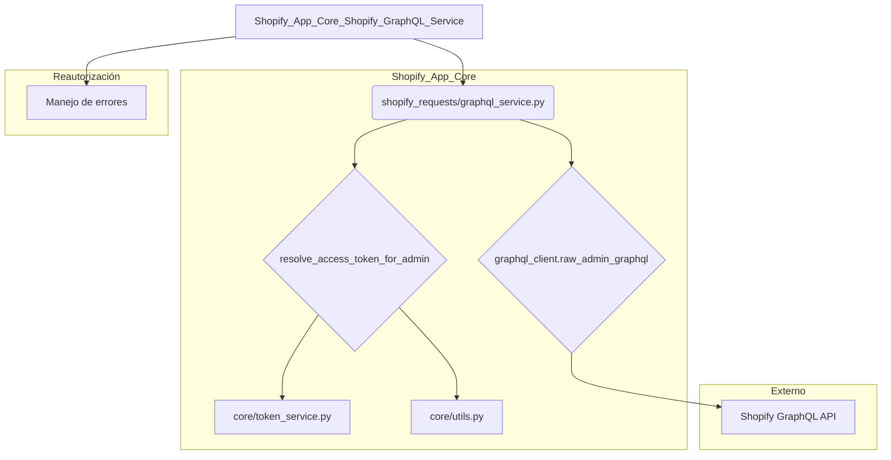
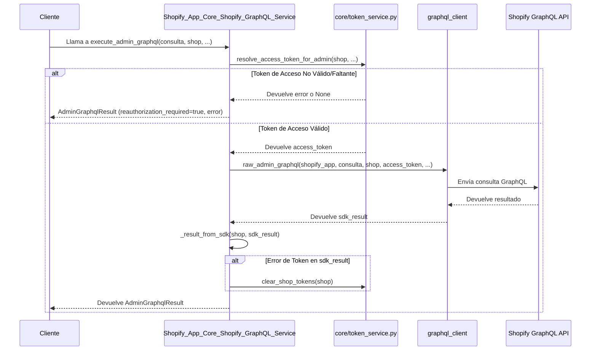

# Servicio GraphQL de Shopify

Este módulo es responsable de facilitar las interacciones con la API GraphQL de administración de Shopify. Proporciona una interfaz estructurada para ejecutar consultas GraphQL, manejar los resultados y gestionar el acceso a tokens para las tiendas de Shopify. El propósito principal es encapsular la lógica para comunicarse con Shopify, incluyendo la reautorización y el manejo de errores, asegurando una integración robusta y fiable.

## Componentes principales

### `shopify_requests/graphql_service.py`

Este archivo contiene la lógica central para interactuar con la API GraphQL de administración de Shopify.

#### `AdminGraphqlResult`

Este `dataclass` define la estructura de los resultados devueltos por las operaciones GraphQL. Incluye campos para el estado de éxito, datos de la tienda, datos de la consulta, extensiones, códigos de error, detalles de registro, indicadores de reautorización requerida y si la operación es reintentable.

#### `execute_admin_graphql`

Esta función es el punto de entrada principal para ejecutar consultas GraphQL de administración de Shopify. Gestiona la resolución de tokens de acceso, la ejecución de la consulta a través del cliente GraphQL y el mapeo de los resultados del SDK a una instancia de `AdminGraphqlResult`. También maneja la limpieza de tokens si se encuentra un error de token.

## Arquitectura y relaciones de componentes

El módulo `Shopify_App_Core_Shopify_GraphQL_Service` se integra con varios otros componentes del sistema para funcionar correctamente.

### Diagrama de componentes

**Diagrama 1: Arquitectura del servicio GraphQL de Shopify**

### Descripción de las relaciones

*   **`Shopify_App_Core_Shopify_GraphQL_Service`** (A) es el módulo principal que orquesta las llamadas a la API de GraphQL de Shopify.
*   Depende de **`shopify_requests/graphql_service.py`** (B) para la implementación real de las funciones.
*   La función `execute_admin_graphql` en (B) utiliza **`resolve_access_token_for_admin`** (C) para obtener el token de acceso necesario.
*   **`resolve_access_token_for_admin`** (C) a su vez depende de **`core/token_service.py`** (E) para la gestión de tokens y **`core/utils.py`** (F) para utilidades generales como `_get_attr` y `get_shopify_app`.
*   Después de obtener el token, `execute_admin_graphql` utiliza **`graphql_client.raw_admin_graphql`** (D) para realizar la llamada HTTP real a la **API GraphQL de Shopify** (G).
*   El módulo también se relaciona con el **Manejo de errores** (H), especialmente para los casos en que se requiere reautorización, lo que a menudo implica la limpieza de tokens a través de **`core/token_service.py`**.

## Flujo de datos

Cuando se ejecuta una consulta GraphQL de administración:

1.  Una solicitud entra en `execute_admin_graphql` con la consulta y el `shop`.
2.  `execute_admin_graphql` llama a `resolve_access_token_for_admin` para obtener un token de acceso.
3.  Si hay un error en la resolución del token, se devuelve un `AdminGraphqlResult` con el error.
4.  Si no hay un token de acceso, se devuelve un `AdminGraphqlResult` indicando que se requiere reautorización.
5.  Con un token válido, `graphql_client.raw_admin_graphql` se invoca para enviar la consulta a la API de Shopify.
6.  La respuesta de la API de Shopify se procesa y mapea a una instancia de `AdminGraphqlResult` por la función interna `_result_from_sdk`.
7.  Si el resultado no es `ok` y el código de error indica un problema de token, se llama a `clear_shop_tokens` de `core/token_service.py` para invalidar los tokens de la tienda.
8.  Finalmente, se devuelve el `AdminGraphqlResult`.

**Diagrama 2: Flujo de datos para la ejecución de consultas GraphQL**

## Cómo encaja el módulo en el sistema general

Este módulo es una parte fundamental del ecosistema de `Shopify_App_Core`, ya que es el principal punto de contacto para cualquier componente de la aplicación que necesite interactuar con la API de administración de Shopify utilizando GraphQL.

*   **Integración con la autenticación y vistas:** Las vistas y componentes de autenticación, como se describe en [Vistas y Autenticación de Shopify App Core](../Shopify_App_Core_Views_and_Authentication.md), pueden utilizar este servicio para realizar operaciones de Shopify que requieren una sesión de administración o datos específicos de la tienda.
*   **Manejo de errores:** Trabaja en conjunto con el módulo [Manejo de Errores de Shopify App Core](../Shopify_App_Core_Shopify_Error_Handling.md) para gestionar excepciones específicas de Shopify, como `ReauthorizationRequired`, que son el resultado de respuestas de error de la API GraphQL.
*   **Configuración de la tienda:** La información de configuración de la tienda, gestionada por el módulo [Configuración y Modelos de la Tienda de Shopify App Core](../Shopify_App_Core_Shop_Configuration_and_Models.md), es crucial para resolver el `shop` y otros detalles necesarios para las llamadas a la API.

En resumen, el `Shopify_App_Core_Shopify_GraphQL_Service` actúa como un adaptador fiable y centralizado para todas las comunicaciones GraphQL con la API de administración de Shopify, abstrayendo la complejidad de la autenticación, el reintento y el manejo de errores.
