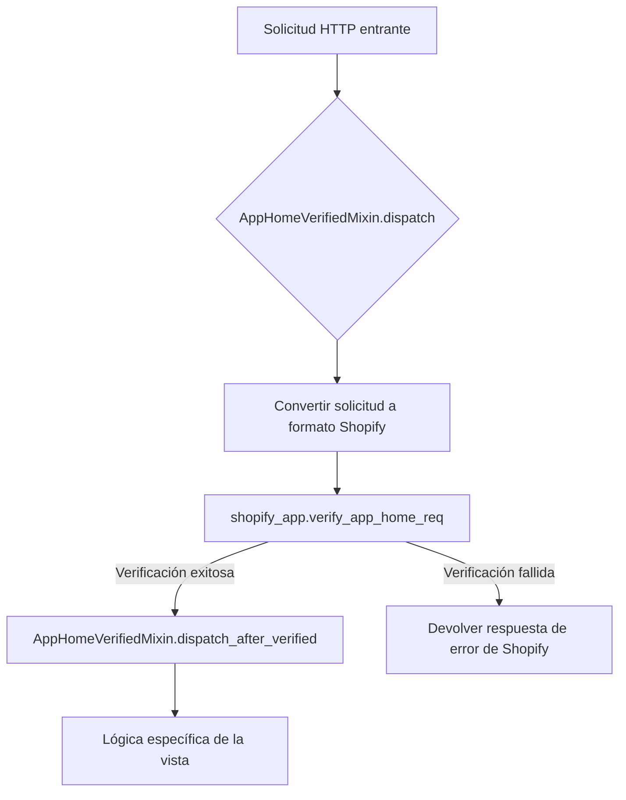
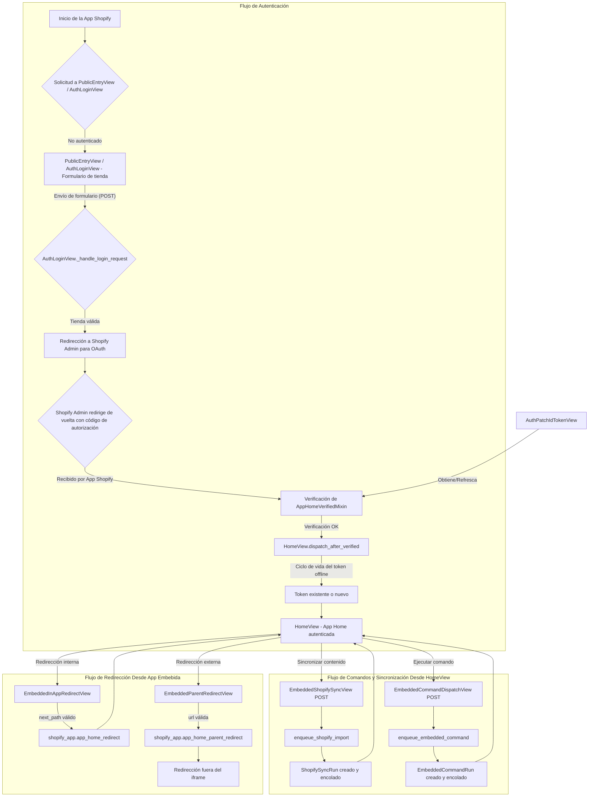

# Vistas y Autenticación de Shopify_App_Core

Este módulo es fundamental para la interacción de la aplicación Django con la plataforma Shopify, especialmente en entornos de aplicaciones incrustadas (embedded apps). Se encarga de gestionar el flujo de autenticación inicial, asegurar la legitimidad de las solicitudes provenientes del administrador de Shopify y proporcionar mecanismos para que la aplicación active la sincronización de contenido y ejecute comandos personalizados dentro de la interfaz de administración de Shopify.

## Propósito y Funcionalidad Clave

El objetivo principal de este módulo es:

*   **Autenticación y Autorización**: Gestionar el proceso de inicio de sesión OAuth para tiendas Shopify y verificar la autenticidad de las solicitudes desde la "App Home" de Shopify.
*   **Interacciones con la App Incrustada**: Facilitar las redirecciones dentro y fuera del iframe de la aplicación incrustada, y permitir la ejecución de comandos y sincronizaciones de contenido directamente desde la interfaz de usuario de Shopify.
*   **Gestión de Tokens**: Asegurar el ciclo de vida adecuado de los tokens de acceso de Shopify, incluyendo la renovación y el uso de tokens offline.

## Arquitectura y Relaciones de Componentes

### Mixin de Verificación: `AppHomeVerifiedMixin`

El `AppHomeVerifiedMixin` (`core/mixins.py`) es un componente clave que asegura que todas las solicitudes a las vistas que lo utilizan provengan de una "App Home" de Shopify legítima y verificada. Implementa el método `dispatch` para realizar la verificación antes de que se ejecute la lógica de la vista real. Las vistas que heredan de este mixin deben implementar `dispatch_after_verified()` para su lógica específica post-verificación.

#### Flujo de Verificación

### Vistas Principales (`core/views.py`)

Las vistas definidas en `core/views.py` son los puntos de entrada HTTP para diversas funcionalidades de la aplicación.

#### `AuthLoginView`

Esta vista maneja el flujo inicial de autenticación OAuth para las tiendas Shopify. Cuando un usuario intenta instalar o iniciar sesión en la aplicación, esta vista valida el dominio de la tienda y redirige al proceso de instalación OAuth de Shopify.

*   **`_oauth_install_redirect(self, shop)`**: Construye la URL de instalación OAuth de Shopify y redirige al usuario.
*   **`_handle_login_request(self, data)`**: Procesa los datos del formulario de inicio de sesión, valida la tienda utilizando [`ShopConfigForm`](../Shopify_App_Core_Shop_Configuration_and_Models.md) y, si es válido, inicia el flujo OAuth.

#### `AuthPatchIdTokenView`

Una vista utilizada para parchear el token de ID de Shopify. Esto es crucial para mantener las sesiones de autenticación activas dentro de la aplicación incrustada y gestionar la renovación de tokens.

#### `EmbeddedCommandDispatchView`

Permite a los administradores de la tienda ejecutar comandos de gestión de Django permitidos directamente desde la interfaz de la aplicación incrustada de Shopify. Esta vista encola el comando para su ejecución asíncrona.

*   **Dependencias**: Se basa en el módulo [shopify_content/embedded_commands/registry.py](Shopify_Content_Management/Embedded_Commands_Registry.md) para obtener la información de los comandos y [shopify_content/embedded_commands/dispatch.py](Shopify_Content_Management/Embedded_Commands_Registry.md) para encolarlos.

#### `EmbeddedInAppRedirectView`

Controla las redirecciones que ocurren *dentro* del iframe de la aplicación incrustada. Valida las rutas relativas de la aplicación para asegurar que las redirecciones se mantengan dentro del ámbito de la aplicación.

#### `EmbeddedParentRedirectView`

Gestiona las redirecciones que rompen el iframe de la aplicación incrustada, dirigiendo al usuario a una URL externa o a otra parte del administrador de Shopify. Valida la URL de destino para garantizar la seguridad.

#### `EmbeddedShopifySyncView`

Activa la importación de contenido (productos, colecciones, blogs, glosario) desde Shopify a Wagtail desde la App Home incrustada. Esta vista encola tareas de sincronización para su procesamiento en segundo plano.

*   **Dependencias**: Interactúa con [shopify_content/sync/service.py](Shopify_Content_Management/Content_Synchronization_Specifications.md) para los recursos de importación válidos y [shopify_content/sync/task_dispatch.py](Shopify_Content_Management/Content_Synchronization_Specifications.md) para encolar las importaciones.

#### `HomeView`

La vista principal para la página de inicio de la aplicación incrustada. Hereda de `AppHomeVerifiedMixin` para la verificación de solicitudes y es responsable de:

*   Mostrar el estado de configuración de la tienda.
*   Listar los recursos de sincronización disponibles y los grupos de comandos.
*   Mostrar ejecuciones recientes de comandos incrustados y sincronizaciones de Shopify.
*   Gestionar el ciclo de vida del token offline de Shopify.
*   Realizar llamadas GraphQL para obtener metadatos de la tienda (a través de `fetch_shop_admin_graphql` del módulo [Shopify_App_Core_Shopify_GraphQL_Service.md](../Shopify_App_Core_Shopify_GraphQL_Service.md)).

#### `PublicEntryView`

Un punto de entrada público, a menudo utilizado como una página de aterrizaje inicial para la aplicación. Presenta el `ShopConfigForm` para la entrada del dominio de la tienda.

#### `RootMenuView`

Actúa como un centro de navegación para la ruta raíz de la aplicación, sin páginas Wagtail asociadas. Ofrece un menú de opciones para el usuario.

### Diagrama de Clases de Vistas y Mixins

```mermaid
classDiagram
    AppHomeVerifiedMixin <|-- HomeView
    AppHomeVerifiedMixin <|-- EmbeddedShopifySyncView
    AppHomeVerifiedMixin <|-- EmbeddedCommandDispatchView
    AppHomeVerifiedMixin <|-- EmbeddedInAppRedirectView
    AppHomeVerifiedMixin <|-- EmbeddedParentRedirectView

    View <|-- AuthLoginView
    View <|-- EmbeddedShopifySyncView
    View <|-- EmbeddedCommandDispatchView
    TemplateView <|-- RootMenuView
    TemplateView <|-- PublicEntryView
    TemplateView <|-- AuthLoginView
    TemplateView <|-- HomeView
    TemplateView <|-- AuthPatchIdTokenView

    AppHomeVerifiedMixin : +dispatch()
    AppHomeVerifiedMixin : +dispatch_after_verified()
    HomeView : +get_context_data()
    HomeView : +dispatch_after_verified()
    HomeView : +render_to_response()
    AuthLoginView : +_oauth_install_redirect()
    AuthLoginView : +_handle_login_request()
    AuthLoginView : +post()
    EmbeddedShopifySyncView : +post()
    EmbeddedCommandDispatchView : +post()
    AuthPatchIdTokenView : +get()
    EmbeddedInAppRedirectView : +dispatch_after_verified()
    EmbeddedParentRedirectView : +dispatch_after_verified()

    HomeView ..> ShopConfigForm : usa
    AuthLoginView ..> ShopConfigForm : usa

    HomeView ..> ShopifySyncRun : muestra
    HomeView ..> EmbeddedCommandRun : muestra
    EmbeddedShopifySyncView ..> ShopifySyncRun : crea
    EmbeddedCommandDispatchView ..> EmbeddedCommandRun : crea

    HomeView ..> get_shopify_app
    HomeView ..> fetch_shop_admin_graphql
    HomeView ..> ensure_offline_token_lifecycle

    EmbeddedShopifySyncView ..> enqueue_shopify_import
    EmbeddedCommandDispatchView ..> enqueue_embedded_command

    EmbeddedCommandDispatchView ..> get_command_by_id
    EmbeddedCommandDispatchView ..> get_commands_by_group

    EmbeddedInAppRedirectView ..> validate_relative_app_path
    EmbeddedParentRedirectView ..> validate_parent_redirect_url
```

### Diagrama de Flujo de Datos y Proceso

## Cómo encaja en el Sistema General

Este módulo es el núcleo interactivo de la aplicación Shopify, funcionando como la capa de presentación y control para las operaciones clave. Se integra con los siguientes módulos:

*   **[Shopify_App_Core/Shopify_App_Core_Shop_Configuration_and_Models.md](../Shopify_App_Core_Shop_Configuration_and_Models.md)**: Para la gestión de la configuración de la tienda (`ShopConfigForm`, `get_shop_config`, `shop_has_access_token`) y el almacenamiento de datos relacionados con la tienda y los tokens.
*   **[Shopify_App_Core/Shopify_App_Core_Shopify_GraphQL_Service.md](../Shopify_App_Core_Shopify_GraphQL_Service.md)**: Para realizar consultas a la API GraphQL de administración de Shopify, obteniendo detalles de la tienda como ID y nombre en la `HomeView`.
*   **[Shopify_Content_Management/Content_Page_Models.md](Shopify_Content_Management/Content_Page_Models.md)**: Proporciona los modelos `EmbeddedCommandRun` y `ShopifySyncRun` para registrar y mostrar el historial de comandos y sincronizaciones ejecutadas.
*   **[Shopify_Content_Management/Content_Synchronization_Specifications.md](Shopify_Content_Management/Content_Synchronization_Specifications.md)**: Define los recursos válidos para la importación (`VALID_IMPORT_RESOURCES`) y proporciona la lógica para encolar tareas de sincronización (`enqueue_shopify_import`).
*   **[Shopify_Content_Management/Embedded_Commands_Registry.md](Shopify_Content_Management/Embedded_Commands_Registry.md)**: Contiene el registro de comandos de gestión permitidos (`get_command_by_id`, `get_commands_by_group`) y la función para encolar estos comandos (`enqueue_embedded_command`).
*   **`core/utils.py` y `core/token_service.py`**: Módulos internos que proporcionan utilidades para interactuar con la API de Shopify y gestionar los tokens de acceso, respectivamente. Estas funcionalidades son esenciales para el `AppHomeVerifiedMixin` y la `HomeView`.

En resumen, `Shopify_App_Core_Views_and_Authentication` orquesta la experiencia del usuario y las interacciones de backend dentro de la aplicación Shopify, actuando como un puente entre la interfaz de usuario de Django, el administrador de Shopify y otros servicios de contenido y datos de la aplicación.