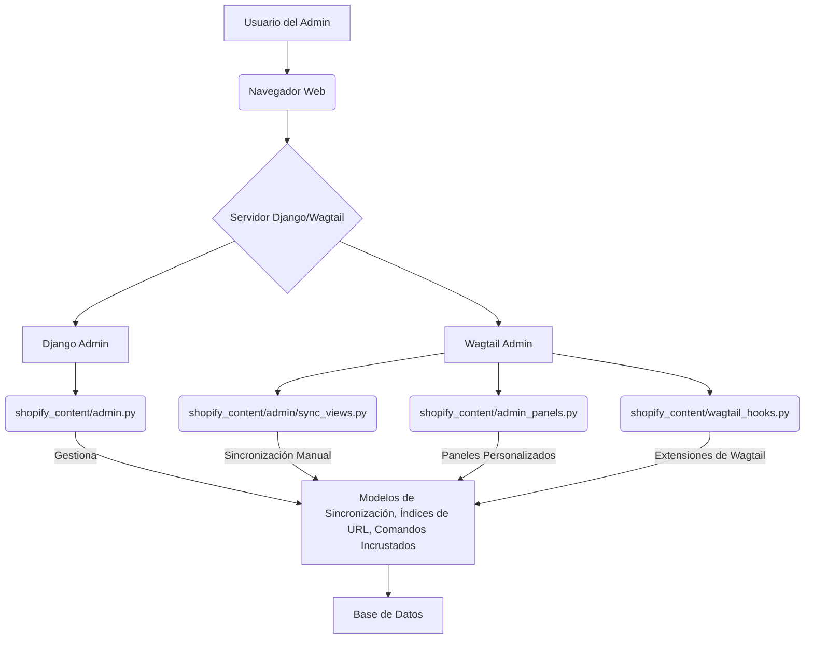

# Interfaz de Administración

El módulo `Admin_Interface` gestiona la interfaz administrativa para la gestión de contenido de Shopify dentro del CMS Wagtail. Facilita la sincronización de contenido desde Shopify, la visualización y gestión de índices de URL, la ejecución y seguimiento de comandos incrustados, y la mejora de la experiencia de edición de páginas con paneles y hooks personalizados.

## Arquitectura

La interfaz de administración se integra estrechamente con el framework Django Admin y el CMS Wagtail. Utiliza:
*   Clases `ModelAdmin` de Django para registrar y personalizar la apariencia y funcionalidad de los modelos relacionados con la sincronización y el indexado.
*   Vistas basadas en clases de Django y Wagtail para manejar flujos de trabajo específicos, como la sincronización manual.
*   Paneles personalizados de Wagtail para mostrar información adicional y mejorar la interfaz de edición de páginas.
*   Hooks de Wagtail para inyectar JavaScript, registrar URLs de administración, añadir elementos al menú y gestionar notificaciones post-publicación.

*Diagrama 1: Arquitectura General de la Interfaz de Administración*

## Funcionalidad de Alto Nivel

El módulo `Admin_Interface` proporciona las siguientes funcionalidades principales:

*   **Registro de Modelos de Administración**: Permite la gestión de `ShopifySyncRun`, `ContentUrlIndex` y `EmbeddedCommandRun` a través de la interfaz de administración de Django, ofreciendo una vista detallada de los procesos de sincronización, las URLs indexadas y la ejecución de comandos.
*   **Vistas de Sincronización con Shopify**: Ofrece una interfaz de usuario en Wagtail para iniciar manualmente la importación de contenido (productos, colecciones, blogs, glosarios) desde Shopify.
*   **Paneles de Administración Personalizados**: Integra paneles personalizados en las páginas de Wagtail para mostrar URLs de escaparate de Shopify y gestionar enlaces semánticos, mejorando la visibilidad de cómo se correlaciona el contenido del CMS con la tienda Shopify.
*   **Hooks de Wagtail**: Extiende la funcionalidad de Wagtail para incluir lógica de sincronización después de la publicación de páginas, añadir elementos de menú para la sincronización, y personalizar el comportamiento del selector de páginas para filtrar por locales.

## Sub-módulos Documentados

Para obtener una descripción detallada de cada componente, consulte los siguientes sub-módulos:

*   [Modelos de Administración del Interfaz de Administración](Admin_Interface/Admin_Interface_Admin_Interface_Admin_Models.md)
*   [Vistas de Sincronización de Shopify del Interfaz de Administración](Admin_Interface/Admin_Interface_Admin_Interface_Sync_Views.md)
*   [Paneles de Administración del Interfaz de Administración](Admin_Interface/Admin_Interface_Admin_Interface_Admin_Panels.md)
*   [Hooks de Wagtail del Interfaz de Administración](Admin_Interface/Admin_Interface_Wagtail_Hooks.md)
