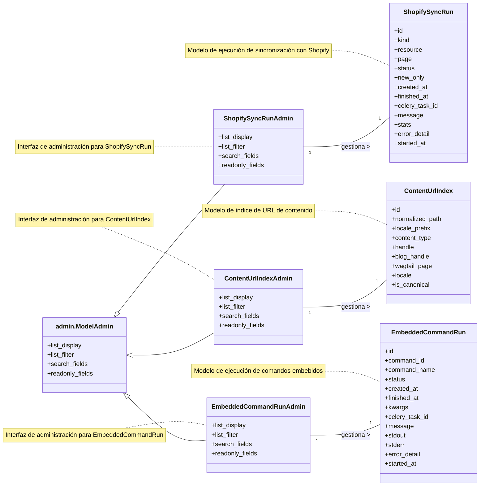

# Modelos de Administración de la Interfaz de Administración

Este módulo `Admin_Interface_Admin_Interface_Admin_Models` define las interfaces de administración de Django para varios modelos clave dentro del sistema de gestión de contenido de Shopify. Estas interfaces permiten a los administradores ver, filtrar y buscar registros relacionados con las ejecuciones de sincronización, el índice de URL de contenido y los comandos embebidos directamente desde el panel de administración de Django.

## Propósito y Funcionalidad Principal

El propósito principal de este módulo es proporcionar una forma sencilla y estructurada para que los administradores interactúen con los datos subyacentes que impulsan las funcionalidades de sincronización de contenido, indexación de URL y ejecución de comandos. Al registrar estos modelos con `admin.ModelAdmin`, se habilita una interfaz gráfica para la gestión de estos importantes aspectos del sistema.

Los componentes principales definidos en `shopify_content/admin.py` son:

*   `ContentUrlIndexAdmin`: Proporciona la interfaz administrativa para el modelo `ContentUrlIndex`.
*   `EmbeddedCommandRunAdmin`: Proporciona la interfaz administrativa para el modelo `EmbeddedCommandRun`.
*   `ShopifySyncRunAdmin`: Proporciona la interfaz administrativa para el modelo `ShopifySyncRun`.

### `ShopifySyncRunAdmin`

Esta clase de administración está registrada para el modelo `ShopifySyncRun`, que rastrea las ejecuciones de sincronización con Shopify. Ofrece una vista detallada de cada ejecución de sincronización, incluyendo su estado, recursos involucrados y marcas de tiempo.

**Detalles de Configuración:**
*   `list_display`: Muestra `id`, `kind`, `resource`, `page`, `status`, `new_only`, `created_at` y `finished_at`.
*   `list_filter`: Permite filtrar por `kind`, `status`, `resource` y `new_only`.
*   `search_fields`: Permite buscar por `celery_task_id`, `message` y `error_detail`.
*   `readonly_fields`: Asegura que campos como `kind`, `resource`, `page`, `new_only`, `celery_task_id`, `status`, `message`, `stats`, `error_detail`, `created_at`, `started_at` y `finished_at` no puedan ser editados directamente a través de la interfaz de administración.

Para obtener más información sobre el modelo `ShopifySyncRun`, consulte [Modelos de Ejecución de Sincronización de Shopify](../../Content_Page_Models/Content_Page_Models_Shopify_Sync_Run_Models.md).

### `ContentUrlIndexAdmin`

Esta clase de administración gestiona el modelo `ContentUrlIndex`, que se encarga de indexar las URL de contenido. Facilita la visualización y el filtrado de las entradas del índice de URL para garantizar que las rutas de contenido se resuelvan correctamente.

**Detalles de Configuración:**
*   `list_display`: Muestra `id`, `normalized_path`, `locale_prefix`, `content_type`, `handle`, `blog_handle`, `wagtail_page`, `locale` e `is_canonical`.
*   `list_filter`: Permite filtrar por `content_type`, `locale` e `is_canonical`.
*   `search_fields`: Permite buscar por `normalized_path`, `handle` y `blog_handle`.
*   `readonly_fields`: Asegura que campos como `normalized_path`, `wagtail_page`, `content_type`, `handle`, `blog_handle`, `locale`, `locale_prefix` e `is_canonical` no puedan ser editados.

Para obtener más información sobre el modelo `ContentUrlIndex`, consulte [Modelos de Índice de URL de Contenido](../../Content_Page_Models/Content_Page_Models_Content_URL_Index_Models.md).

### `EmbeddedCommandRunAdmin`

Esta clase de administración está asociada con el modelo `EmbeddedCommandRun`, que registra la ejecución de comandos embebidos dentro del sistema. Proporciona una visión general del estado y los resultados de estos comandos.

**Detalles de Configuración:**
*   `list_display`: Muestra `id`, `command_id`, `command_name`, `status`, `created_at` y `finished_at`.
*   `list_filter`: Permite filtrar por `status` y `command_name`.
*   `search_fields`: Permite buscar por `command_id`, `command_name`, `celery_task_id`, `message` y `error_detail`.
*   `readonly_fields`: Asegura que campos como `command_id`, `command_name`, `kwargs`, `celery_task_id`, `status`, `message`, `stdout`, `stderr`, `error_detail`, `created_at`, `started_at` y `finished_at` no puedan ser editados.

Para obtener más información sobre el modelo `EmbeddedCommandRun`, consulte [Modelos de Ejecución de Comandos Embebidos](../../Content_Page_Models/Content_Page_Models_Embedded_Command_Run_Models.md).

## Arquitectura y Relaciones

El módulo `shopify_content/admin.py` integra los modelos de contenido con el framework de administración de Django. Cada clase `Admin` actúa como un adaptador entre la base de datos y la interfaz de usuario del administrador, permitiendo la gestión de los objetos del modelo.

## Encaje en el Sistema General

Este módulo forma una parte esencial de la [Interfaz de Administración](../Admin_Interface.md) de Shopify Content Management. Permite a los administradores supervisar y gestionar directamente aspectos críticos del sistema como:

*   **Sincronización de Contenido:** A través de `ShopifySyncRunAdmin`, los administradores pueden ver el progreso y el resultado de las operaciones de sincronización de contenido entre la aplicación y Shopify. Esto es crucial para asegurar que el contenido se mantenga actualizado y consistente.
*   **Indexación de URL:** `ContentUrlIndexAdmin` permite verificar que las URLs de contenido se estén indexando correctamente, lo que es vital para el enrutamiento y la accesibilidad del contenido en el frontend.
*   **Ejecución de Comandos:** Con `EmbeddedCommandRunAdmin`, se puede rastrear la ejecución de comandos internos, lo que es útil para la depuración y para entender las operaciones automatizadas del sistema.

En resumen, las clases de administración definidas en este módulo son el puente entre los datos operacionales del sistema de gestión de contenido y la capacidad de los administradores para inspeccionarlos y gestionarlos, contribuyendo a la estabilidad y la mantenibilidad del sistema.
