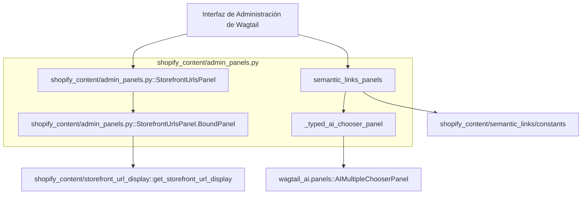
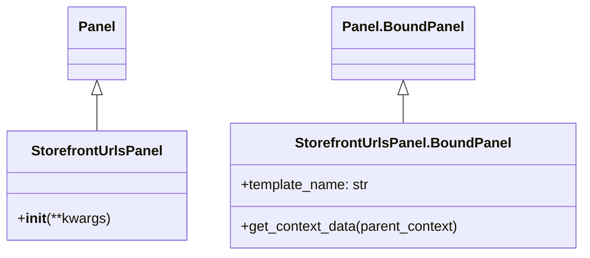
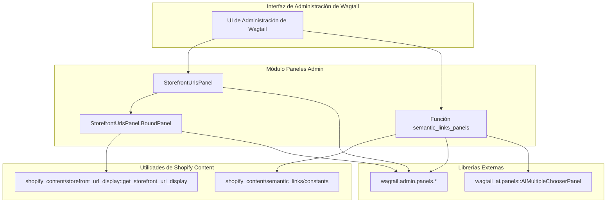

# Paneles de Administración de la Interfaz de Administración

El módulo `Admin_Interface_Admin_Interface_Admin_Panels` (definido en `shopify_content/admin_panels.py`) gestiona la creación y el comportamiento de paneles personalizados en la interfaz de administración de Wagtail. Su propósito principal es mejorar la experiencia del usuario de Wagtail proporcionando vistas y funcionalidades específicas para el contenido de Shopify. Este módulo incluye paneles para mostrar las URLs de la tienda y para gestionar enlaces semánticos, integrándose con las capacidades de Wagtail y Wagtail AI.

## Funcionalidad Principal

Este módulo define las siguientes clases y funciones clave:

### `StorefrontUrlsPanel`

Este panel de solo lectura está diseñado para mostrar las rutas de las URLs de Shopify asociadas con la página actual dentro del CMS de Wagtail. Facilita a los editores y desarrolladores la visualización de cómo se publicará el contenido en la tienda Shopify.

*   **Propósito**: Proporcionar una visión clara de las URLs públicas del contenido, que son distintas de las URLs internas del CMS de Wagtail. Esto es crucial para la correlación con herramientas como Google Search Console (GSC) y para entender el comportamiento en diferentes mercados.
*   **Configuración**:
    *   `heading`: 'Storefront URLs'
    *   `classname`: 'storefront-urls-panel'
    *   `help_text`: Proporciona una explicación sobre la diferencia entre las URLs de Wagtail y las de Shopify, y la influencia de los mercados.

### `StorefrontUrlsPanel.BoundPanel`

Es la implementación vinculada de `StorefrontUrlsPanel`, responsable de la lógica de renderizado y de la recuperación de datos para el panel.

*   **Plantilla**: Utiliza la plantilla `shopify_content/panels/storefront_urls.html` para la presentación visual del panel.
*   **Contexto de Datos**: Sobrescribe `get_context_data` para inyectar las URLs de la tienda. Para ello, importa `get_storefront_url_display` (presumiblemente desde un módulo de utilidad dentro de `shopify_content`) y pasa la instancia de la página actual para obtener las URLs formateadas.

### Funciones de Soporte para Paneles Avanzados

El módulo también incluye funciones para la creación dinámica de paneles relacionados con la gestión de enlaces internos y la integración con funcionalidades de IA:

*   **`_typed_ai_chooser_panel(relation_name, *, heading, label, type_key, vector_index='PageIndex')`**: Una función fábrica que genera instancias de `TypedAIMultipleChooserPanel`. Este panel, derivado de `wagtail_ai.panels.AIMultipleChooserPanel`, permite a los usuarios seleccionar páginas relacionadas utilizando capacidades de IA, con filtros basados en tipos de página y un índice vectorial configurable.
*   **`semantic_links_panels()`**: Esta función construye un `MultiFieldPanel` que contiene paneles para gestionar enlaces semánticos internos. Dependiendo de la configuración de `WAGTAIL_AI_PGVECTOR`, puede utilizar los paneles de selección de IA (`_typed_ai_chooser_panel`) o paneles `InlinePanel` estándar de Wagtail para gestionar las relaciones de enlaces. La configuración de estos enlaces se obtiene de `shopify_content.semantic_links.constants.RELATION_CONFIG`.

## Arquitectura y Relaciones

El módulo `Admin_Interface_Admin_Interface_Admin_Panels` se integra directamente con el sistema de administración de Wagtail, utilizando sus clases base `Panel`, `InlinePanel` y `MultiFieldPanel`.

**Explicación de las Relaciones:**

*   **Wagtail Admin**: Los paneles definidos en este módulo son componentes que se insertan en las páginas de edición de Wagtail para extender su funcionalidad.
*   **`get_storefront_url_display`**: `StorefrontUrlsPanel.BoundPanel` depende de esta función de utilidad para obtener las URLs que se mostrarán. Aunque `shopify_content/storefront_url_display` no es un módulo listado explícitamente, su funcionalidad está estrechamente relacionada con [Generación de URLs de Storefront](Shopify_Content_Management/Shopify_Content_Application_Core/Shopify_Content_Application_Core_Storefront_URL_Generation.md).
*   **[Servicio de Enlaces Semánticos](../Semantic_Links_Service.md)**: La función `semantic_links_panels` interactúa con las constantes definidas en [Servicio de Enlaces Semánticos](Shopify_Content_Management/Semantic_Links_Service.md) para configurar dinámicamente los paneles de enlaces internos.
*   **Wagtail AI**: Cuando está habilitada la integración con Wagtail AI (a través de la configuración `WAGTAIL_AI_PGVECTOR`), los paneles de selección de enlaces semánticos utilizan `AIMultipleChooserPanel` para proporcionar una experiencia de usuario mejorada basada en IA.

## Diagramas

### Diagrama de Clases

### Diagrama de Componentes

