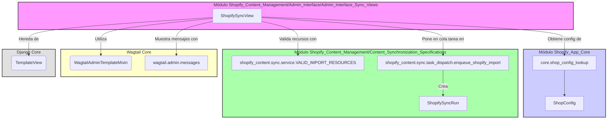
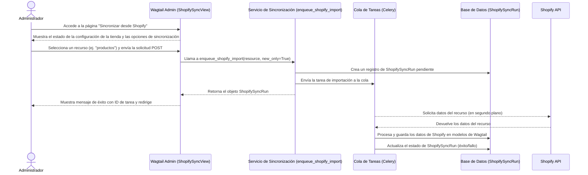

# Vistas de Sincronización de la Interfaz de Administración de Shopify

Este módulo, `Admin_Interface_Admin_Interface_Sync_Views`, define las vistas de administración de Wagtail utilizadas para iniciar manualmente la sincronización de contenido desde Shopify. Su componente principal, `ShopifySyncView`, proporciona una interfaz de usuario para que los administradores activen importaciones de productos, colecciones, blogs, glosarios o todos los recursos de Shopify.

## Propósito y Funcionalidad Principal

El propósito principal de este módulo es ofrecer a los administradores una forma directa de iniciar la importación de contenido desde una tienda Shopify conectada. La `ShopifySyncView` actúa como el punto de entrada para esta funcionalidad, permitiendo a los usuarios seleccionar el tipo de recurso de Shopify que desean sincronizar y ver el estado de la configuración de la tienda.

## Arquitectura y Relaciones entre Componentes

La `ShopifySyncView` es una clase basada en vistas de Wagtail, lo que significa que se integra estrechamente con el panel de administración de Wagtail. Depende de varios servicios y configuraciones para su operación:

*   **`wagtail.admin.views.generic.WagtailAdminTemplateMixin`**: Proporciona el contexto de plantilla necesario y las funcionalidades básicas para las vistas del administrador de Wagtail.
*   **`django.views.generic.TemplateView`**: La clase base de Django para vistas que renderizan una plantilla.
*   **`core.shop_config_lookup`**: Este módulo (a través de `get_shop_config` y `shop_has_access_token`) se utiliza para verificar si la tienda Shopify está configurada correctamente y tiene un token de acceso válido, lo cual es crucial antes de intentar cualquier sincronización. Consulte [Shopify_App_Core.md](../../../Shopify_App_Core.md) para más detalles sobre la configuración de la tienda.
*   **`shopify_content.sync.service.VALID_IMPORT_RESOURCES`**: Una constante que define los tipos de recursos válidos que se pueden importar desde Shopify. Esto garantiza que solo se intenten importaciones permitidas.
*   **`shopify_content.sync.task_dispatch.enqueue_shopify_import`**: La función central para poner en cola la tarea de importación real en un proceso en segundo plano (generalmente Celery). Esto desacopla la solicitud HTTP de la operación de sincronización de larga duración. Para más información sobre el despacho de tareas, consulte [Content_Synchronization_Specifications.md](../../Content_Synchronization_Specifications.md).
*   **`wagtail.admin.messages`**: Se utiliza para mostrar mensajes de éxito o error al usuario dentro de la interfaz de administración de Wagtail, proporcionando retroalimentación sobre el resultado de la acción de sincronización.

### Diagrama de Componentes

## Cómo encaja el módulo en el sistema general

El módulo `Admin_Interface_Admin_Interface_Sync_Views` es una parte integral de la [Gestión de Contenido de Shopify (Shopify_Content_Management.md)](../../Shopify_Content_Management.md). Proporciona la funcionalidad de interfaz de usuario para iniciar el proceso de sincronización, que es un aspecto clave para mantener el contenido del CMS actualizado con la información de Shopify. Se posiciona dentro del área de administración de Wagtail, sirviendo como un puente entre la interacción manual del administrador y los procesos de importación asíncronos que manejan la transferencia de datos desde Shopify.

Esencialmente, este módulo permite a los administradores:

1.  **Verificar la configuración de la tienda**: Asegurarse de que la aplicación esté correctamente conectada a Shopify.
2.  **Seleccionar recursos para importar**: Elegir qué tipo de contenido (productos, colecciones, blogs, etc.) desean sincronizar.
3.  **Iniciar el proceso de sincronización**: Disparar una tarea en segundo plano que importará los datos, evitando que la interfaz de usuario se bloquee.
4.  **Recibir retroalimentación**: Informar sobre el éxito o el fracaso de la operación de sincronización a través de mensajes en la interfaz de administración.

Este proceso es fundamental para el flujo de trabajo editorial, ya que permite a los creadores de contenido importar fácilmente la estructura básica y los datos de productos o colecciones desde Shopify, que luego pueden ser enriquecidos y gestionados dentro de Wagtail. Las ejecuciones de sincronización se registran en el modelo `ShopifySyncRun` (definido en [Content_Page_Models_Shopify_Sync_Run_Models.md](../../Content_Page_Models/Content_Page_Models_Shopify_Sync_Run_Models.md)), lo que permite a los administradores rastrear y auditar las operaciones de sincronización.

### Flujo de Proceso de Sincronización Manual

