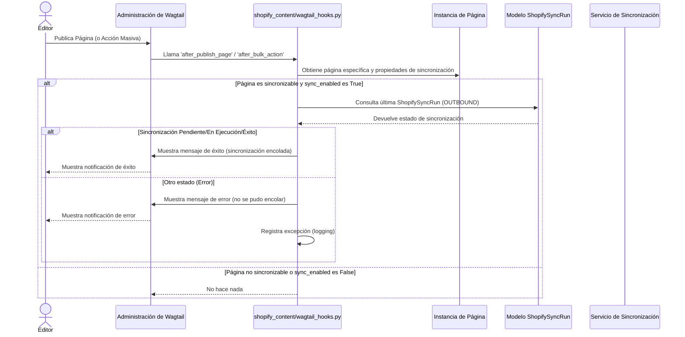
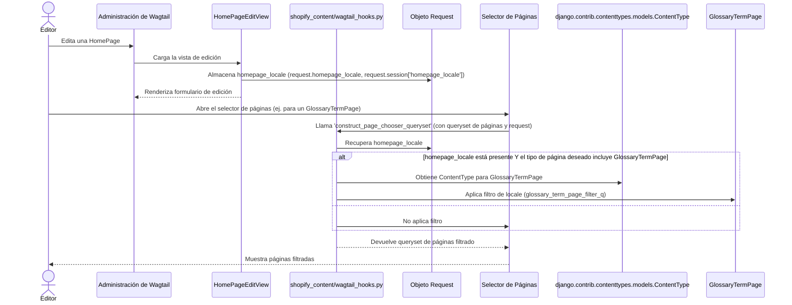

# Ganchos de Wagtail de la Interfaz de Administración

Este módulo (`shopify_content/wagtail_hooks.py`) contiene ganchos (hooks) de Wagtail que extienden y personalizan la interfaz de administración de Wagtail para las necesidades específicas de la integración de contenido de Shopify. Incluye funcionalidades para la notificación de sincronización con Shopify, la personalización de la vista de edición de la página de inicio (HomePage) y el filtrado de selectores de páginas basado en el locale.

## Propósito y funcionalidad principal

El propósito principal de este módulo es mejorar la experiencia del editor de contenido en Wagtail, proporcionando retroalimentación sobre el estado de la sincronización del contenido con Shopify y facilitando la gestión de contenido multilingüe dentro de la interfaz de administración.

Las funcionalidades clave incluyen:
*   **Notificaciones de Sincronización con Shopify**: Muestra mensajes en la interfaz de administración de Wagtail después de que las páginas se publican (individualmente o en masa), informando al editor si la sincronización con Shopify se ha puesto en cola con éxito o si ha habido un error.
*   **Gestión de URLs de Sincronización**: Registra una URL y un elemento de menú en la administración de Wagtail para acceder a la vista de sincronización de Shopify.
*   **Personalización de la Vista de Edición de la Página de Inicio (HomePage)**: Introduce una vista de edición personalizada para las instancias de `HomePage` para almacenar el locale de la página, lo que es crucial para el funcionamiento de los bloques de `StreamField` sensibles al locale.
*   **Filtrado del Selector de Páginas por Locale**: Modifica el comportamiento del selector de páginas de Wagtail para filtrar las páginas disponibles (específicamente `GlossaryTermPage`) basándose en el locale de la `HomePage` que se está editando.
*   **Parche de JS para el selector de IA de Wagtail**: Inyecta un script JavaScript para parchear el selector de IA, aunque su funcionalidad específica no se detalla en este módulo.

## Arquitectura y relaciones entre componentes

El módulo `Admin_Interface_Wagtail_Hooks` interactúa con varios componentes de Wagtail y del sistema de gestión de contenido de Shopify. Utiliza el sistema de ganchos de Wagtail para inyectar su lógica en puntos específicos del ciclo de vida de la administración.

### Diagrama de Componentes

```mermaid
graph TD
    subgraph "Módulo Admin_Interface_Wagtail_Hooks"
        A[shopify_content/wagtail_hooks.py]
        B(HomePageEditView)
    end

    subgraph "Wagtail Core"
        WC[Ganchos de Wagtail]
        WA[Admin de Wagtail]
        WAP[Selector de Páginas de Wagtail]
        WEV[wagtail.admin.views.pages.edit.EditView]
    end

    subgraph "Modelos de Contenido"
        MHC[shopify_content/models/home_page.py::HomePage]
        MGT[shopify_content/models/glossary.py::GlossaryTermPage]
        MSR[shopify_content/models/sync_run.py::ShopifySyncRun]
    end

    subgraph "Servicios de Sincronización"
        SSV[shopify_content/admin/sync_views.py::ShopifySyncView]
        SSP[shopify_content/sync/publish_sync.py::is_syncable_page]
        SPC[shopify_content/page_chooser_locale.py]
    end

    A -- "Registra JS" --> WA
    A -- "Registra URLs" --> SSV
    A -- "Registra Elemento de Menú" --> WA
    A -- "Gancho 'after_publish_page'" --> SSP
    A -- "Gancho 'after_bulk_action'" --> SSP
    A -- "Gancho 'register_page_editing_view'" --> B
    B -- "Hereda de" --> WEV
    B -- "Establece locale de request" --> MHC
    A -- "Gancho 'construct_page_chooser_queryset'" --> WAP
    A -- "Gancho 'construct_page_chooser_queryset'" --> SPC
    SPC -- "Filtra por" --> MGT
    MSR -- "Usado por" --> A
    SSV -- "Referenciado por" --> A
    MHC -- "Usado por" --> A
    MHC -- "Usado por" --> B
```

### Notificaciones de Sincronización con Shopify

El módulo utiliza los ganchos `after_publish_page` y `after_bulk_action` de Wagtail para mostrar retroalimentación al editor sobre el estado de la sincronización.

#### Flujo de Sincronización al Publicar Páginas

Cuando una página se publica, la lógica en `notify_shopify_sync_on_publish` o `notify_shopify_sync_after_bulk_publish` se ejecuta. Estas funciones consultan el estado de la última ejecución de sincronización saliente (`ShopifySyncRun.KIND_OUTBOUND`) para la página.

### Personalización de la Vista de Edición de HomePage

La clase `HomePageEditView` es una extensión de `wagtail.admin.views.pages.edit.EditView`. Su propósito es capturar el locale de la `HomePage` que se está editando y almacenarlo en el objeto `request` (y la sesión) para que otros componentes, como `LocaleAwarePageChooserBlock`, puedan acceder a esta información. Esto es crucial para filtrar dinámicamente el contenido en los selectores de páginas.

El gancho `register_page_editing_view` asegura que cualquier instancia de `HomePage` utilice esta vista personalizada.

#### Flujo del Selector de Páginas con Reconocimiento de Locale

El gancho `construct_page_chooser_queryset` es el encargado de filtrar las páginas en el selector de páginas de Wagtail.

## Integración con el sistema general

Este módulo es una parte integral de la [Gestión de Contenido de Shopify](Shopify_Content_Management.md), ya que proporciona la interfaz de usuario y las mejoras de experiencia del editor necesarias para manejar el contenido que se sincroniza con la plataforma Shopify. Se basa en los [Modelos de Página de Contenido](Shopify_Content_Management/Content_Page_Models.md) para acceder a los datos de la página y los registros de sincronización, y en los [Servicios de Sincronización de Contenido](Shopify_Content_Management/Content_Synchronization_Specifications.md) y [Vistas de Sincronización de Administración](Shopify_Content_Management/Admin_Interface/Admin_Interface_Sync_Views.md) para la ejecución y el seguimiento de las operaciones de sincronización. La funcionalidad de locale-aware se integra estrechamente con el [Núcleo de la Aplicación de Contenido de Shopify](Shopify_Content_Management/Shopify_Content_Application_Core.md), especialmente con `HomePageLocaleSource` para la validación de locale y la lógica de filtrado del selector de páginas.

## Referencias

*   [Gestión de Contenido de Shopify](Shopify_Content_Management.md)
*   [Modelos de Página de Contenido](Shopify_Content_Management/Content_Page_Models.md)
*   [Modelos de Ejecución de Sincronización de Shopify](Shopify_Content_Management/Content_Page_Models/Content_Page_Models_Shopify_Sync_Run_Models.md)
*   [Vistas de Sincronización de Administración](Shopify_Content_Management/Admin_Interface/Admin_Interface_Sync_Views.md)
*   [Núcleo de la Aplicación de Contenido de Shopify](Shopify_Content_Management/Shopify_Content_Application_Core.md)
*   [Validación de Locale de Página de Inicio del Núcleo de la Aplicación de Contenido de Shopify](Shopify_Content_Management/Shopify_Content_Application_Core/Shopify_Content_Application_Core_Home_Page_Locale_Validation.md)
*   [Modelos de Páginas de Términos de Glosario](Shopify_Content_Management/Content_Page_Models/Content_Page_Models_Glossary_Term_Pages.md)
*   [Modelos de Páginas de Inicio](Shopify_Content_Management/Content_Page_Models/Content_Page_Models_Home_Pages.md)
