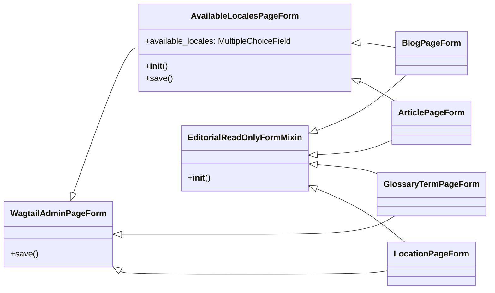
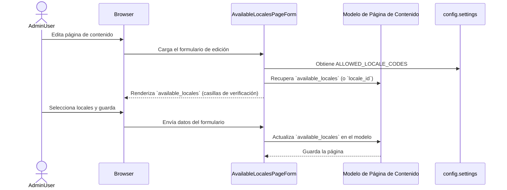
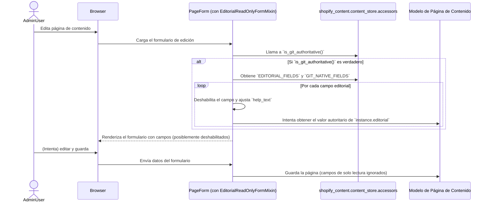

# Formularios de Contenido

Este módulo, `Content_Forms`, define los formularios de administración de Wagtail utilizados para gestionar los diferentes tipos de páginas de contenido dentro de la aplicación Shopify. Estos formularios extienden la funcionalidad base de Wagtail para incluir características específicas de la aplicación, como la gestión de la disponibilidad de locales y la integración con un flujo de trabajo de contenido autoritario basado en Git.

## Propósito y Funcionalidad Principal

El objetivo principal de este módulo es proporcionar interfaces de usuario en el panel de administración de Wagtail para la creación y edición de páginas de contenido como artículos, blogs, términos de glosario y páginas de ubicación. Incorpora lógica para:

*   **Gestión de Locales**: Permitir a los editores seleccionar en qué locales (mercados/idiomas) debe estar disponible una página de contenido específica.
*   **Integración Git Authoritative**: Habilitar un modo de solo lectura para campos de contenido editorial que son gestionados externamente a través de un sistema de control de versiones (Git), asegurando que la verdad proviene de Git y no de la base de datos de Wagtail para esos campos.

## Componentes del Módulo

Los componentes clave en `shopify_content/forms.py` son:

### `AvailableLocalesPageForm`

Este formulario es una extensión de `WagtailAdminPageForm` que añade un campo de selección múltiple para gestionar los locales disponibles de una página. Utiliza los códigos de locale definidos en la configuración de la aplicación.

**Funcionalidad:**
*   Presenta una lista de `ALLOWED_LOCALE_CODES` como opciones de casilla de verificación.
*   Inicializa el campo `available_locales` con los valores existentes de la instancia de la página o el locale por defecto si no hay ninguno configurado.
*   Guarda los locales seleccionados en el campo `available_locales` (un campo JSONField en el modelo subyacente de la página).

### `EditorialReadOnlyFormMixin`

Este mixin se utiliza para hacer que los campos editoriales de las páginas sean de solo lectura cuando la aplicación está configurada en un modo "git_authoritative". Esto es crucial para mantener la coherencia del contenido cuando parte del mismo es gestionado por un sistema externo como Git.

**Funcionalidad:**
*   Detecta si el modo `git_authoritative` está activo (a través de `is_git_authoritative()` de `shopify_content.content_store.accessors`).
*   Si está activo, itera sobre los campos definidos en `EDITORIAL_FIELDS` y los deshabilita en el formulario.
*   Modifica el texto de ayuda (`help_text`) para indicar que el contenido es de solo lectura y gestionado por Git.
*   Para campos "Git-nativos", se muestra un mensaje específico indicando que el contenido reside en Markdown en Git.
*   Intenta precargar los valores iniciales de los campos desde la propiedad `editorial` de la instancia de la página, lo que permite visualizar el valor autoritario de Git.

### `BlogPageForm`, `ArticlePageForm`, `GlossaryTermPageForm`, `LocationPageForm`

Estas clases son formularios específicos para diferentes tipos de páginas de contenido en Wagtail. Heredan de `EditorialReadOnlyFormMixin` para aplicar la lógica de solo lectura editorial y, en el caso de `BlogPageForm` y `ArticlePageForm`, también de `AvailableLocalesPageForm` para gestionar los locales. `GlossaryTermPageForm` y `LocationPageForm` heredan directamente de `WagtailAdminPageForm` y aplican el mixin de solo lectura editorial.

*   **`BlogPageForm`**: Formulario para la gestión de páginas de blog.
*   **`ArticlePageForm`**: Formulario para la gestión de páginas de artículos.
*   **`GlossaryTermPageForm`**: Formulario para la gestión de páginas de términos de glosario.
*   **`LocationPageForm`**: Formulario para la gestión de páginas de ubicación.

## Arquitectura y Relaciones entre Componentes

Los formularios de este módulo son parte integral del panel de administración de Wagtail para el `Shopify_Content_Management`.

### Diagrama de Clases

### Relación con otros módulos

*   **[Content Page Models](../Content_Page_Models.md)**: Los formularios interactúan directamente con los modelos de página definidos en el módulo `Content_Page_Models` (ej. `ArticlePage`, `BlogPage`, `GlossaryTermPage`, `LocationPage`). Los datos ingresados en los formularios se persisten en estos modelos.
*   **[Shopify Content Application Core](Shopify_Content_Application_Core.md)**: El comportamiento de `AvailableLocalesPageForm` depende de `ALLOWED_LOCALE_CODES`, que se configura en los ajustes de la aplicación. El módulo `Shopify_Content_Application_Core` encapsula la configuración de la aplicación.
*   **[Content Store - Markdown Processing](../Content_Store___Markdown_Processing.md)**: `EditorialReadOnlyFormMixin` se basa en la lógica definida en el `content_store` para determinar si el modo `git_authoritative` está activo y para acceder a los campos editoriales autoritarios. Esto incluye `shopify_content.content_store.accessors` (no directamente listado en el árbol, pero conceptualmente parte de este módulo) que proporciona `EDITORIAL_FIELDS`, `GIT_NATIVE_FIELDS`, y `is_git_authoritative`.

## Flujo de Datos y Proceso

### Gestión de Locales

### Modo de Solo Lectura Editorial

## Cómo encaja en el Sistema General

Los formularios de contenido son un punto de entrada crítico para los editores de contenido que utilizan Wagtail CMS. Al estandarizar la forma en que se gestionan los locales y se aplica la autoridad de Git, este módulo garantiza que el contenido en el CMS sea coherente con la estrategia de localización y el flujo de trabajo de desarrollo basado en Git. Permite una edición eficiente y controlada del contenido, al mismo tiempo que respeta las fuentes de verdad externas para ciertos campos de contenido editorial.
