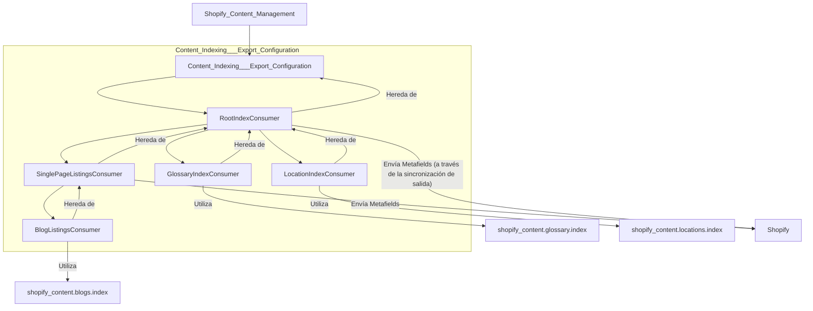

# Configuración de Indexación y Exportación de Contenido

## Introducción

Este módulo es responsable de la configuración y gestión de la indexación y exportación de varios tipos de contenido (blogs, glosarios, ubicaciones, páginas individuales) a Shopify. Define consumidores que construyen cargas útiles de índice precalculadas y gestionan los contratos `hreflang`/`noindex` para diferentes familias de contenido.

## Arquitectura del Módulo

El módulo `Content_Indexing___Export_Configuration` está estructurado en torno a una clase base `RootIndexConsumer` y consumidores especializados para diferentes tipos de contenido. Se encarga de construir los payloads de indexación y las configuraciones de `hreflang` y `noindex` que luego son sincronizadas con Shopify.

### Componentes de Alto Nivel

A continuación, se presenta una descripción de los componentes clave de este módulo:

*   **[Consumidor de Índice Raíz](Content_Indexing___Export_Configuration/Content_Indexing___Export_Configuration_Root_Index_Consumer.md)** (`RootIndexConsumer`): Proporciona la funcionalidad base para construir cargas útiles de índice, manejar valores `hreflang` y determinar el estado `noindex` para las familias de `ShopifyRootPage`.
*   **[Consumidor de Listados de Página Única](Content_Indexing___Export_Configuration/Content_Indexing___Export_Configuration_Single_Page_Listings_Consumer.md)** (`SinglePageListingsConsumer`): Una clase base abstracta para los consumidores que envían listados de contenido a una única página de Shopify a través del metafield `custom.index_listings`.
*   **[Consumidor de Listados de Blog](Content_Indexing___Export_Configuration/Content_Indexing___Export_Configuration_Blog_Listings_Consumer.md)** (`BlogListingsConsumer`): Especializa a `SinglePageListingsConsumer` para manejar la indexación y exportación de listados de contenido de blogs.
*   **[Consumidor de Índice de Glosario](Content_Indexing___Export_Configuration/Content_Indexing___Export_Configuration_Glossary_Index_Consumer.md)** (`GlossaryIndexConsumer`): Especializa a `RootIndexConsumer` para manejar la indexación y exportación de términos de glosario, generando un metaobjeto por cada localización.
*   **[Consumidor de Índice de Ubicaciones](Content_Indexing___Export_Configuration/Content_Indexing___Export_Configuration_Location_Index_Consumer.md)** (`LocationIndexConsumer`): Especializa a `RootIndexConsumer` para manejar la indexación y exportación de contenido basado en ubicaciones, generando un metaobjeto por cada localización.
