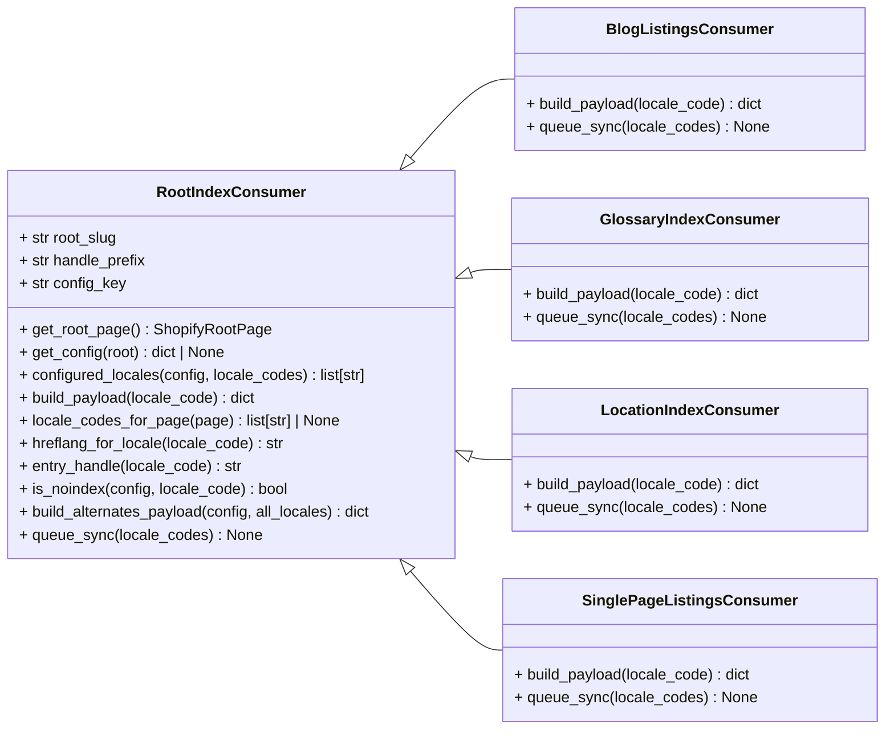

# Consumidor de Índice Raíz (RootIndexConsumer)

El módulo `RootIndexConsumer` define la clase base para los consumidores de índice de exportación dentro del sistema de gestión de contenido de Shopify. Su propósito principal es construir cargas útiles de índice precomputadas y gestionar los contratos `hreflang` y `noindex` para las familias de páginas raíz de Shopify, como glosarios y ubicaciones. Es importante destacar que esta clase no interactúa directamente con la API de Shopify; la escritura final de estos índices es manejada por el servicio de sincronización saliente.

## Funcionalidad Principal

La clase `RootIndexConsumer` sirve como una plantilla abstracta para la creación de índices, proporcionando la lógica común para el acceso a la configuración, la gestión de la localización y la construcción de metadatos de hreflang y noindex. Las subclases específicas implementan los detalles de cómo se construye la carga útil para cada tipo de contenido.

### Métodos y Atributos Clave:

*   **`root_slug` (atributo)**: Una cadena que identifica la página raíz a la que está asociado el consumidor de índice (por ejemplo, 'glossary', 'locations').
*   **`handle_prefix` (atributo)**: Un prefijo utilizado para construir identificadores únicos para los metaobjetos de la página raíz.
*   **`config_key` (atributo)**: Una clave para acceder a la configuración específica de exportación dentro del objeto `ShopifyRootPage`.
*   **`get_root_page()`**: Recupera la instancia de `ShopifyRootPage` correspondiente al `root_slug` configurado.
*   **`get_config(root=None)`**: Obtiene la configuración de exportación para la clave de configuración de este consumidor, verificando si está habilitada y si hay locales definidos.
*   **`configured_locales(config: dict, locale_codes: list[str] | None)`**: Filtra los códigos de locale disponibles basándose en la configuración de exportación proporcionada.
*   **`build_payload(locale_code: str)`**: **Método abstracto**. Las subclases deben implementar esta función para construir la carga útil JSON específica del índice para un código de locale dado.
*   **`locale_codes_for_page(page)`**: Un método que puede ser sobrescrito por las subclases para obtener los códigos de locale relevantes para una página específica.
*   **`hreflang_for_locale(locale_code: str)`**: Mapea un código de locale interno (ej. 'en-US') a un valor `hreflang` compatible con estándares (ej. 'en-us').
*   **`entry_handle(locale_code: str)`**: Genera un identificador (handle) determinista para el metaobjeto de la página raíz, combinando el prefijo del handle y el código de locale.
*   **`is_noindex(config: dict, locale_code: str)`**: Determina si una entrada de índice para un locale específico debe tener una metaetiqueta `noindex` para robots, basándose en la configuración.
*   **`build_alternates_payload(config: dict, all_locales: list[str])`**: Construye la carga útil JSON `index_alternates` que es compartida por todas las entradas de la página raíz "hermanas". Esto ayuda en la configuración de `hreflang` para SEO.
*   **`queue_sync(*, locale_codes: list[str] | None = None)`**: **Método abstracto**. Las subclases deben implementar este método para encolar la tarea de sincronización de los índices.

### Constantes Globales:

*   **`METAFIELD_NAMESPACE`**: `custom`, el espacio de nombres predeterminado para los metacampos.
*   **`LISTINGS_KEY`**: `index_listings`, una clave utilizada para los listados de índice, particularmente por el consumidor de listados de página única (SinglePageListingsConsumer).
*   **`ALTERNATES_KEY`**: `index_alternates`, clave de metacampos para las configuraciones de hreflang (obsoleto para la arquitectura de índice multi-página, pero el concepto se mantiene dentro de la carga útil).
*   **`NOINDEX_KEY`**: `index_noindex`, clave de metacampos para la configuración de noindex (obsoleto para la arquitectura de índice multi-página, pero el concepto se mantiene dentro de la carga útil).

## Arquitectura y Relaciones

El `RootIndexConsumer` establece una base para una serie de consumidores de índices especializados. Su diseño se centra en la abstracción de la lógica común para el manejo de la configuración y la construcción de metadatos de SEO, dejando la especificidad de la carga útil del índice a sus subclases.

### Diagrama de Clases



### Diagrama de Flujo de Datos

```mermaid
graph TD
    A[ShopifyRootPage] -->|Lee configuración de exportación| B(RootIndexConsumer.get_config())
    B -->|Define estructura de índice| C{Subclases de RootIndexConsumer}
    C -->|Genera carga útil del índice (build_payload())| D[Carga Útil de Índice Precomputada]
    C -->|Genera metadatos hreflang/noindex| E[Metadatos de SEO (hreflang, noindex)]
    D & E --> F[shopify_content.sync.outbound.sync_root_index_locales]
    F --> G[Plataforma Shopify (Metaobjetos/Metacampos)]
```

## Encaje en el Sistema General

El `RootIndexConsumer` es un componente fundamental en el proceso de exportación de contenido indexable a la plataforma Shopify. Se integra con:

*   **Modelos de Páginas de Contenido**: Específicamente con [ShopifyRootPage](../../Content_Page_Models/Content_Page_Models_Shopify_Root_Page.md) para acceder a la configuración de exportación definida para las páginas raíz.
*   **Consumidores de Índice Específicos**: Sirve como la base para consumidores como [BlogListingsConsumer](../Content_Indexing___Export_Configuration_Blog_Listings_Consumer.md), [GlossaryIndexConsumer](../Content_Indexing___Export_Configuration_Glossary_Index_Consumer.md), [LocationIndexConsumer](../Content_Indexing___Export_Configuration_Location_Index_Consumer.md) y [SinglePageListingsConsumer](../Content_Indexing___Export_Configuration_Single_Page_Listings_Consumer.md), que implementan la lógica de construcción de índices para tipos de contenido específicos.
*   **Mecanismos de Sincronización**: Aunque `RootIndexConsumer` no escribe directamente en Shopify, sus subclases interactúan con un mecanismo de sincronización externo (mencionado como `shopify_content.sync.outbound.sync_root_index_locales`) para publicar los índices y metadatos generados. Esto asegura que el contenido indexable y sus propiedades de SEO estén correctamente reflejados en la tienda Shopify.

Este módulo es crucial para mantener la coherencia y la optimización SEO del contenido exportado, permitiendo una configuración flexible de la indexación y la gestión de locales a través de la interfaz de administración.
