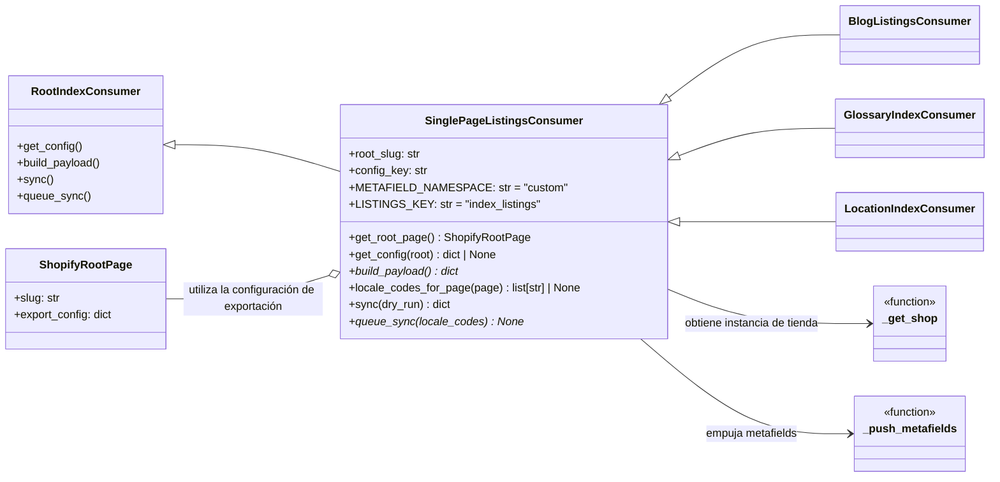

# Módulo Content_Indexing___Export_Configuration_Single_Page_Listings_Consumer

Este documento proporciona una descripción completa del módulo `Content_Indexing___Export_Configuration_Single_Page_Listings_Consumer`, que forma parte del sistema de gestión de contenido de Shopify. Su función principal es gestionar la exportación de listados de índices de páginas individuales a Shopify como metafields personalizados.

## Propósito y Funcionalidad del Módulo

El módulo `Content_Indexing___Export_Configuration_Single_Page_Listings_Consumer` actúa como un consumidor base para la sincronización de listados de índices personalizados (metafields `custom.index_listings`) con páginas específicas de Shopify. Está diseñado para ser extendido por subclases que definirán la lógica específica para construir la carga útil de datos para diferentes tipos de contenido.

Las responsabilidades clave de este módulo incluyen:
*   **Identificación de la Configuración**: Localiza la configuración de exportación relevante dentro de una `ShopifyRootPage` basándose en un `root_slug` y un `config_key` definidos.
*   **Validación de la Configuración**: Asegura que la configuración de exportación esté habilitada y especifique un `page_gid` (ID global de Shopify de la página) válido para la sincronización.
*   **Sincronización de Metafields**: Facilita el envío de datos de listados de índices construidos a una página de Shopify designada como un metafield de tipo JSON.
*   **Modo de Ejecución en Seco (Dry Run)**: Soporta la ejecución de una simulación para verificar la configuración y la lógica sin realizar cambios reales en Shopify.
*   **Manejo de Errores**: Captura y reporta errores durante el proceso de sincronización.

## Arquitectura del Módulo

El `SinglePageListingsConsumer` es una clase base abstracta que define la interfaz y la lógica común para el proceso de exportación de listados de índices. Las implementaciones concretas para tipos específicos de contenido (como blogs o glosarios) deben heredar de esta clase e implementar los métodos abstractos.

### Diagrama de Clases



### Componentes Clave

*   **`SinglePageListingsConsumer`**: La clase principal en este módulo.
    *   `root_slug`: Identificador único para la `ShopifyRootPage` de la cual se obtiene la configuración.
    *   `config_key`: Clave dentro del diccionario `export_config` de `ShopifyRootPage` que contiene la configuración específica para este consumidor.
    *   `METAFIELD_NAMESPACE` y `LISTINGS_KEY`: Constantes que definen el espacio de nombres y la clave del metafield en Shopify donde se almacenarán los listados.
    *   `get_root_page()`: Recupera la instancia de `ShopifyRootPage` activa utilizando `root_slug`.
    *   `get_config()`: Extrae la configuración de exportación relevante de la `ShopifyRootPage`, verificando si está habilitada y tiene un `page_gid` definido.
    *   `build_payload()`: **Método abstracto** que las subclases deben implementar para construir el diccionario de datos que se serializará a JSON y se enviará como metafield.
    *   `locale_codes_for_page()`: Puede ser implementado por subclases para devolver códigos de locales específicos para una página.
    *   `sync(*, dry_run: bool = False)`: El método principal que orquesta el proceso de sincronización, incluyendo la recuperación de la configuración, la construcción de la carga útil y la interacción con la API de Shopify.
    *   `queue_sync()`: **Método abstracto** que las subclases deben implementar para encolar una operación de sincronización, posiblemente para procesamiento asíncrono.

### Relaciones con Otros Módulos

*   **[Content_Page_Models/Content_Page_Models_Shopify_Root_Page.md](Shopify_Content_Management/Content_Page_Models/Content_Page_Models_Shopify_Root_Page.md)**: El consumidor depende de `ShopifyRootPage` para obtener su configuración de exportación.
*   **`shopify_content.sync.outbound`**: Este módulo importa las funciones `_get_shop` y `_push_metafields` desde `shopify_content/sync/outbound.py`. Estas funciones son cruciales para interactuar con la API de Shopify, obteniendo la instancia de la tienda y enviando los metafields.

## Flujo de Proceso de Sincronización

El método `sync` es el punto de entrada para iniciar la exportación de listados de índices.

### Diagrama de Flujo del Proceso `sync`

```mermaid
graph TD
    A[Inicio de sync()] --> B{Obtener ShopifyRootPage};
    B -- No encontrada --> F(Retornar stats con root_not_found);
    B -- Encontrada --> C{Obtener Configuración de Exportación (get_config)};
    C -- No válida/Deshabilitada/page_gid faltante --> F;
    C -- Válida --> D[Construir Carga Útil (build_payload)];
    D --> E{Es Dry Run?};
    E -- Sí --> G(Retornar stats con pushed = 1);
    E -- No --> H[Obtener Instancia de Tienda de Shopify (_get_shop)];
    H --> I[Empujar Metafields a Shopify (_push_metafields)];
    I -- OK --> J(Actualizar stats: pushed = 1);
    I -- Falló --> K(Actualizar stats: errores);
    J --> L[Retornar Estadísticas (stats)];
    K --> L;
```

### Explicación Detallada del Flujo de Sincronización

1.  **Inicio de `sync()`**: El proceso comienza con una llamada al método `sync`, opcionalmente con `dry_run=True` para una simulación.
2.  **Obtener `ShopifyRootPage`**: Se intenta recuperar la `ShopifyRootPage` basándose en el `root_slug` configurado. Si no se encuentra, el proceso termina con un estado de error.
3.  **Obtener Configuración de Exportación**: Utilizando `get_config()`, se extrae la configuración específica para este consumidor del campo `export_config` de la página raíz. Se verifica que la sección esté `enabled` y que contenga un `page_gid`. Si alguna de estas condiciones falla, el proceso se detiene y se registra el motivo.
4.  **Construir Carga Útil (`build_payload()`)**: El método `build_payload()` (implementado por la subclase) es invocado para generar los datos que se enviarán a Shopify.
5.  **Verificación de `Dry Run`**: Si `dry_run` es `True`, el proceso se considera exitoso sin realizar llamadas a la API de Shopify y retorna el estado.
6.  **Obtener Instancia de Tienda (`_get_shop()`)**: Se obtiene una instancia de la tienda Shopify para autenticar y realizar operaciones API.
7.  **Empujar Metafields (`_push_metafields()`)**: La carga útil se serializa a JSON y se envía a Shopify como un metafield con `ownerId` igual al `page_gid` configurado, utilizando el `METAFIELD_NAMESPACE` y `LISTINGS_KEY` definidos.
8.  **Registro de Resultados**: El estado de la operación (`pushed`, `errors`) se actualiza y se retorna al final del método.

## Integración con el Sistema General

`SinglePageListingsConsumer` es una pieza fundamental en la estrategia de exportación de contenido indexado a Shopify. Se integra en el módulo [Shopify_Content_Management](../Shopify_Content_Management.md), específicamente en la sección de configuración de indexación y exportación de contenido.

Su diseño como clase base fomenta la reutilización y la consistencia en cómo los diferentes tipos de listados de índices (blogs, glosarios, ubicaciones) se publican en Shopify. Permite que la lógica específica de cada tipo de contenido se maneje en sus respectivas subclases, mientras que la interacción subyacente con la API de Shopify y la gestión de la configuración se centralizan.

Este módulo es invocado típicamente por comandos de gestión o tareas en segundo plano que necesitan sincronizar el estado del contenido del CMS con la plataforma Shopify, asegurando que la información de los listados de páginas esté actualizada y disponible para el frontend de Shopify.

## Consideraciones de Implementación y Extensión

Cuando se implementa una subclase de `SinglePageListingsConsumer`, los desarrolladores deben centrarse en:
*   **Implementar `build_payload()`**: Este es el método crítico donde se define cómo se recopilan y estructuran los datos del listado de índices en un diccionario.
*   **Implementar `queue_sync()`**: Si la sincronización debe ser asíncrona (lo cual es común para operaciones de larga duración), la subclase debe definir cómo se encola esta tarea (por ejemplo, usando Celery).
*   **Definir `root_slug` y `config_key`**: Estas propiedades deben configurarse correctamente en la subclase o durante la instanciación para apuntar a la `ShopifyRootPage` y la sección de configuración adecuadas.
*   **Manejo de Locales**: Si el contenido es multilingüe, el método `locale_codes_for_page()` puede ser extendido para manejar la exportación de listados de índices para diferentes configuraciones regionales.
