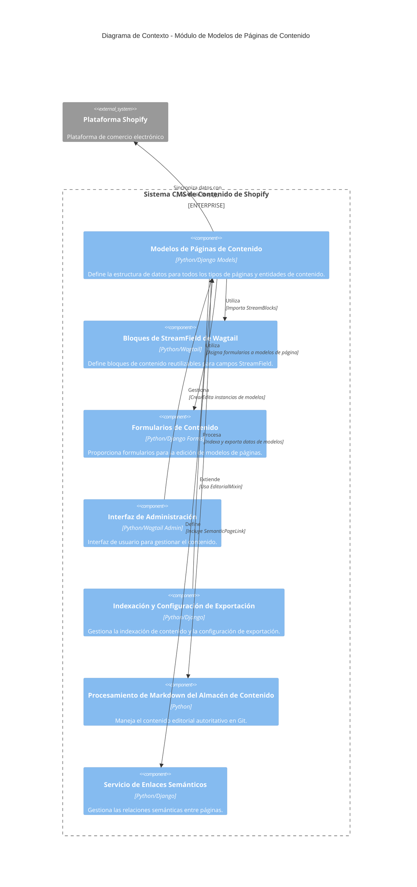

# Modelos de Páginas de Contenido de Shopify

Este módulo (`Content_Page_Models`) define todos los modelos de página y componentes de datos fundamentales utilizados para gestionar el contenido dentro de la aplicación Shopify. Proporciona la estructura de datos para varios tipos de páginas, como artículos de blog, colecciones, productos, términos de glosario, páginas de inicio y páginas de ubicación, así como modelos para rastrear operaciones de sincronización y comandos incrustados.

## Propósito

El propósito principal de este módulo es:
*   **Definir la estructura de datos**: Establecer los esquemas de base de datos para los diferentes tipos de contenido que se sincronizan con Shopify o se gestionan a través de Wagtail.
*   **Facilitar la sincronización con Shopify**: Proporcionar los campos necesarios para mapear los datos entre Wagtail y las entidades correspondientes en Shopify (blogs, artículos, colecciones, productos, metaobjetos).
*   **Soportar la funcionalidad de Wagtail**: Integrarse con el CMS de Wagtail para la edición y publicación de contenido, incluyendo `StreamField` para cuerpos de contenido flexibles y `InlinePanel` para componentes relacionados como preguntas frecuentes y meta-campos.
*   **Habilitar capacidades de búsqueda e indexación**: Incluir campos de índice de búsqueda para mejorar la capacidad de descubrimiento del contenido dentro del CMS.

## Arquitectura

El módulo `Content_Page_Models` reside dentro del módulo principal `Shopify_Content_Management` y actúa como la capa de datos. Interactúa estrechamente con otros módulos como:
*   **[Wagtail_StreamField_Blocks](../Wagtail_StreamField_Blocks.md)**: Proporciona los bloques de contenido (`StreamBlock`) utilizados en los modelos de página (ej. `ArticleBodyStreamBlock`, `CollectionBodyStreamBlock`).
*   **[Content_Forms](../Content_Forms.md)**: Define los formularios Wagtail utilizados para la edición de estos modelos de página.
*   **[Admin_Interface](../Admin_Interface.md)**: Utiliza los modelos definidos aquí para poblar la interfaz de administración de Wagtail.
*   **[Content_Indexing___Export_Configuration](../Content_Indexing___Export_Configuration.md)**: Se basa en estos modelos para la indexación y configuración de exportación de contenido.
*   **[Content_Store___Markdown_Processing](../Content_Store___Markdown_Processing.md)**: Utiliza `EditorialMixin` para la gestión de contenido autoritativo en Git.
*   **[Semantic_Links_Service](../Semantic_Links_Service.md)**: Gestiona las relaciones entre páginas a través del modelo `SemanticPageLink`.

### Diagrama de Contexto del Sistema

## Sub-módulos

El módulo `Content_Page_Models` se desglosa en los siguientes sub-módulos para organizar los diferentes tipos de modelos de página y funcionalidades relacionadas:

*   **[Modelos de Páginas de Blog y Artículo](Content_Page_Models/Content_Page_Models_Blog_and_Article_Pages.md)**: Define los modelos para `BlogPage` y `ArticlePage`, incluyendo mezclas para la localización y campos relacionados como preguntas frecuentes y meta-campos.
*   **[Modelos de Páginas de Colección](Content_Page_Models/Content_Page_Models_Collection_Pages.md)**: Contiene el modelo `CollectionPage` para representar colecciones de productos de Shopify.
*   **[Modelos de Páginas de Términos de Glosario](Content_Page_Models/Content_Page_Models_Glossary_Term_Pages.md)**: Define el modelo `GlossaryTermPage` para la gestión de términos de glosario.
*   **[Modelos de Páginas de Inicio](Content_Page_Models/Content_Page_Models_Home_Pages.md)**: Incluye el modelo `HomePage` para la gestión del contenido de la página de inicio de la tienda.
*   **[Modelos de Páginas de Ubicación](Content_Page_Models/Content_Page_Models_Location_Pages.md)**: Proporciona el modelo `LocationPage` para páginas de ubicación específicas.
*   **[Modelos de Páginas de Producto](Content_Page_Models/Content_Page_Models_Product_Model.md)**: Define el modelo `ProductPage` para representar productos de Shopify.
*   **[Modelos de Páginas Raíz de Shopify](Content_Page_Models/Content_Page_Models_Shopify_Root_Model.md)**: Contiene el modelo `ShopifyRootPage`, que actúa como la página raíz para todo el contenido de Shopify.
*   **[Modelos de Mixins Reutilizables](Content_Page_Models/Content_Page_Models_Reusable_Mixins.md)**: Define clases abstractas y mixins reutilizables como `FAQItem` y `ShopifyMetafield` que son utilizados por varios modelos de página.
*   **[Modelos de Índice de Contenido](Content_Page_Models/Content_Page_Models_Content_Indexing_Model.md)**: Incluye `ContentIndex` y `ContentReferenceIndex` para el seguimiento del contenido editorial autoritativo en Git.
*   **[Modelos de Índice de URL de Contenido](Content_Page_Models/Content_Page_Models_Content_URL_Index_Models.md)**: Contiene el modelo `ContentUrlIndex` para mapear rutas de URL de Shopify a páginas de Wagtail.
*   **[Modelos de Ejecución de Comandos Incrustados](Content_Page_Models/Content_Page_Models_Embedded_Command_Run.md)**: Define el modelo `EmbeddedCommandRun` para rastrear trabajos de comandos asíncronos.
*   **[Modelos de Enlaces Semánticos](Content_Page_Models/Content_Page_Models_Semantic_Links_Model.md)**: Proporciona el modelo `SemanticPageLink` y la lógica para gestionar enlaces internos entre páginas.
*   **[Modelos de Ejecución de Sincronización de Shopify](Content_Page_Models/Content_Page_Models_Shopify_Sync_Run_Models.md)**: Incluye el modelo `ShopifySyncRun` para rastrear los trabajos de sincronización entrantes y salientes de Shopify.

Cada uno de estos sub-módulos se documenta en un archivo separado para proporcionar detalles sobre sus componentes principales y responsabilidades.
