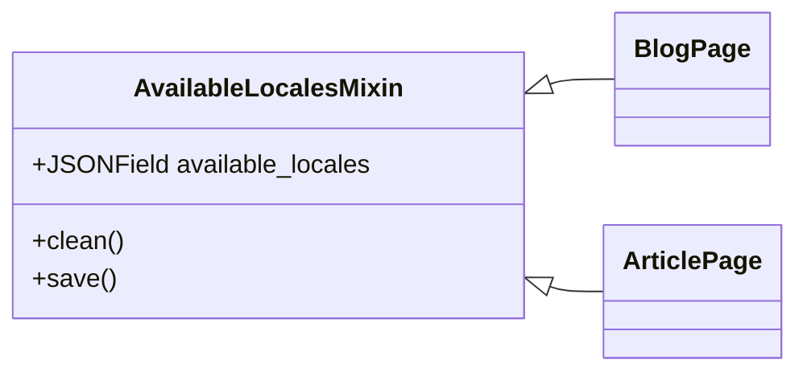
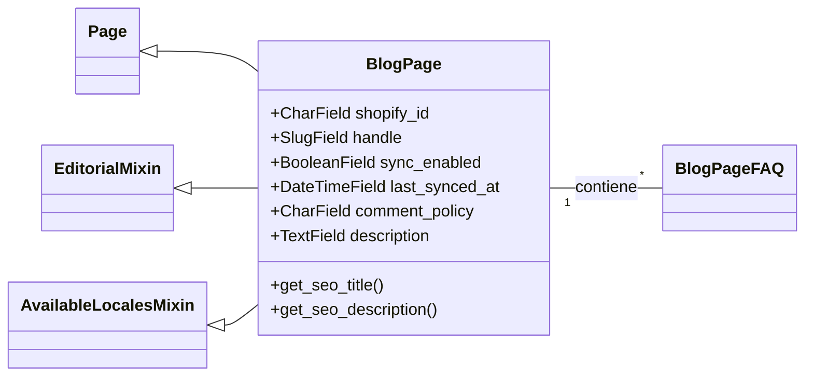
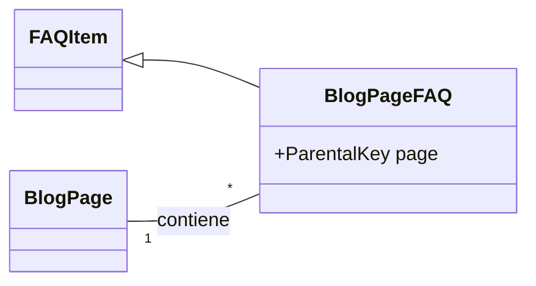
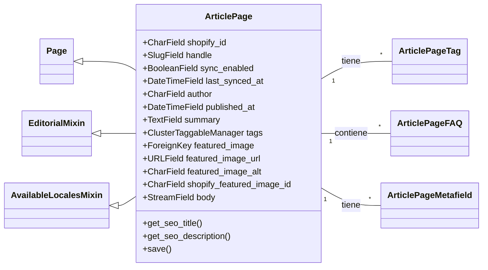
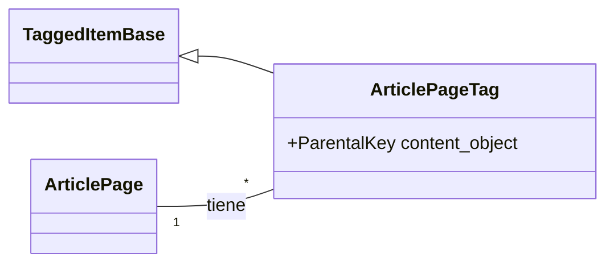
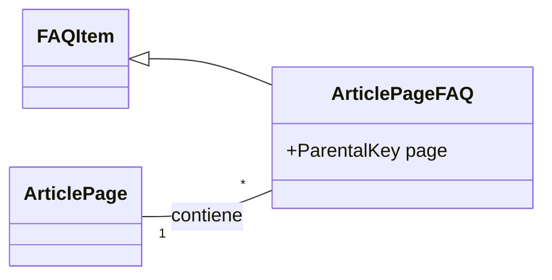
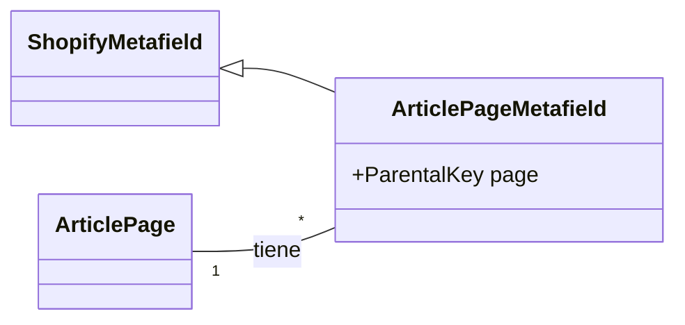
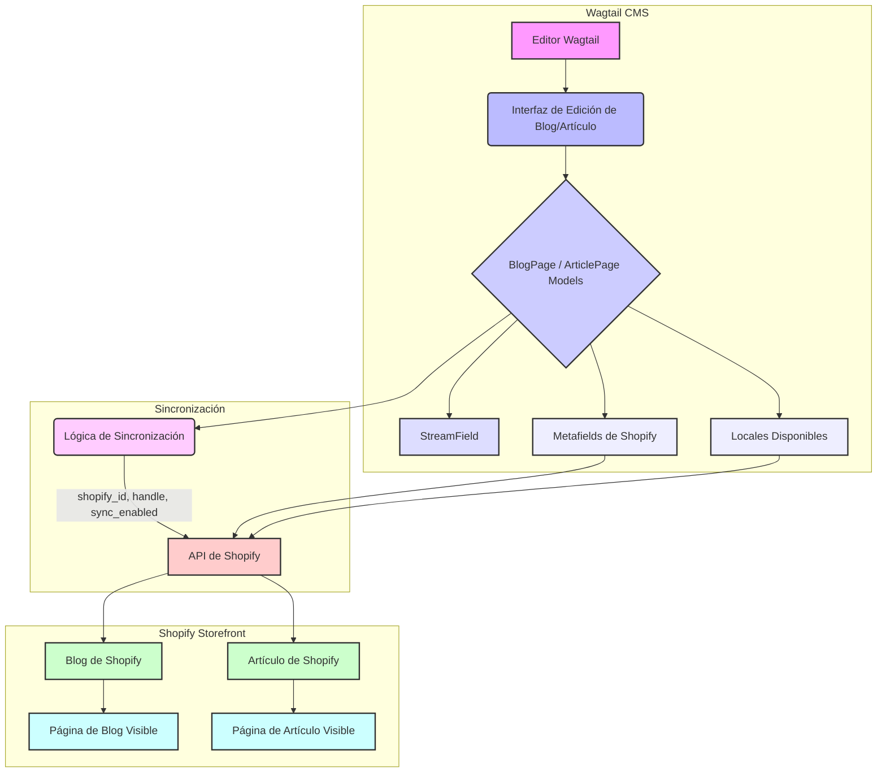

# Modelos de Páginas de Blog y Artículo

Este módulo define los modelos de Django para la gestión de páginas de blog y artículos dentro del sistema de gestión de contenido (CMS) Wagtail, con una integración específica para Shopify. Estos modelos son fundamentales para estructurar y sincronizar el contenido editorial con una tienda Shopify.

## Propósito y Funcionalidad Principal

El propósito principal de este módulo es proporcionar la estructura de datos necesaria para crear y gestionar blogs y artículos. Esto incluye la definición de campos para el contenido, metadatos, configuraciones de SEO y la capacidad de sincronizar estos datos con Shopify.

El módulo `shopify_content/models/blog.py` contiene las siguientes clases de componentes principales:

*   `ArticlePage`: Representa una página de artículo individual.
*   `ArticlePage.Meta`: Opciones de metadatos para `ArticlePage`.
*   `ArticlePageFAQ`: Modelo para preguntas frecuentes asociadas a un `ArticlePage`.
*   `ArticlePageMetafield`: Modelo para los metafields de Shopify asociados a un `ArticlePage`.
*   `ArticlePageTag`: Modelo para las etiquetas asociadas a un `ArticlePage`.
*   `AvailableLocalesMixin`: Mixin para gestionar la disponibilidad de contenido en diferentes configuraciones regionales.
*   `AvailableLocalesMixin.Meta`: Opciones de metadatos para `AvailableLocalesMixin`.
*   `BlogPage`: Representa una página de blog que actúa como contenedor de artículos.
*   `BlogPage.Meta`: Opciones de metadatos para `BlogPage`.
*   `BlogPageFAQ`: Modelo para preguntas frecuentes asociadas a un `BlogPage`.

## Arquitectura y Relaciones de Componentes

### AvailableLocalesMixin

Este `mixin` es un `models.Model` abstracto que añade la funcionalidad de gestionar las configuraciones regionales (locales) donde un blog o artículo está intencionalmente disponible en el escaparate.

*   **`available_locales`**: Un campo `JSONField` que almacena una lista de códigos de configuración regional de Wagtail (por ejemplo, 'en-US', 'es-US'). Este campo se sincroniza con Shopify como `custom.available_locales`.
*   **Métodos**:
    *   `clean()`: Valida los locales disponibles, asegurando que sean válidos y consistentes con el locale de la página.
    *   `save()`: Establece los locales por defecto si no se especifican.

### BlogPage

La clase `BlogPage` es un modelo de página de Wagtail que replica un Blog de Shopify. Hereda de `EditorialMixin`, `AvailableLocalesMixin` y `wagtail.models.Page`.

*   **Campos de Sincronización de Shopify**:
    *   `shopify_id`: GID de Shopify para el blog.
    *   `handle`: Identificador único del blog.
    *   `sync_enabled`: Booleano para habilitar/deshabilitar la sincronización.
    *   `last_synced_at`: Marca de tiempo de la última sincronización.
*   **`comment_policy`**: Define la política de comentarios (AUTO_PUBLISHED, CLOSED, MODERATED).
*   **`description`**: Descripción del blog (se sincroniza como metafield).
*   **SEO**: Hereda `seo_title` y `search_description` de `Page`, sincronizándose como metafields de Shopify.
*   **Paneles de Wagtail**: Organiza los campos en pestañas para Contenido, SEO/Promoción, Shopify y Configuración.
    *   `content_panels`: Incluye `comment_policy`, `description`, `available_locales` y un `InlinePanel` para `faqs`.
    *   `promote_panels`: Incluye paneles de SEO de Shopify (`SHOPIFY_SEO_PANELS`) y el `slug` interno de Wagtail.
    *   `edit_handler`: Utiliza `TabbedInterface` para organizar los paneles.
*   **`parent_page_types`**: Puede ser hijo de `wagtailcore.Page` o `shopify_content.ShopifyRootPage`.
*   **`subpage_types`**: Solo puede tener `shopify_content.ArticlePage` como subpáginas.

### BlogPageFAQ

Este modelo hereda de `FAQItem` y representa una pregunta frecuente asociada a una `BlogPage`. Utiliza `ParentalKey` para establecer una relación uno a muchos con `BlogPage`.

### ArticlePage

La clase `ArticlePage` es un modelo de página de Wagtail que replica un Artículo de Shopify, contenido dentro de un `BlogPage`. Hereda de `EditorialMixin`, `AvailableLocalesMixin` y `wagtail.models.Page`.

*   **Campos de Sincronización de Shopify**:
    *   `shopify_id`: GID de Shopify para el artículo.
    *   `handle`: Identificador único del artículo.
    *   `sync_enabled`: Booleano para habilitar/deshabilitar la sincronización.
    *   `last_synced_at`: Marca de tiempo de la última sincronización.
*   **`author`**: Nombre completo del autor.
*   **`published_at`**: Fecha y hora de publicación (se establece automáticamente en la primera publicación si está en blanco).
*   **`summary`**: Resumen corto del artículo (HTML permitido).
*   **`tags`**: Un `ClusterTaggableManager` para gestionar las etiquetas del artículo a través de `ArticlePageTag`.
*   **`featured_image`**: Clave foránea a una imagen de Wagtail.
*   **`featured_image_url`**: URL absoluta de la imagen destacada del artículo en Shopify.
*   **`featured_image_alt`**: Texto alternativo para la imagen destacada.
*   **`shopify_featured_image_id`**: GID de Shopify para la imagen destacada.
*   **`body`**: Un `StreamField` que contiene el contenido del cuerpo del artículo, renderizado a HTML para Shopify. En modo `git_authoritative`, el cuerpo canónico proviene de archivos Markdown.
*   **SEO**: Hereda `seo_title` y `search_description` de `Page`, sincronizándose como metafields de Shopify.
*   **Paneles de Wagtail**: Organiza los campos en pestañas similares a `BlogPage`.
    *   `content_panels`: Incluye detalles del artículo (`author`, `published_at`, `tags`), `featured_image`, `featured_image_url`, `featured_image_alt`, `summary`, `body`, `available_locales`, paneles de enlaces semánticos (`semantic_links_panels`), `InlinePanel` para `faqs` y `InlinePanel` para `metafields`.
    *   `promote_panels`: Incluye paneles de SEO de Shopify (`SHOPIFY_SEO_PANELS`) y el `slug` interno de Wagtail.
    *   `edit_handler`: Utiliza `TabbedInterface` para organizar los paneles.
*   **`parent_page_types`**: Solo puede ser hijo de `shopify_content.BlogPage`.
*   **`subpage_types`**: No tiene subpáginas.

### ArticlePageTag

Este modelo hereda de `TaggedItemBase` y se utiliza para asociar etiquetas a una `ArticlePage` a través de `ClusterTaggableManager`.

### ArticlePageFAQ

Similar a `BlogPageFAQ`, este modelo hereda de `FAQItem` y representa una pregunta frecuente asociada a una `ArticlePage` mediante `ParentalKey`.

### ArticlePageMetafield

Este modelo hereda de `ShopifyMetafield` y se utiliza para gestionar los metafields personalizados asociados a una `ArticlePage` a través de `ParentalKey`.

## Flujo de Datos y Componentes Relacionados

Los modelos `BlogPage` y `ArticlePage` son el corazón de la gestión de contenido editorial.

*   **Creación/Edición en Wagtail**: Los editores utilizan la interfaz de administración de Wagtail para crear y modificar blogs y artículos. Los `StreamField` (`ARTICLE_BODY_BLOCKS`) permiten una construcción flexible del cuerpo del contenido.
*   **Sincronización con Shopify**: Los campos `shopify_id`, `handle`, `sync_enabled`, `last_synced_at` son cruciales para la integración con Shopify. La lógica de sincronización (no detallada en este módulo, pero implícita) utiliza estos campos para mapear y actualizar el contenido en la plataforma Shopify. Los campos de descripción y SEO se sincronizan como metafields de Shopify.
*   **Locales**: El `AvailableLocalesMixin` asegura que el contenido se marque correctamente para los diferentes mercados de Shopify.
*   **SEO**: Las funciones `get_seo_title` y `get_seo_description` proporcionan un fallback si los campos de SEO específicos de la página están vacíos, utilizando el título y la descripción/resumen de la página.

## Referencias

*   Para más detalles sobre los modelos de página generales, consulte la documentación del módulo [Content_Page_Models](../Content_Page_Models.md).
*   Los bloques `StreamField` utilizados en `ArticlePage` se definen en el módulo [Wagtail_StreamField_Blocks](../../Wagtail_StreamField_Blocks.md).
*   La gestión de formularios para estas páginas se encuentra en [Content_Forms](../../Content_Forms.md).
*   Para la configuración general de la aplicación de contenido de Shopify, vea [Shopify_Content_Application_Core](../../Shopify_Content_Application_Core.md).
