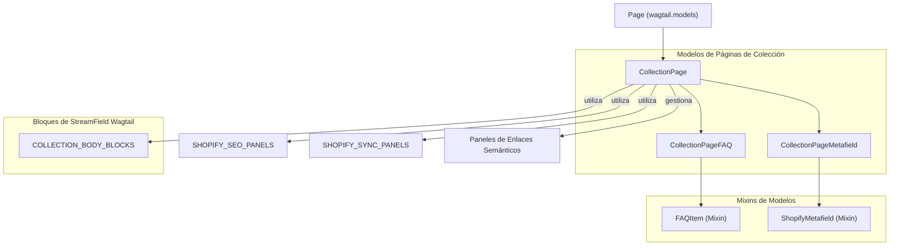

# Modelos de Páginas de Colección

El módulo `Content_Page_Models_Collection_Pages` define los modelos de datos para gestionar las páginas de colección de Shopify dentro del sistema de gestión de contenido (CMS) basado en Wagtail. Estos modelos permiten la sincronización de datos de colecciones de Shopify y su enriquecimiento con contenido editorial y metadatos adicionales.

## Funcionalidad Principal

Este módulo se centra en la representación de las colecciones de Shopify como páginas editables en Wagtail. Los componentes clave son:

*   **`CollectionPage`**: El modelo principal que extiende `wagtail.models.Page` y replica la estructura de una colección de Shopify.
*   **`CollectionPage.Meta`**: Define las opciones de metadatos para el modelo `CollectionPage`, como los nombres en singular y plural para el panel de administración de Wagtail.
*   **`CollectionPageFAQ`**: Un modelo para gestionar preguntas frecuentes asociadas a una `CollectionPage` específica.
*   **`CollectionPageMetafield`**: Un modelo para adjuntar metacampos personalizados de Shopify a una `CollectionPage`.

### `CollectionPage`

El modelo `CollectionPage` es la representación central de una colección de Shopify. Hereda de `wagtail.models.Page` e incluye campos para la sincronización con Shopify, contenido editorial y configuraciones de SEO.

**Campos Clave:**

*   **`shopify_id`**: Identificador global de Shopify (GID) para la colección.
*   **`handle`**: El identificador único y legible por humanos de la colección, utilizado en las URLs.
*   **`sync_enabled`**: Un booleano que indica si la sincronización con Shopify está habilitada para esta página.
*   **`last_synced_at`**: Marca de tiempo de la última sincronización con Shopify.
*   **`theme_config`**: Un campo JSON para configuraciones específicas del tema, que se empujan como metacampos de Shopify durante la sincronización.
*   **`sort_order`**: El orden de clasificación de los productos en la colección (ej. 'ALPHA_ASC', 'PRICE_DESC').
*   **`description`**: Un `StreamField` que contiene el contenido editorial de la descripción de la colección, utilizando bloques definidos en `COLLECTION_BODY_BLOCKS`. Este contenido se renderiza a HTML para el campo `descriptionHtml` de Shopify.
*   **`image_url`**: La URL absoluta de la imagen de la colección de Shopify.
*   **`image_alt_text`**: Texto alternativo para la imagen de la colección.
*   **`shopify_image_id`**: El GID de Shopify MediaImage para la imagen de la colección.

**Paneles de Wagtail:**

El `edit_handler` de `CollectionPage` utiliza un `TabbedInterface` para organizar la interfaz de edición en Wagtail, dividiéndola en las siguientes pestañas:

*   **Contenido**: Contiene campos como `sort_order`, `description`, paneles de enlaces semánticos, `image_url`, `image_alt_text`, `FAQs` (InlinePanel) y `Metafields` (InlinePanel).
*   **SEO / Promoción**: Incluye los paneles de SEO (`SHOPIFY_SEO_PANELS`) y el campo `slug` para la URL interna de Wagtail.
*   **Shopify**: Contiene los paneles de sincronización de Shopify (`SHOPIFY_SYNC_PANELS`) y el campo `theme_config`.
*   **Configuración**: Pestaña estándar de Wagtail para configuraciones de página.

### `CollectionPageFAQ`

Este modelo es un elemento de preguntas frecuentes (`FAQItem`) que se relaciona con una `CollectionPage` a través de un `ParentalKey`. Permite añadir múltiples preguntas y respuestas a una colección.

### `CollectionPageMetafield`

Este modelo representa un metacampo de Shopify (`ShopifyMetafield`) asociado a una `CollectionPage` mediante un `ParentalKey`. Permite la gestión de metacampos personalizados directamente desde Wagtail.

## Arquitectura y Relaciones de Componentes

El módulo `Content_Page_Models_Collection_Pages` se integra dentro de la arquitectura de Wagtail y se relaciona estrechamente con otros modelos de contenido y bloques de StreamField.


```

**Explicación del Diagrama:**

*   `CollectionPage` hereda directamente de `Page` de Wagtail.
*   `CollectionPageFAQ` y `CollectionPageMetafield` son modelos "hijos" de `CollectionPage` a través de `ParentalKey`, lo que significa que su ciclo de vida está ligado al de la `CollectionPage` padre.
*   `CollectionPageFAQ` y `CollectionPageMetafield` extienden las clases `FAQItem` y `ShopifyMetafield` respectivamente, que son mixins que proporcionan campos y funcionalidades comunes para FAQs y metacampos en el contexto de Shopify.
*   `CollectionPage` utiliza `COLLECTION_BODY_BLOCKS` (definido en el módulo [Wagtail_StreamField_Blocks](../Wagtail_StreamField_Blocks.md)) para su campo `description` de `StreamField`, permitiendo un contenido rico y estructurado.
*   También se apoya en `SHOPIFY_SEO_PANELS` y `SHOPIFY_SYNC_PANELS` (definidos en los mixins) para organizar la interfaz de administración.
*   Los paneles de enlaces semánticos (`semantic_links_panels`) se integran en la edición de `CollectionPage`, lo que indica una relación con la funcionalidad de enlaces semánticos del sistema.

## Integración en el Sistema General

El módulo `Content_Page_Models_Collection_Pages` es una parte fundamental de la estrategia de gestión de contenido de Shopify, proporcionando una interfaz rica en Wagtail para las colecciones de Shopify.

*   **Sincronización con Shopify**: Los campos `shopify_id`, `handle`, `sync_enabled`, `last_synced_at` y `theme_config` facilitan la sincronización bidireccional de datos con la plataforma Shopify. Esto asegura que los cambios realizados en Wagtail puedan reflejarse en Shopify y viceversa.
*   **Contenido Editorial Enriquecido**: El uso de `StreamField` y `COLLECTION_BODY_BLOCKS` permite a los equipos editoriales crear descripciones de colección ricas y personalizadas que van más allá de las capacidades nativas de Shopify.
*   **SEO y Metadatos**: La integración de campos SEO (`seo_title`, `search_description` a través de `SHOPIFY_SEO_PANELS`) y metacampos (`CollectionPageMetafield`) asegura que las páginas de colección sean optimizadas para motores de búsqueda y puedan extenderse con datos personalizados.
*   **Administración Wagtail**: La integración con el panel de administración de Wagtail a través de `TabbedInterface` y `InlinePanel` proporciona una experiencia de usuario familiar y eficiente para los administradores de contenido.
*   **Módulos Relacionados**:
    *   **[Content_Page_Models](../Content_Page_Models.md)**: Este módulo es parte del conjunto más amplio de modelos de página de contenido, compartiendo patrones y mixins comunes.
    *   **[Wagtail_StreamField_Blocks](../../Wagtail_StreamField_Blocks.md)**: El campo `description` de `CollectionPage` consume bloques definidos en este módulo, lo que permite la creación de contenido modular.
    *   **[Admin_Interface](../../Admin_Interface.md)**: La configuración de `edit_handler` y los `InlinePanel` son componentes de la interfaz de administración de Wagtail, gestionados en este módulo.
    *   **[Shopify_Content_Application_Core_Storefront_URL_Generation](../../Shopify_Content_Application_Core/Shopify_Content_Application_Core_Storefront_URL_Generation.md)**: El campo `handle` y la generación de slugs son cruciales para la resolución de URL en el frontend.
