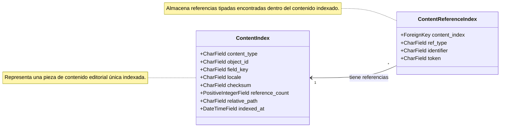

# Modelos de Indexación de Contenido

Este módulo define los modelos de Django para la indexación y gestión de referencias dentro del contenido editorial desplegado. Estos modelos son fundamentales para rastrear y organizar las diversas piezas de contenido y sus dependencias internas en el sistema de gestión de contenido de Shopify.

## Propósito y Funcionalidad Principal

El módulo `Content_Indexing_Model` proporciona dos modelos clave:

*   `ContentIndex`: Representa una entrada única de contenido editorial indexado.
*   `ContentReferenceIndex`: Almacena referencias tipadas extraídas de un documento de contenido indexado.

### `ContentIndex`

El modelo `ContentIndex` (ubicado en `shopify_content/models/content_index.py`) es una representación indexada de una `ContentRef` encontrada en el árbol de contenido. Cada fila corresponde a una pieza de contenido editorial y almacena metadatos cruciales para su identificación y gestión. Sus campos principales son:

*   `content_type` (CharField): El tipo de contenido (ej. "artículo", "producto", "colección").
*   `object_id` (CharField): El identificador único del objeto de contenido.
*   `field_key` (CharField): La clave del campo específico dentro del objeto de contenido que se está indexando.
*   `locale` (CharField): El locale al que pertenece el contenido (ej. "en-us", "es-es").
*   `checksum` (CharField): Un hash del contenido para detectar cambios.
*   `reference_count` (PositiveIntegerField): El número de referencias encontradas dentro de este contenido.
*   `relative_path` (CharField): La ruta relativa al archivo de contenido en el repositorio.
*   `indexed_at` (DateTimeField): La marca de tiempo de la última indexación.

Este modelo incluye una restricción única (`uniq_content_index_ref`) en los campos `content_type`, `object_id`, `field_key` y `locale` para asegurar que no haya entradas duplicadas para la misma pieza de contenido en un locale y campo específico.

### `ContentReferenceIndex`

El modelo `ContentReferenceIndex` (también en `shopify_content/models/content_index.py`) se utiliza para almacenar referencias específicas que se han extraído del cuerpo de un documento de contenido indexado. Cada referencia está vinculada a una entrada `ContentIndex`.

*   `content_index` (ForeignKey): Un enlace al `ContentIndex` al que pertenece esta referencia. Al eliminar el `ContentIndex` asociado, todas sus referencias se eliminarán en cascada.
*   `ref_type` (CharField): El tipo de referencia (ej. "producto", "artículo").
*   `identifier` (CharField): El identificador de la referencia (ej. un handle de producto o un slug de artículo).
*   `token` (CharField): El token original o la cadena de la referencia tal como se encontró en el contenido.

Este modelo tiene un índice (`content_ref_type_ident_idx`) en `ref_type` e `identifier` para optimizar las búsquedas de referencias.

## Arquitectura y Relaciones

Los modelos `ContentIndex` y `ContentReferenceIndex` están estrechamente relacionados. `ContentIndex` actúa como el registro principal de una pieza de contenido indexado, y `ContentReferenceIndex` detalla todas las referencias internas encontradas dentro de ese contenido.

### Relación con otros componentes

*   **Modelos de Páginas de Contenido**: Estos modelos de índice trabajan en conjunto con los diferentes [Modelos de Páginas de Contenido](../Content_Page_Models.md) como `ArticlePage`, `ProductPage`, `CollectionPage`, etc., para indexar su contenido y sus referencias internas. Cada instancia de `ContentIndex` puede corresponder a un campo de una de estas páginas.
*   **Procesamiento de Markdown del Content Store**: El proceso de extracción de referencias y la creación de entradas `ContentIndex` y `ContentReferenceIndex` se realiza durante la materialización y el procesamiento del contenido editorial, a menudo involucrando el [Content Store y el Procesamiento de Markdown](../../Content_Store___Markdown_Processing.md).
*   **Comandos de Gestión**: Comandos de gestión como `content_index_rebuild` o `rebuild_content_url_index` (ver [Comandos de Gestión](../../Management_Commands.md)) interactúan directamente con estos modelos para poblar y mantener la base de datos de índices.

## Integración en el Sistema General

El subsistema de indexación de contenido juega un papel vital en el ecosistema de gestión de contenido de Shopify. Permite:

*   **Búsqueda y Descubrimiento**: Facilitar la búsqueda eficiente de contenido y la identificación de relaciones entre diferentes piezas de contenido.
*   **Validación de Referencias**: Ayudar a identificar enlaces rotos o referencias inconsistentes dentro del contenido editorial.
*   **Sincronización y Materialización**: Servir como una fuente de verdad para el estado indexado del contenido, lo que es crucial para procesos de sincronización y materialización de contenido entre diferentes entornos o sistemas.
*   **Análisis de Contenido**: Proporcionar datos para analizar la estructura del contenido, la densidad de enlaces y otras métricas importantes.