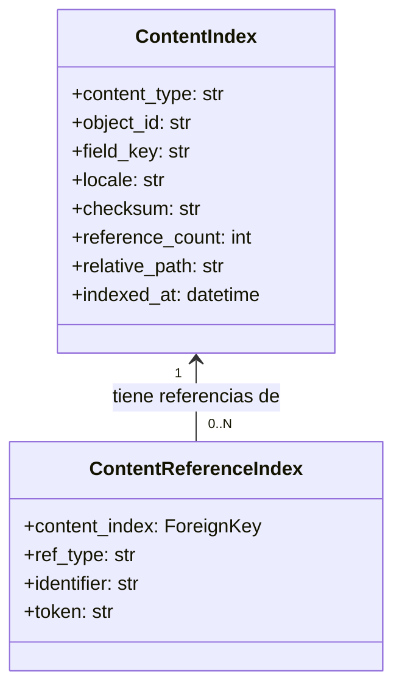
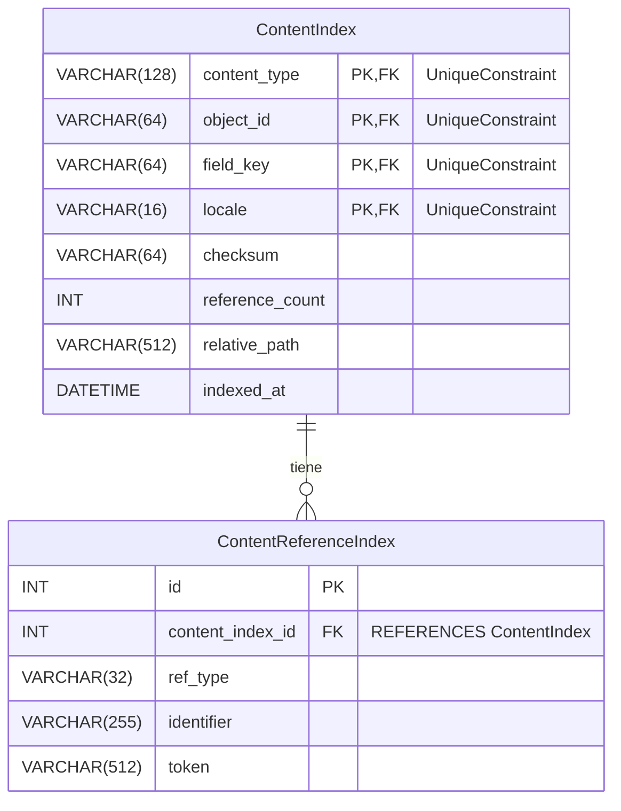

# Modelos de Indexación de Contenido

Este módulo, `Content_Page_Models_Content_Page_Models_Content_Indexing_Models`, define los modelos de base de datos utilizados para indexar y gestionar referencias dentro del contenido editorial de Shopify. Su propósito principal es permitir la búsqueda eficiente y el seguimiento de las relaciones entre las diferentes piezas de contenido.

## Modelos Principales

Este módulo contiene los siguientes modelos Django:

### `ContentIndex`

El modelo `ContentIndex` almacena metadatos sobre cada `ContentRef` descubierto en el árbol de contenido desplegado. Cada fila representa una pieza única de contenido basada en su tipo, identificador, clave de campo y localización.

**Campos:**

*   `content_type` (CharField): El tipo de contenido (por ejemplo, "Artículo", "Producto"). Indexado para búsquedas rápidas.
*   `object_id` (CharField): El identificador único del objeto de contenido. Indexado.
*   `field_key` (CharField): Una clave que identifica un campo específico dentro del objeto de contenido (por ejemplo, "cuerpo", "título"). Indexado.
*   `locale` (CharField): La localización del contenido (por ejemplo, "es-ES", "en-US"). Indexado.
*   `checksum` (CharField): Un hash del contenido para detectar cambios. Puede estar en blanco.
*   `reference_count` (PositiveIntegerField): El número de referencias encontradas dentro de este contenido. Por defecto es 0.
*   `relative_path` (CharField): La ruta relativa al archivo de contenido en el sistema de archivos. Puede estar en blanco.
*   `indexed_at` (DateTimeField): La fecha y hora en que se indexó el contenido por última vez. Se actualiza automáticamente en cada guardado.

**Restricciones:**

*   `uniq_content_index_ref`: Restricción de unicidad en la combinación de `content_type`, `object_id`, `field_key` y `locale` para asegurar que no haya entradas duplicadas para la misma pieza de contenido indexada.

### `ContentReferenceIndex`

El modelo `ContentReferenceIndex` almacena referencias tipificadas extraídas del cuerpo de un documento indexado. Vincula referencias específicas a una entrada `ContentIndex`.

**Campos:**

*   `content_index` (ForeignKey): Una clave foránea que apunta a la `ContentIndex` a la que pertenece esta referencia. Se elimina en cascada si la `ContentIndex` asociada se elimina.
*   `ref_type` (CharField): El tipo de referencia (por ejemplo, "producto", "artículo", "glosario"). Indexado.
*   `identifier` (CharField): El identificador de la entidad a la que se hace referencia.
*   `token` (CharField): El token real o la cadena de texto de la referencia encontrada en el contenido.

**Índices:**

*   `content_ref_type_ident_idx`: Un índice en la combinación de `ref_type` e `identifier` para optimizar las búsquedas de referencias por tipo e identificador.

## Arquitectura y Relaciones

El módulo `Content_Indexing_Models` es fundamental para la capacidad del sistema de gestionar y buscar contenido editorial. Establece una relación uno a muchos entre `ContentIndex` y `ContentReferenceIndex`, donde una pieza de contenido indexada (`ContentIndex`) puede tener múltiples referencias internas (`ContentReferenceIndex`).

## Diagrama de Entidad-Relación (ERD)

El siguiente diagrama ilustra la relación entre los modelos `ContentIndex` y `ContentReferenceIndex` a nivel de base de datos.

## Integración en el Sistema General

Estos modelos son una parte crucial del proceso de gestión de contenido en `Shopify_Content_Management`. Facilitan la creación de un índice reconstruible a partir de contenido editorial autorizado por Git. El `ContentIndex` sirve como un registro maestro para cada elemento de contenido rastreado, mientras que el `ContentReferenceIndex` proporciona granularidad sobre los enlaces y menciones dentro de ese contenido.

Se utilizan para potenciar características como:

*   **Búsqueda y Filtrado**: Permite a los administradores buscar contenido y referencias específicas rápidamente.
*   **Análisis de Enlaces**: Facilita la identificación de enlaces rotos o referencias desactualizadas.
*   **Generación de Mapas de Sitio**: Ayuda a construir una comprensión de la estructura de contenido para propósitos de SEO.
*   **Sincronización de Contenido**: Sirve como base para garantizar que el contenido desplegado esté correctamente indexado y referenciado.

Para obtener más detalles sobre cómo se utilizan estos índices en la gestión de URLs, consulte la documentación de [Modelos de Índice de URL de Contenido](Shopify_Content_Management/Content_Page_Models/Content_Page_Models_Content_URL_Index_Models.md). El proceso de reconstrucción de estos índices se gestiona a través de comandos de gestión específicos, como se detalla en la sección de [Comandos de Gestión](../../Management_Commands.md).