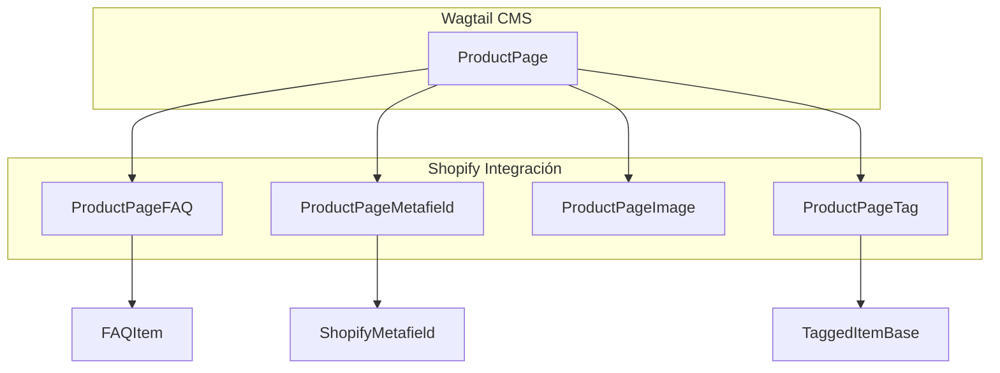

# Modelos de Página de Producto (ProductPage)

Este módulo define los modelos de Wagtail para representar y gestionar páginas de productos, sincronizándose con los productos de Shopify. Incluye la definición principal de `ProductPage` y sus componentes relacionados como FAQs, imágenes, metacampos y etiquetas.

## Propósito y Funcionalidad Principal

El módulo `Content_Page_Models_Product_Pages` es crucial para la integración del sistema de gestión de contenido con la plataforma Shopify. Su objetivo principal es:

*   **Mirroring de Productos Shopify**: Permite crear una representación local de los productos de Shopify dentro del CMS Wagtail.
*   **Gestión de Contenido Enriquecido**: Habilita la edición de descripciones de productos mediante StreamField, FAQs, metacampos personalizados e imágenes.
*   **Sincronización Bidireccional**: Facilita la importación de datos de productos desde Shopify y la exportación de contenido enriquecido desde Wagtail a Shopify.

## Componentes del Módulo

El módulo se compone de los siguientes modelos principales definidos en `shopify_content/models/product.py`:

### `ProductPage`

La clase `ProductPage` es el modelo central, heredando de `wagtail.models.Page`. Representa un producto individual de Shopify dentro de Wagtail.

*   **Campos de Sincronización con Shopify**:
    *   `shopify_id`: GID único de Shopify para el producto.
    *   `handle`: Identificador URL del producto en Shopify.
    *   `sync_enabled`: Bandera para controlar la sincronización del producto con Shopify.
    *   `last_synced_at`: Fecha y hora de la última sincronización.
    *   `theme_config`: Un campo JSON para almacenar anulaciones de configuración de temas que se empujan como metacampos de Shopify.
*   **Campos Específicos del Producto**:
    *   `vendor`: El proveedor del producto.
    *   `product_type`: El tipo de producto.
    *   `tags`: Etiquetas asociadas al producto, gestionadas a través de `ClusterTaggableManager`.
    *   `status`: El estado del producto (Activo, Archivad, Borrador).
*   **Contenido Enriquecido**:
    *   `body`: Un `StreamField` que permite a los editores construir descripciones de productos complejas utilizando una variedad de bloques de contenido definidos en [Bloques de StreamField de Wagtail](../Wagtail_StreamField_Blocks.md). Este contenido se renderiza a HTML para la descripción de Shopify (`descriptionHtml`).
*   **Paneles de Administración**:
    *   Define pestañas para "Content", "SEO / Promote" y "Shopify", organizando los campos para facilitar la edición en el panel de administración de Wagtail.

#### `ProductPage.Meta`

Clase interna que define metadatos para el modelo `ProductPage`, como `verbose_name` y `verbose_name_plural` para la interfaz de administración.

### `ProductPageTag`

Un modelo intermedio que gestiona la relación de muchos a muchos entre `ProductPage` y las etiquetas. Utiliza `ParentalKey` para vincularse a `ProductPage` y es utilizado por `ClusterTaggableManager`.

### `ProductPageFAQ`

Representa un elemento de Pregunta Frecuente (FAQ) asociado a un `ProductPage`. Hereda de `FAQItem` (definido en [Mixins Reutilizables](Content_Page_Models_Reusable_Mixins.md)) y se vincula a `ProductPage` mediante una `ParentalKey`.

### `ProductPageMetafield`

Representa un metacampo personalizado asociado a un `ProductPage`. Hereda de `ShopifyMetafield` (definido en [Mixins Reutilizables](Content_Page_Models_Reusable_Mixins.md)) y se vincula a `ProductPage` mediante una `ParentalKey`.

### `ProductPageImage`

Este modelo almacena URLs de imágenes de productos de Shopify. A diferencia de las imágenes de Wagtail, no descarga el archivo de imagen, sino que guarda la URL directa del CDN.

*   **Campos**:
    *   `page`: Clave parental que enlaza con `ProductPage`.
    *   `shopify_id`: GID de `MediaImage` de Shopify.
    *   `url`: URL absoluta del CDN de la imagen.
    *   `alt_text`: Texto alternativo de la imagen.
    *   `sort_order`: Orden de clasificación de la imagen.

#### `ProductPageImage.Meta`

Clase interna que define metadatos para `ProductPageImage`, incluyendo el orden (`ordering`) y nombres detallados (`verbose_name`).

## Arquitectura y Relaciones de Componentes

El módulo `ProductPage` es el eje central de este conjunto de modelos, con `ProductPageFAQ`, `ProductPageMetafield` y `ProductPageImage` actuando como modelos relacionados que extienden su funcionalidad y almacenamiento de datos específicos de Shopify.

*   **`ProductPage`**: Es una `Page` de Wagtail, lo que significa que se integra directamente en el árbol de páginas del CMS y hereda sus funcionalidades básicas como enrutamiento, SEO (`seo_title`, `search_description`) y gestión de versiones.
*   **Relaciones Parentales (`ParentalKey`)**:
    *   `ProductPageFAQ`, `ProductPageMetafield` y `ProductPageImage` usan `ParentalKey` para establecer una relación uno a muchos con `ProductPage`. Esto asegura que estos elementos se eliminen en cascada si la `ProductPage` asociada es eliminada y permite el uso de `InlinePanel` en la interfaz de administración de Wagtail.
*   **Mixins**: `ProductPageFAQ` y `ProductPageMetafield` extienden funcionalidades de los mixins `FAQItem` y `ShopifyMetafield` respectivamente, definidos en [Mixins Reutilizables](Content_Page_Models_Reusable_Mixins.md), promoviendo la reutilización de código y la coherencia en la estructura de datos.
*   **Etiquetas**: `ProductPageTag` sirve como un modelo a través para `ClusterTaggableManager`, permitiendo a `ProductPage` tener un sistema de etiquetado flexible y gestionado por la biblioteca `django-taggit`.
*   **`StreamField`**: El campo `body` utiliza bloques definidos en [Bloques de StreamField de Wagtail](../Wagtail_StreamField_Blocks.md), lo que permite a los editores crear contenido rico y estructurado para las descripciones de los productos.

## Encaje en el Sistema General

El módulo `Content_Page_Models_Product_Pages` es un componente fundamental dentro de la [Gestión de Contenido de Shopify (Shopify_Content_Management)](../Shopify_Content_Management.md).

*   **Integración con Wagtail**: Como páginas de Wagtail, las `ProductPage` se benefician de la interfaz de usuario amigable del CMS para la edición, la previsualización y la gestión de contenido.
*   **Sincronización de Contenido**: Las `ProductPage` son el destino principal para la importación de productos desde Shopify y la fuente para la exportación de descripciones de productos y metacampos enriquecidos de vuelta a Shopify. Los comandos de gestión de sincronización, como `import_shopify_products` y `materialize_editorial_content`, interactúan directamente con estos modelos para mantener el contenido actualizado.
*   **API de Contenido**: Los datos de `ProductPage` son expuestos a través de la [API de Contenido (Content_API)](../../../Content_API.md) mediante esquemas como `api/schemas/product.py::ProductOut`, permitiendo que otras partes del sistema o aplicaciones externas accedan a la información del producto.
*   **Bloques de StreamField**: La flexibilidad del campo `body` de `ProductPage` se basa en la definición de bloques de contenido en el módulo [Bloques de StreamField de Wagtail](../Wagtail_StreamField_Blocks.md), permitiendo una rica experiencia de edición.
*   **Mixins Comunes**: La dependencia de `FAQItem` y `ShopifyMetafield` de [Mixins Reutilizables](Content_Page_Models_Reusable_Mixins.md) asegura la consistencia en cómo se manejan los elementos comunes en diferentes tipos de páginas de contenido.
