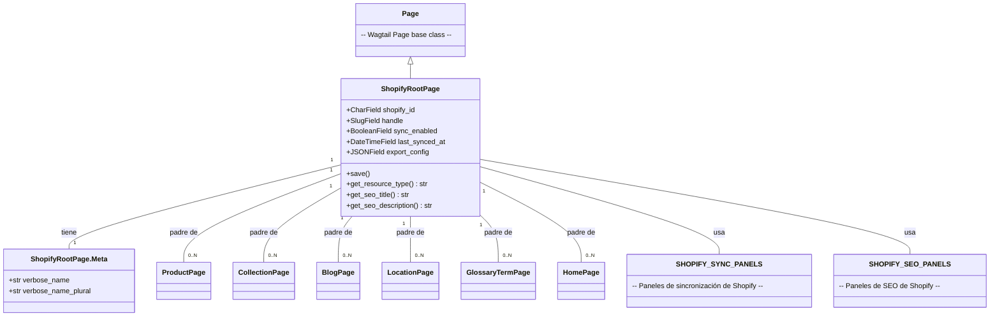
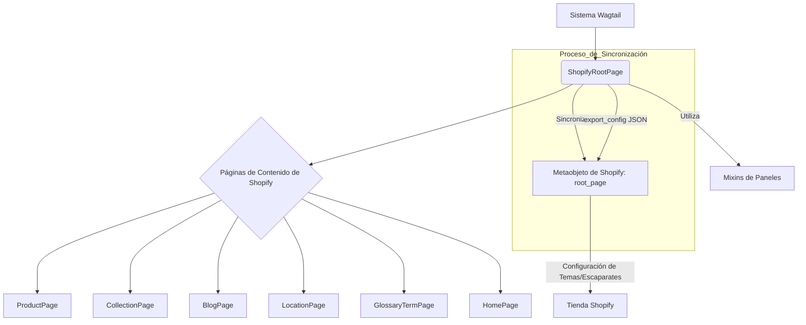

# Modelos de Página de Contenido de Shopify: Página Raíz

El módulo `Content_Page_Models_Content_Page_Models_Shopify_Root_Model` define el modelo `ShopifyRootPage`, que sirve como la página raíz o de índice para todas las páginas de contenido específicas de Shopify dentro del sistema Wagtail. Este modelo es fundamental para organizar la jerarquía del contenido y facilita la sincronización de las configuraciones de contenido con los metaobjetos de Shopify.

## Propósito y Funcionalidad Principal

La `ShopifyRootPage` es una extensión de `wagtail.models.Page` y actúa como el contenedor principal para diversos tipos de páginas de contenido como productos, colecciones, blogs, ubicaciones, términos de glosario y páginas de inicio. Su funcionalidad clave incluye:

*   **Organización del Contenido**: Establece una estructura jerárquica clara para el contenido, permitiendo que las páginas de Shopify vivan bajo una raíz definida.
*   **Sincronización con Shopify**: Cada instancia de `ShopifyRootPage` está diseñada para sincronizarse con un metaobjeto `root_page` propiedad del comercio en Shopify. Esto se gestiona a través de campos como `shopify_id`, `handle` y `export_config`.
*   **Configuración de Exportación**: El campo `export_config` permite definir una carga útil JSON específica del tipo que se envía al campo de configuración del metaobjeto de Shopify, habilitando configuraciones personalizadas de tema/escaparate.
*   **Gestión de SEO**: Proporciona métodos para recuperar el título y la descripción SEO, que pueden ser utilizados para optimizar la visibilidad en los motores de búsqueda.
*   **Paneles de Administración de Wagtail**: Integra paneles para la gestión del contenido, promoción (SEO) y configuraciones de sincronización de Shopify, mejorando la experiencia del usuario en el backend de Wagtail.

### Componentes Principales

Este módulo define los siguientes componentes:

*   `ShopifyRootPage`: La clase de modelo principal para la página raíz.
*   `ShopifyRootPage.Meta`: La clase interna que define las opciones de metadatos para `ShopifyRootPage`.

## Arquitectura y Relaciones entre Componentes

La `ShopifyRootPage` hereda de `wagtail.models.Page`, lo que la integra directamente en el sistema de gestión de contenido de Wagtail.

### Relaciones Clave

*   **Herencia de Wagtail**: `ShopifyRootPage` hereda de `Page` de Wagtail, lo que le permite aprovechar todas las características y la estructura de las páginas de Wagtail.
*   **Tipos de Subpáginas**: Define explícitamente los tipos de páginas que pueden ser sus descendientes (`subpage_types`), incluyendo:
    *   [`ProductPage`](./Content_Page_Models_Product_Pages.md)
    *   [`CollectionPage`](./Content_Page_Models_Collection_Pages.md)
    *   [`BlogPage`](./Content_Page_Models_Blog_and_Article_Pages.md)
    *   [`LocationPage`](./Content_Page_Models_Location_Pages.md)
    *   [`GlossaryTermPage`](./Content_Page_Models_Glossary_Term_Pages.md)
    *   [`HomePage`](./Content_Page_Models_Home_Pages.md)
    Esta relación asegura una estructura de contenido organizada y predecible.
*   **Paneles de Administración**: Utiliza `SHOPIFY_SYNC_PANELS` y `SHOPIFY_SEO_PANELS` (importados de [`mixins.py`](./Content_Page_Models_Reusable_Mixins.md)) para construir su `edit_handler` a través de un `TabbedInterface`, lo que mejora la gestión en el interfaz de administración de Wagtail.

## Cómo el Módulo Encaja en el Sistema General

La `ShopifyRootPage` es un punto de entrada crucial para la gestión de contenido editorial que se exporta a Shopify. Sirve como la base de la jerarquía de contenido y el principal mecanismo para la sincronización de metaobjetos raíz con Shopify.

La `ShopifyRootPage` encapsula la lógica para la interacción con Shopify a nivel de metaobjeto raíz, permitiendo que la aplicación integre de forma nativa el contenido de Wagtail con la plataforma Shopify. Las configuraciones de exportación (`export_config`) son vitales para dictar cómo el contenido de la página raíz influye en la presentación de la tienda Shopify.

Para más detalles sobre los mixins utilizados, consulte la documentación del módulo [Modelos de Mixins Reutilizables de Páginas de Contenido](./Content_Page_Models_Reusable_Mixins.md).
