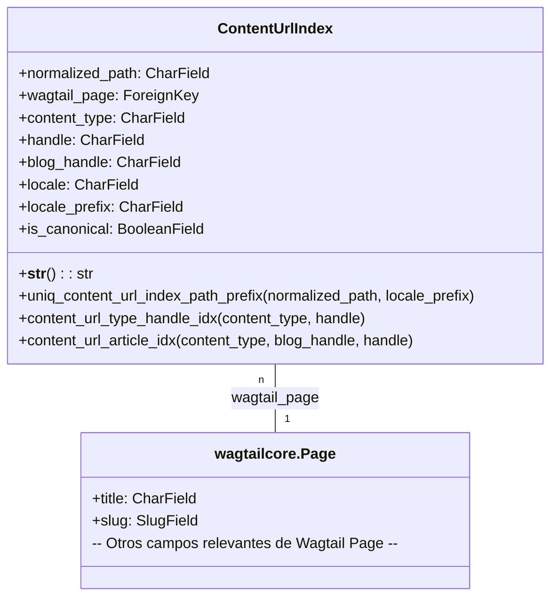

# Modelos de Índice de URL de Contenido

Este módulo define los modelos de Django para el `ContentUrlIndex`, que proporciona una asignación materializada de las rutas URL del escaparate de Shopify a las páginas de Wagtail correspondientes. Es un componente crucial para correlacionar las URLs de tráfico de Google Search Console (GSC) con el contenido del CMS, lo que facilita el análisis de SEO y la gestión de contenido.

## Propósito y Funcionalidad Principal

El objetivo principal de `ContentUrlIndex` es crear y mantener un índice de todas las URLs de contenido relevantes en el escaparate de Shopify y vincularlas a las páginas de Wagtail que las representan. Esto permite una fácil identificación del contenido del CMS asociado con el tráfico de la tienda y ayuda en tareas de SEO, como la identificación de páginas populares o la resolución de problemas de enlaces rotos.

El índice se actualiza automáticamente cuando se publica una página de Wagtail y puede reconstruirse manualmente utilizando el [comando de gestión `rebuild_content_url_index`](Shopify_Content_Management/Management_Commands.md).

### Componentes Principales

#### `ContentUrlIndex`

Este es el modelo central del módulo. Representa una entrada individual en el índice de URL de contenido. Cada instancia de `ContentUrlIndex` mapea una ruta URL específica del escaparate de Shopify a una página de Wagtail, junto con metadatos adicionales para facilitar la búsqueda y el filtrado.

**Campos clave:**

*   `normalized_path`: La ruta del escaparate sin el dominio ni el prefijo de localización (ej., `/pages/glossary/alpha`). Es el campo principal para la identificación de la URL.
*   `wagtail_page`: Una clave foránea que apunta a la página de Wagtail (`wagtailcore.Page`) asociada con esta URL. Si una entrada se elimina, también se eliminarán las entradas del índice asociadas.
*   `content_type`: El tipo de contenido de la página de Wagtail (ej., `product`, `collection`, `blog`, `article`, `glossary_term`, `location`, `home`, `index`, `root`).
*   `handle`: Un identificador único para el contenido, a menudo utilizado en Shopify para productos, colecciones o blogs.
*   `blog_handle`: Específico para páginas de artículos, indica el `handle` del blog padre.
*   `locale`: El código de localización de Wagtail (ej., `en-US`).
*   `locale_prefix`: El prefijo de URL de Shopify Markets (ej., `es-us`) para URLs localizadas. Está vacío para la URL canónica.
*   `is_canonical`: Un booleano que indica si esta entrada de URL es la versión canónica sin un prefijo de localización de Markets.

#### `ContentUrlIndex.Meta`

La clase `Meta` anidada dentro de `ContentUrlIndex` define metadatos específicos del modelo de Django:

*   `verbose_name` y `verbose_name_plural`: Nombres legibles por humanos para el modelo en la interfaz de administración.
*   `constraints`: Incluye una `UniqueConstraint` en `normalized_path` y `locale_prefix`, asegurando que no haya dos entradas idénticas para la misma ruta y prefijo de localización, lo que garantiza la integridad de los datos.
*   `indexes`: Define índices de base de datos para mejorar el rendimiento de las consultas, incluyendo índices en `(content_type, handle)` y `(content_type, blog_handle, handle)` para búsquedas eficientes por tipo de contenido y handles.

## Arquitectura y Relaciones entre Componentes

El modelo `ContentUrlIndex` es fundamental en la capa de modelos de contenido, estableciendo una relación directa con las páginas de Wagtail. Esta relación es clave para la navegación interna del CMS y la exposición del contenido en el escaparate de Shopify.



## Cómo Encaja el Módulo en el Sistema General

El módulo `Content_Page_Models_Content_URL_Index_Models` se integra en el sistema de gestión de contenido de Shopify para proporcionar una capa esencial de indexación de URLs. Su propósito es actuar como un puente entre la estructura de URLs del escaparate de Shopify y la organización de contenido dentro de Wagtail, lo cual es vital para el SEO y el seguimiento del rendimiento.

*   **Gestión de Contenido (Wagtail):** Cada vez que se crea o actualiza una página de Wagtail, especialmente al publicarla, se espera que se generen o actualicen las entradas correspondientes en `ContentUrlIndex`. Esto asegura que el índice esté siempre sincronizado con el contenido vivo del CMS.
*   **Sincronización con Shopify:** Aunque el modelo no interactúa directamente con la API de Shopify para crear URLs, el `normalized_path` se deriva de cómo Shopify construye sus URLs para el contenido. Esto permite una correlación precisa con los datos de tráfico de GSC.
*   **Administración del Sistema:** La administración del `ContentUrlIndex` se realiza a través de la interfaz de administración de Django/Wagtail, utilizando el [ContentUrlIndexAdmin](Shopify_Content_Management/Admin_Interface.md) para visualizar y, potencialmente, gestionar las entradas del índice. Además, los administradores pueden invocar manualmente el [comando de gestión `rebuild_content_url_index`](Shopify_Content_Management/Management_Commands.md) para reconstruir el índice completo, lo cual es útil después de migraciones o cambios masivos en la estructura de URLs.
*   **Análisis y SEO:** Los datos almacenados en `ContentUrlIndex` son fundamentales para herramientas de análisis y optimización SEO, permitiendo a los equipos de marketing y SEO entender qué contenido de Wagtail está generando tráfico desde Shopify.

```mermaid
graph TD
    A[Creación/Publicación de Contenido en Wagtail] --> B{Sistema de Eventos de Wagtail}
    B -- "Al publicar" --> C[Actualización/Creación de Entradas en ContentUrlIndex]
    D[Comando de Gestión: rebuild_content_url_index] --> C
    C --> E[Base de Datos: ContentUrlIndex]
    E --> F[Herramientas de SEO y Análisis (ej. GSC)]
    F -- "Tráfico/Rendimiento" --> E
    G[Interfaz de Administración de Wagtail] -- "Visualizar/Gestionar" --> E

    subgraph Módulo Shopify_Content_Management
        B
        C
        D
        E
        G
    end

    subgraph Integración Externa
        A
        F
    end
```