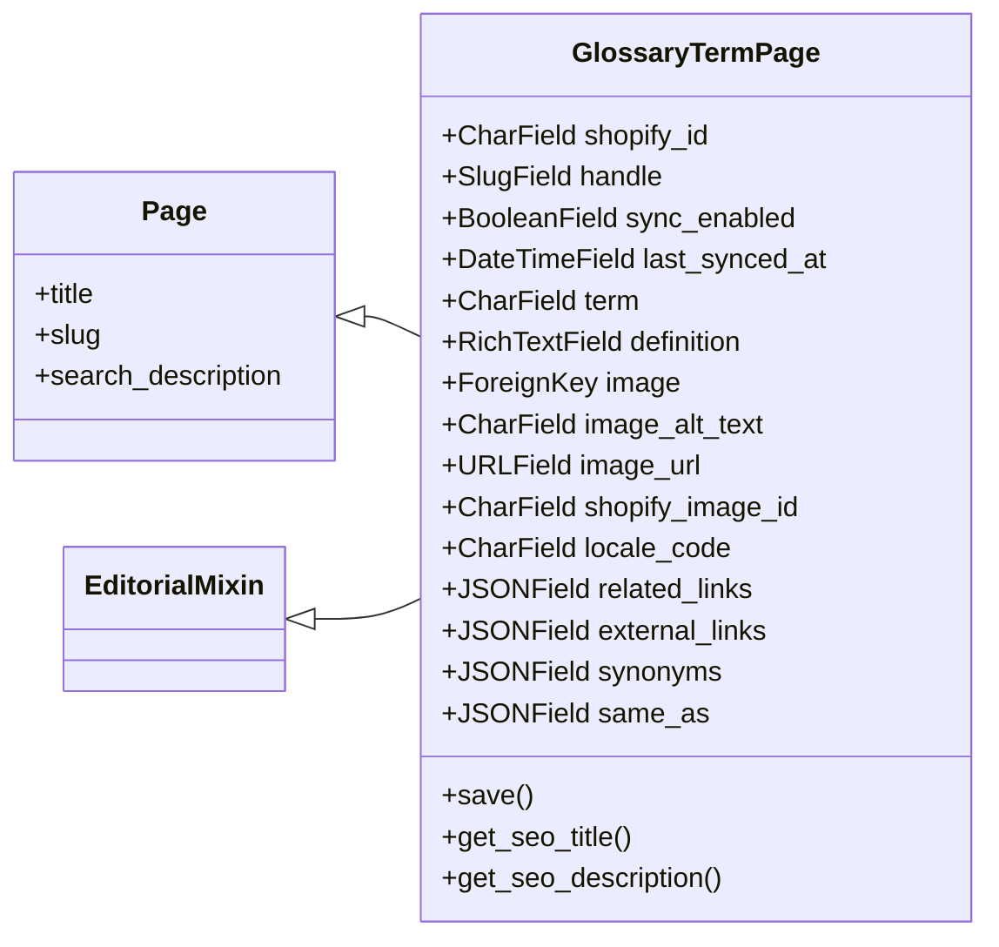
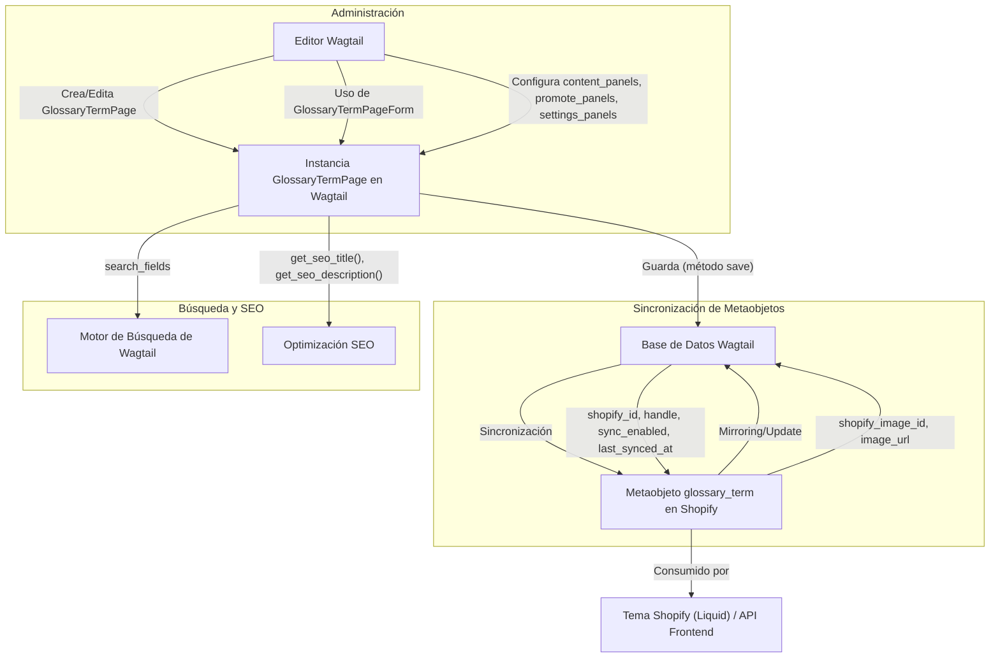

# Páginas de Términos de Glosario

Este módulo define el modelo de página `GlossaryTermPage` para la gestión de términos de glosario dentro del sistema Wagtail, facilitando su sincronización con metaobjetos de Shopify.

## 1. Propósito y Funcionalidad Principal

El módulo `Content_Page_Models_Glossary_Term_Pages` proporciona la estructura para crear y administrar términos de glosario como páginas en Wagtail. Cada `GlossaryTermPage` está diseñada para ser sincronizada con un metaobjeto de Shopify de tipo `glossary_term`, permitiendo una gestión centralizada del contenido del glosario.

### Componentes Principales:

*   `GlossaryTermPage`: El modelo principal de Wagtail para un término de glosario.
*   `GlossaryTermPage.Meta`: Metadatos y opciones de configuración para el modelo `GlossaryTermPage`.

## 2. Arquitectura y Relaciones entre Componentes

### 2.1. `GlossaryTermPage`

La clase `GlossaryTermPage` hereda de `EditorialMixin` y `wagtail.models.Page`, integrando funcionalidades editoriales y las capacidades estándar de una página de Wagtail.

#### Campos de `GlossaryTermPage`:

*   **Campos de Sincronización de Shopify**:
    *   `shopify_id` (CharField): GID del metaobjeto de Shopify, se popula después de la primera inserción/actualización.
    *   `handle` (SlugField): Handle del metaobjeto de Shopify, por defecto es el término slugificado.
    *   `sync_enabled` (BooleanField): Indica si la sincronización con Shopify está habilitada.
    *   `last_synced_at` (DateTimeField): Marca de tiempo de la última sincronización.
*   **Campos de Contenido**:
    *   `term` (CharField): El término del glosario.
    *   `definition` (RichTextField): La definición del término, con soporte para formato de texto enriquecido.
    *   `image` (ForeignKey a `wagtailimages.Image`): Imagen opcional asociada al término.
    *   `image_alt_text` (CharField): Texto alternativo para la imagen.
    *   `image_url` (URLField): URL absoluta de CDN de Shopify para la imagen.
    *   `shopify_image_id` (CharField): GID de la imagen en Shopify.
    *   `locale_code` (CharField): Código de la configuración regional (idioma) del término.
    *   `related_links` (JSONField): Enlaces relacionados, almacenados como una lista de JSON.
    *   `external_links` (JSONField): Enlaces externos, almacenados como una lista de JSON.
    *   `synonyms` (JSONField): Sinónimos o variantes del término, almacenados como una lista de cadenas.
    *   `same_as` (JSONField): URLs de entidades canónicas externas (e.g., Wikipedia), almacenadas como una lista de URLs.

#### Paneles de Administración Wagtail:

La interfaz de edición de `GlossaryTermPage` se organiza en pestañas (`TabbedInterface`) con los siguientes paneles:

*   **Content**: Contiene los campos `term`, `definition`, `image`, un `MultiFieldPanel` para `image_url`, `image_alt_text`, `shopify_image_id`, `locale_code`, `related_links` (a través de `semantic_links_panels`), `external_links`, `synonyms` y `same_as`.
*   **Promote**: Incluye los paneles SEO de Shopify (`SHOPIFY_SEO_PANELS`) y el campo `slug` de la página.
*   **Shopify Sync**: Contiene los paneles de sincronización de Shopify (`SHOPIFY_SYNC_PANELS`).

#### Métodos Importantes:

*   `save()`: Sobrescribe el método `save` para establecer el `title` de la página con el `term` si existe, derivar el `locale_code` basado en el `locale_id` de Wagtail, y asegurar que los campos JSON (`related_links`, `external_links`, `synonyms`, `same_as`) no sean `None`.
*   `get_seo_title()`: Devuelve el título SEO de la página, usando `seo_title`, `term` o `title` en ese orden.
*   `get_seo_description()`: Genera la descripción SEO a partir de `search_description` o una versión de texto plano de la `definition`.

### 2.2. `GlossaryTermPage.Meta`

Esta clase interna define metadatos para el modelo `GlossaryTermPage`:

*   `verbose_name`: 'Glossary Term'
*   `verbose_name_plural`: 'Glossary Terms'

### 2.3. Diagrama de Clases

## 3. Integración en el Sistema General

El módulo `Content_Page_Models_Glossary_Term_Pages` es una parte fundamental del sistema de gestión de contenido, especialmente para la administración de glosarios.

### 3.1. Relación con Shopify

`GlossaryTermPage` está diseñada para una integración profunda con Shopify. Cada instancia se mapea a un metaobjeto de Shopify de tipo `glossary_term`. Esta sincronización bidireccional garantiza que los términos del glosario sean coherentes entre Wagtail y Shopify.

La definición de los metaobjetos de Shopify necesarios para `GlossaryTermPage` se puede inicializar mediante el comando de gestión de Django `python manage.py ensure_metaobject_definitions`. Para más detalles, consulte la documentación del módulo [Shopify Metaobjects Connector](../../Shopify_Platform_Integrations/Shopify_Metaobjects_Connector.md).

### 3.2. Estructura de Páginas Wagtail

Las páginas `GlossaryTermPage` deben ser hijas de una `ShopifyRootPage` con el slug `glossary`. Esta `ShopifyRootPage` actúa como un contenedor organizativo. La página de lista del glosario (`/pages/glossary`) es gestionada directamente por el tema de Shopify utilizando Liquid.

### 3.3. Formularios y Administración

La clase `GlossaryTermPageForm` (definida en el módulo [Content Forms](../Content_Forms.md)) es la base para el formulario de edición en el administrador de Wagtail.

Los paneles de enlaces semánticos (`semantic_links_panels`) se importan de `shopify_content.admin_panels`, lo que indica una dependencia en la funcionalidad de administración para la gestión de enlaces. Consulte [Admin Interface](../../Shopify_Content_Management/Admin_Interface.md) para más detalles.

### 3.4. Indexación y Exportación

Los términos de glosario son indexados y pueden ser consumidos por el sistema de exportación de contenido. El `GlossaryIndexConsumer` (definido en el módulo [Content Indexing & Export Configuration](../../Shopify_Content_Management/Content_Indexing___Export_Configuration.md)) es responsable de cómo los términos del glosario se procesan para su exportación o visualización en la tienda.

### 3.5. Flujo de Sincronización de Datos

El flujo de datos para un `GlossaryTermPage` implica la creación/edición en Wagtail y la subsiguiente sincronización con Shopify, así como la posibilidad de reflejar cambios desde Shopify (aunque la fuente de verdad principal para ciertos campos reside en Wagtail o Shopify según el campo).

