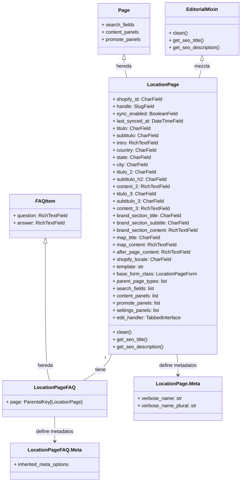
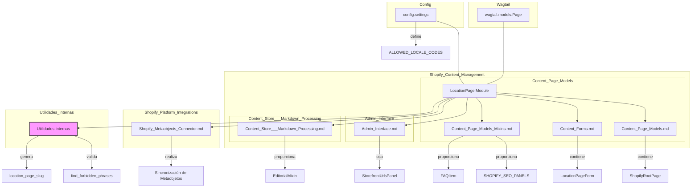

# Páginas de Ubicación (Location Pages)

Este módulo, `Content_Page_Models_Location_Pages`, define los modelos de página Wagtail para representar páginas de ubicación geográficas. Estas páginas están diseñadas para sincronizarse con metaobjetos específicos de Shopify, permitiendo la gestión de contenido localizado directamente desde el CMS de Wagtail.

## Propósito y Funcionalidad Principal

El objetivo principal de este módulo es proporcionar una estructura robusta para crear y gestionar páginas de ubicación que contienen información relevante para un país, estado o ciudad específica. Esto incluye campos para contenido editorial, detalles de ubicación y preguntas frecuentes, todo ello mientras se mantiene la capacidad de sincronizar estos datos con la plataforma Shopify.

## Arquitectura y Componentes

El módulo se compone principalmente de dos modelos Django/Wagtail: `LocationPage` y `LocationPageFAQ`, junto con sus respectivas clases `Meta`.

### `LocationPage`
La clase `LocationPage` es un modelo de página Wagtail que extiende `EditorialMixin` y `Page`. Está diseñada para ser el contenedor principal de contenido para una ubicación específica.

*   **Campos de Sincronización con Shopify:** `shopify_id`, `handle`, `sync_enabled`, `last_synced_at` son cruciales para la integración con los metaobjetos de Shopify. El `handle` se deriva automáticamente del `locale` y la ubicación (por ejemplo, `<locale>-<city>[-<state>]`).
*   **Campos de Contenido:** Incluye múltiples campos `CharField` y `RichTextField` para estructurar el contenido de la página, como un título de héroe, subtítulos, introducciones, secciones de contenido principal, una sección de marca y una sección de mapa.
*   **Campos de Ubicación:** `country`, `state`, `city` capturan los detalles geográficos.
*   **Localización de Shopify:** `shopify_locale` permite anular la configuración regional predeterminada para Shopify.
*   **Paneles de Administración Wagtail:** Utiliza `content_panels`, `promote_panels` y `settings_panels` para organizar la interfaz de edición en el administrador de Wagtail, incluyendo secciones para contenido, SEO/promoción y configuración de sincronización con Shopify.
*   **Método `clean()`:** Este método sobrescrito realiza una validación importante:
    *   Genera automáticamente el `slug` y el `handle` de la página basándose en la ubicación (`city`, `state`, `country`) y el `shopify_locale`.
    *   Verifica que el contenido de los `RichTextField` no contenga frases prohibidas, asegurando la conformidad con las políticas de contenido.

### `LocationPage.Meta`
Una subclase anidada que proporciona metadatos para el modelo `LocationPage`, como `verbose_name` y `verbose_name_plural` para una mejor representación en la interfaz de administración.

### `LocationPageFAQ`
Este modelo es una subclase de `FAQItem` y representa una pregunta frecuente asociada a una `LocationPage`.
*   **Relación Parental:** Utiliza `ParentalKey` para establecer una relación uno a muchos con `LocationPage`, lo que significa que una página de ubicación puede tener múltiples preguntas frecuentes.

### `LocationPageFAQ.Meta`
Una subclase anidada que hereda metadatos de `FAQItem.Meta`.

## Relaciones y Dependencias

El módulo `Content_Page_Models_Location_Pages` tiene varias dependencias y se integra con otras partes del sistema:

*   **`wagtail.models.Page`**: `LocationPage` hereda directamente de la clase base de página de Wagtail, integrándose en la jerarquía de páginas del CMS.
*   **[Content_Page_Models_Mixins.md](Content_Page_Models_Mixins.md)**: Proporciona la clase `FAQItem` para las preguntas frecuentes y `SHOPIFY_SEO_PANELS` para los paneles de SEO en el administrador de Wagtail.
*   **[Content_Forms.md](Content_Forms.md)**: `LocationPage` utiliza `LocationPageForm` para la gestión de sus campos en el editor de Wagtail.
*   **[Content_Page_Models.md](../Content_Page_Models.md)**: El modelo `ShopifyRootPage` (definido en `shopify_content/models/root.py` dentro de [Content_Page_Models.md](../Content_Page_Models.md)) puede ser un tipo de página padre para `LocationPage`.
*   **[Admin_Interface.md](../../Admin_Interface.md)**: El `StorefrontUrlsPanel` se utiliza en los paneles de configuración de `LocationPage` para mostrar URLs relevantes para la tienda.
*   **[Content_Store___Markdown_Processing.md](../../Content_Store___Markdown_Processing.md)**: `LocationPage` hereda de `EditorialMixin`, lo que le permite acceder a la funcionalidad editorial proporcionada por el sistema de almacenamiento de contenido.
*   **`config.settings`**: Se utiliza para acceder a `ALLOWED_LOCALE_CODES`, que define las opciones de localización disponibles para las páginas de Shopify.
*   **[Shopify_Metaobjects_Connector.md](../../../Shopify_Platform_Integrations/Shopify_Metaobjects_Connector.md)**: `LocationPage` está diseñado para sincronizarse con metaobjetos de Shopify. La creación y verificación de la definición del metaobjeto se realiza en tiempo de ejecución a través de `MetaobjectClient.ensure_definition()`, y la sincronización se maneja mediante `MetaobjectClient.sync()`.
*   **Utilidades Internas (`shopify_content/location_slug.py` y `shopify_content/content_templates/location_city_en_us.py`)**: Estas utilidades son responsables de generar los slugs y handles de las páginas de ubicación y de validar el contenido para frases prohibidas, respectivamente.

## Flujo de Datos y Procesos

### Sincronización con Shopify
Cuando una `LocationPage` se publica o se actualiza en Wagtail, los datos relevantes se sincronizan con un metaobjeto de Shopify del tipo `local_page`. Este proceso implica:
1.  **Verificación de Definición:** Asegurar que la definición del metaobjeto `local_page` existe en Shopify, o crearla si es necesario, utilizando `MetaobjectClient.ensure_definition()`.
2.  **Sincronización de Datos:** Los campos de la `LocationPage` (como el título, contenido, detalles de ubicación y el handle) se mapean a los campos correspondientes del metaobjeto de Shopify y se envían para su actualización mediante `MetaobjectClient.sync()`.
3.  **Registro de `shopify_id` y `handle`:** Después de la primera operación de "upsert" (insertar/actualizar), el `shopify_id` y el `handle` del metaobjeto se almacenan en la `LocationPage` para futuras referencias y actualizaciones.

### Proceso de Limpieza y Validación
El método `clean()` de `LocationPage` es fundamental para mantener la integridad y consistencia de los datos:
1.  **Generación de Slug y Handle:** Se calcula un `canonical slug` basado en la ciudad, estado y país, y se asigna al campo `slug` de Wagtail y al `handle` de Shopify.
2.  **Validación de Contenido:** Se escanea todo el contenido `RichTextField` de la página y las preguntas frecuentes asociadas en busca de frases prohibidas. Si se encuentran, se lanza un `ValidationError`, impidiendo la publicación de la página hasta que se corrijan. Esto es crucial para cumplir con ciertas directrices de contenido.

## Integración con el Sistema General

El módulo `Content_Page_Models_Location_Pages` es un componente vital del sistema `Shopify_Content_Management`.

*   **Gestión de Contenido Localizado:** Permite a los administradores de contenido crear y gestionar páginas dedicadas a ubicaciones geográficas específicas, lo cual es esencial para estrategias de SEO local y marketing dirigido.
*   **Extensión de Wagtail:** Al heredar de `wagtail.models.Page`, se integra perfectamente con el CMS de Wagtail, aprovechando sus capacidades de edición, versionado y permisos.
*   **Base para el Front-end:** Estas páginas actúan como la fuente de datos para la renderización de contenido en el front-end de la tienda Shopify, utilizando las URL de la tienda para acceder a la información.
*   **Comandos de Gestión:** Existen comandos de gestión como `ensure_metaobject_definitions` (parte de [Management_Commands.md](../../Management_Commands.md)) que se utilizan para inicializar y verificar las definiciones de metaobjetos necesarias en Shopify para estas páginas. Por ejemplo, `python manage.py ensure_metaobject_definitions` bootstrap la definición de metaobjetos.
