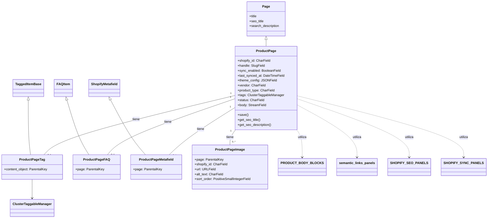
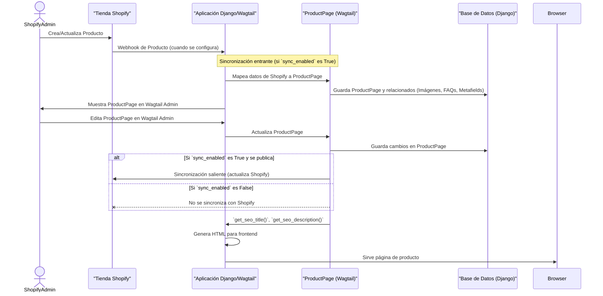

# Modelos de Página de Producto

Este módulo define los modelos de Django y Wagtail para gestionar páginas de producto, que replican la información de los productos de Shopify. Incluye la estructura principal de la página de producto, así como modelos para imágenes, preguntas frecuentes, meta-campos y etiquetas asociados a los productos.

## Arquitectura y Componentes

El módulo `Content_Page_Models_Product_Model` está compuesto por las siguientes clases:

*   `ProductPage`: La clase principal de la página de producto en Wagtail.
*   `ProductPage.Meta`: Opciones de metadatos para `ProductPage`.
*   `ProductPageTag`: Modelo para gestionar las etiquetas de los productos.
*   `ProductPageFAQ`: Modelo para preguntas frecuentes asociadas a un producto.
*   `ProductPageMetafield`: Modelo para meta-campos personalizados de los productos de Shopify.
*   `ProductPageImage`: Modelo para almacenar las URLs de las imágenes de los productos de Shopify.
*   `ProductPageImage.Meta`: Opciones de metadatos para `ProductPageImage`.

### `ProductPage`

La clase `ProductPage` hereda de `wagtail.models.Page` y está diseñada para reflejar un producto de Shopify. Almacena información sincronizada desde Shopify y permite la edición de contenido a través de StreamField. Sus campos incluyen `shopify_id`, `handle`, `sync_enabled`, `last_synced_at`, `theme_config`, `vendor`, `product_type`, `tags`, `status` y `body` (un StreamField para la descripción del producto).

También hereda `seo_title` y `search_description` de la clase `Page` de Wagtail, que se mapean a `seo.title` y `seo.description` en Shopify, respectivamente.

#### Paneles de Edición

`ProductPage` utiliza `TabbedInterface` para organizar sus paneles de edición en el administrador de Wagtail:

*   **Content (Contenido)**: Contiene `MultiFieldPanel` para detalles del producto (vendedor, tipo de producto, etiquetas, estado), el campo `body` (StreamField), paneles para enlaces semánticos, `InlinePanel` para imágenes (`shopify_images`), preguntas frecuentes (`faqs`) y meta-campos (`metafields`).
*   **SEO / Promote (SEO / Promoción)**: Utiliza `SHOPIFY_SEO_PANELS` para campos relacionados con SEO y un `MultiFieldPanel` para el slug interno de Wagtail.
*   **Shopify**: Contiene `SHOPIFY_SYNC_PANELS` para campos de sincronización y un `FieldPanel` para la configuración del tema (`theme_config`).
*   **Settings (Ajustes)**: Utiliza los paneles de configuración estándar de Wagtail.

### `ProductPage.Meta`

Define el `verbose_name` y `verbose_name_plural` para `ProductPage` como 'Product Page' y 'Product Pages' respectivamente, mejorando la legibilidad en el administrador de Django/Wagtail.

### `ProductPageTag`

`ProductPageTag` es un modelo intermedio que permite a `ProductPage` utilizar `ClusterTaggableManager` para gestionar etiquetas. Hereda de `taggit.models.TaggedItemBase` y establece una `ParentalKey` a `ProductPage`.

### `ProductPageFAQ`

`ProductPageFAQ` extiende el mixin `FAQItem` para asociar preguntas frecuentes directamente con una `ProductPage` a través de una `ParentalKey`.

### `ProductPageMetafield`

`ProductPageMetafield` extiende el mixin `ShopifyMetafield` para almacenar meta-campos personalizados de Shopify que están relacionados con una `ProductPage` a través de una `ParentalKey`.

### `ProductPageImage`

Este modelo almacena las URLs de las imágenes de productos de Shopify. A diferencia de las imágenes de Wagtail, no descarga ni gestiona los archivos de imagen directamente, sino que guarda la URL de CDN proporcionada por Shopify. Incluye campos para `shopify_id`, `url`, `alt_text` y `sort_order`.

#### Paneles de Edición de `ProductPageImage`

Permite la edición de `url`, `alt_text` y `sort_order` en el administrador de Wagtail.

### `ProductPageImage.Meta`

Define el orden (`ordering`) por `sort_order` y `id`, y establece los nombres verbose para `ProductPageImage` como 'Shopify product image' y 'Shopify product images'.

## Diagramas de Componentes



### Diagrama de Flujo de Datos para Sincronización de Productos



## Relaciones con Otros Módulos

Este módulo se integra con varios otros módulos dentro del sistema de gestión de contenido:

*   **[Content_Page_Models](../Content_Page_Models.md)**: Es parte de la colección de modelos de página de contenido, proporcionando la estructura para las páginas de productos.
*   **[Wagtail_StreamField_Blocks](../../Wagtail_StreamField_Blocks.md)**: Utiliza los `PRODUCT_BODY_BLOCKS` definidos en este módulo para la estructura del `StreamField` `body` de `ProductPage`.
*   **[Content_Page_Models_Reusable_Mixins](../Content_Page_Models_Reusable_Mixins.md)**: `ProductPageFAQ` y `ProductPageMetafield` heredan de `FAQItem` y `ShopifyMetafield` respectivamente, definidos en este módulo.
*   **[Admin_Interface](../../Admin_Interface.md)**: La interfaz de administración de Wagtail para `ProductPage` se define aquí, utilizando paneles y mixins relacionados con la administración de Shopify.
*   **[Content_API](Content_API.md)**: Expone los modelos de productos a través de la API para la integración con sistemas externos, permitiendo la creación, lectura, actualización y eliminación de páginas de productos.
*   **[Shopify_Platform_Integrations/Shopify_Metaobjects_Connector](Shopify_Platform_Integrations/Shopify_Metaobjects_Connector.md)**: Los meta-campos de Shopify gestionados por `ProductPageMetafield` son interactuados por el conector de meta-objetos de Shopify durante la sincronización.

## Componentes Clave

### `shopify_content/models/product.py`

Este archivo contiene todas las definiciones de clases para el modelo `ProductPage` y sus componentes asociados. Es el centro neurálgico para la representación y gestión de productos de Shopify dentro de la aplicación Wagtail.

```python
from django.db import models
from django.utils.translation import gettext_lazy as _

from modelcluster.fields import ParentalKey
from modelcluster.contrib.taggit import ClusterTaggableManager
from taggit.models import TaggedItemBase

from wagtail.models import Page
from wagtail.fields import StreamField
from wagtail.admin.panels import (
    FieldPanel, InlinePanel, MultiFieldPanel, ObjectList, TabbedInterface,
)
from wagtail.search import index

from shopify_content.admin_panels import semantic_links_panels
from .mixins import FAQItem, ShopifyMetafield, SHOPIFY_SYNC_PANELS, SHOPIFY_SEO_PANELS
from ..blocks import PRODUCT_BODY_BLOCKS


class ProductPageTag(TaggedItemBase):
    content_object = ParentalKey(
        'shopify_content.ProductPage',
        related_name='tagged_items',
        on_delete=models.CASCADE,
    )


class ProductPageFAQ(FAQItem):
    page = ParentalKey(
        'shopify_content.ProductPage',
        on_delete=models.CASCADE,
        related_name='faqs',
    )


class ProductPageMetafield(ShopifyMetafield):
    page = ParentalKey(
        'shopify_content.ProductPage',
        on_delete=models.CASCADE,
        related_name='metafields',
    )


class ProductPageImage(models.Model):
    """Shopify product image URL stored locally (no wagtailimages download)."""

    page = ParentalKey(
        'shopify_content.ProductPage',
        on_delete=models.CASCADE,
        related_name='shopify_images',
    )
    shopify_id = models.CharField(
        max_length=255,
        blank=True,
        help_text='Shopify MediaImage GID.',
    )
    url = models.URLField(
        max_length=2048,
        help_text='Absolute CDN URL for use in img src.',
    )
    alt_text = models.CharField(max_length=255, blank=True)
    sort_order = models.PositiveSmallIntegerField(default=0)

    class Meta:
        ordering = ['sort_order', 'id']
        verbose_name = 'Shopify product image'
        verbose_name_plural = 'Shopify product images'

    panels = [
        FieldPanel('url'),
        FieldPanel('alt_text'),
        FieldPanel('sort_order'),
    ]


class ProductPage(Page):
    """
    Mirrors a Shopify Product.

    Shopify field → Wagtail field:
      title           → Page.title
      handle          → handle
      descriptionHtml → body (StreamField, rendered to HTML on outbound)
      vendor          → vendor
      productType     → product_type
      tags            → tags (ClusterTaggableManager)
      status          → status
      seo.title       → seo_title
      seo.description → search_description
      metafields      → metafields InlinePanel (ProductPageMetafield)
    """

    # Shopify sync fields
    shopify_id = models.CharField(
        max_length=255, blank=True, db_index=True,
        help_text='Shopify GID, e.g. gid://shopify/Product/12345678',
    )
    handle = models.SlugField(
        max_length=255, blank=True,
        help_text='Shopify URL handle. Populated automatically on inbound import.',
    )
    sync_enabled = models.BooleanField(
        default=True,
        db_default=True,
        help_text='When unchecked, publishing will NOT sync to Shopify.',
    )
    last_synced_at = models.DateTimeField(null=True, blank=True)

    theme_config = models.JSONField(
        default=dict,
        blank=True,
        db_default={},
        help_text=(
            'Theme storefront overrides pushed as Shopify metafields on sync. '
            'Schema: {"metafields": [{"namespace": "custom", "key": "...", "type": "json", "value": "..."}]}'
        ),
    )

    # Product-specific fields
    vendor = models.CharField(max_length=255, blank=True)
    product_type = models.CharField(max_length=255, blank=True)
    tags = ClusterTaggableManager(through=ProductPageTag, blank=True)
    status = models.CharField(
        max_length=20,
        choices=[
            ('ACTIVE', 'Active'),
            ('ARCHIVED', 'Archived'),
            ('DRAFT', 'Draft'),
        ],
        default='ACTIVE',
    )

    body = StreamField(
        PRODUCT_BODY_BLOCKS,
        blank=True,
        use_json_field=True,
        help_text='Product description. Rendered to HTML for Shopify descriptionHtml.',
    )

    # seo_title and search_description are inherited from Page.
    # seo_title → Shopify seo.title
    # search_description → Shopify seo.description

    template = 'shopify_content/product_page.html'
    parent_page_types = ['wagtailcore.Page', 'shopify_content.ShopifyRootPage']
    subpage_types = []

    search_fields = Page.search_fields + [
        index.SearchField('vendor'),
        index.SearchField('product_type'),
        index.FilterField('status'),
        index.FilterField('shopify_id'),
    ]

    content_panels = Page.content_panels + [
        MultiFieldPanel([
            FieldPanel('vendor'),
            FieldPanel('product_type'),
            FieldPanel('tags'),
            FieldPanel('status'),
        ], heading='Shopify Product Details'),
        FieldPanel('body'),
        *semantic_links_panels().children,
        InlinePanel('shopify_images', label='Shopify Images (URLs)'),
        InlinePanel('faqs', label='FAQs'),
        InlinePanel('metafields', label='Metafields'),
    ]

    promote_panels = SHOPIFY_SEO_PANELS + [
        MultiFieldPanel([
            FieldPanel('slug'),
        ], heading='Wagtail Internal'),
    ]

    edit_handler = TabbedInterface([
        ObjectList(content_panels, heading='Content'),
        ObjectList(promote_panels, heading='SEO / Promote'),
        ObjectList(SHOPIFY_SYNC_PANELS + [FieldPanel('theme_config')], heading='Shopify'),
        ObjectList(Page.settings_panels, heading='Settings'),
    ])

    def save(self, **kwargs):
        if self.theme_config is None:
            self.theme_config = {}
        super().save(**kwargs)

    class Meta:
        verbose_name = 'Product Page'
        verbose_name_plural = 'Product Pages'

    def get_seo_title(self):
        return self.seo_title or self.title

    def get_seo_description(self):
        return self.search_description or ''

```
