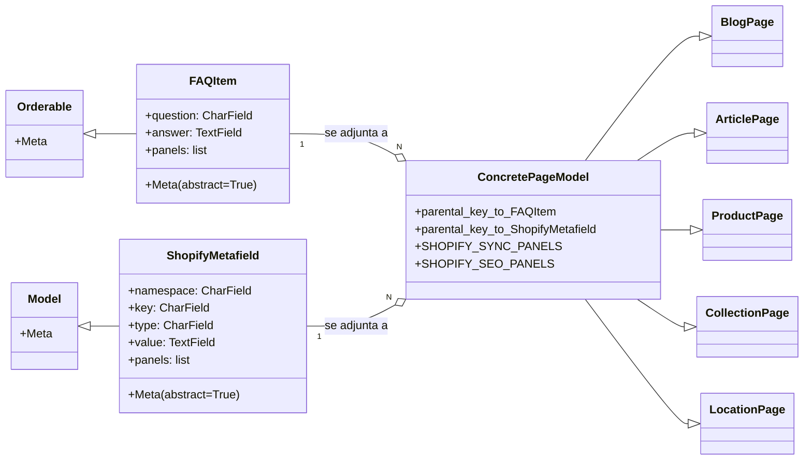
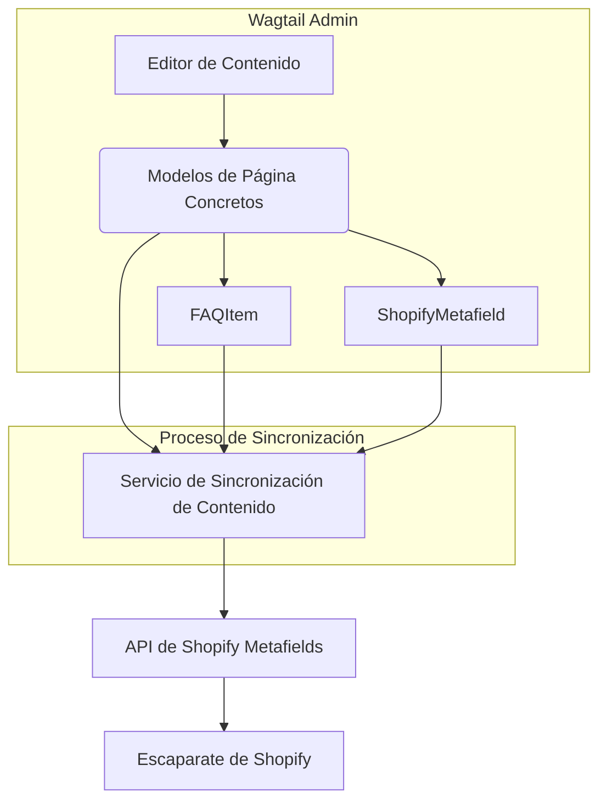

# Mixins Reutilizables de Modelos de Página de Contenido

Este módulo, `Shopify_Content_Management/Content_Page_Models/Content_Page_Models_Reusable_Mixins.md`, proporciona un conjunto de modelos abstractos (mixins) que encapsulan funcionalidades comunes necesarias para varias páginas de contenido dentro del sistema. Su propósito principal es fomentar la reutilización de código y mantener una estructura consistente para elementos como las Preguntas Frecuentes (FAQ) y los metafields de Shopify en diferentes tipos de página, facilitando la gestión y sincronización del contenido.

## Propósito y Funcionalidad Principal

El módulo `shopify_content/models/mixins.py` define dos mixins clave: `FAQItem` y `ShopifyMetafield`. Estos mixins están diseñados para ser heredados por modelos de página concretos, permitiendo que cada página extienda su funcionalidad sin duplicar código.

### `FAQItem`

La clase `FAQItem` es una entrada abstracta de Preguntas Frecuentes que se puede adjuntar a cualquier tipo de página de contenido.

*   **Campos**:
    *   `question` (CharField): La pregunta de la FAQ.
    *   `answer` (TextField): La respuesta a la pregunta.
*   **Paneles de Administración**: Utiliza `FieldPanel` para `question` y `answer`, lo que permite a los editores de Wagtail gestionar fácilmente las FAQs.
*   **Sincronización con Shopify**: Está diseñado para ser sincronizado con Shopify como un metafield `custom.faqs`, que es un array JSON que contiene las preguntas y respuestas.
*   **Reutilización**: Al ser una clase abstracta (`abstract = True`), las subclases concretas deben definir una `ParentalKey` que las vincule a su página padre, como se ve en modelos como `ArticlePageFAQ` o `LocationPageFAQ` (ver [Modelos de Páginas de Blog y Artículo](../Content_Page_Models/Content_Page_Models_Blog_and_Article_Pages.md) y [Modelos de Páginas de Ubicación](../Content_Page_Models/Content_Page_Models_Location_Pages.md)).

### `ShopifyMetafield`

La clase `ShopifyMetafield` sirve como base abstracta para filas de metafields en línea que se adjuntan a un tipo de página específico.

*   **Campos**:
    *   `namespace` (CharField): El namespace del metafield en Shopify (por defecto 'custom').
    *   `key` (CharField): La clave del metafield en Shopify.
    *   `type` (CharField): El tipo de metafield de Shopify (por defecto 'single_line_text_field'), con un texto de ayuda que explica los tipos posibles.
    *   `value` (TextField): El valor del metafield.
*   **Paneles de Administración**: Incluye `FieldPanel` para `namespace`, `key`, `type` y `value`, proporcionando una interfaz directa en el panel de administración de Wagtail para gestionar estos metafields.
*   **Mapeo a Shopify**: Se mapea directamente a `MetafieldsSetInput` de Shopify, lo que facilita la creación y actualización de metafields programáticamente.
*   **Reutilización**: Como clase abstracta, las subclases concretas definen una `ParentalKey` para establecer su relación con la página padre, permitiendo que diferentes tipos de páginas tengan sus propios conjuntos de metafields.

### Paneles Comunes en el Admin de Wagtail

El módulo también define dos listas de paneles reutilizables para el admin de Wagtail: `SHOPIFY_SYNC_PANELS` y `SHOPIFY_SEO_PANELS`. Estos paneles se importan y utilizan en los modelos de página para presentar una interfaz de usuario consistente en el editor de Wagtail.

*   `SHOPIFY_SYNC_PANELS`: Contiene campos relacionados con la sincronización con Shopify, como `shopify_id`, `handle`, `sync_enabled` y `last_synced_at`. También incluye un `StorefrontUrlsPanel` (definido en `shopify_content/admin_panels.py`) para gestionar las URLs del escaparate.
*   `SHOPIFY_SEO_PANELS`: Contiene campos para la optimización de motores de búsqueda, como `seo_title` y `search_description`, utilizando `AIDescriptionFieldPanel` para funcionalidades asistidas por IA en la descripción.

## Arquitectura y Relaciones entre Componentes

Estos mixins son componentes fundamentales en la estrategia de modelado de contenido, proporcionando una base extensible para varios tipos de páginas.

### Diagrama de Clases

**Explicación del Diagrama:**

*   `FAQItem` hereda de `Orderable` de Wagtail, lo que le permite mantener un orden dentro de una lista de FAQs en una página padre.
*   `ShopifyMetafield` hereda directamente de `django.db.models.Model`.
*   Ambos `FAQItem` y `ShopifyMetafield` son clases abstractas (indicado por `Meta(abstract=True)`), lo que significa que no se instancian directamente, sino que actúan como plantillas para otras clases.
*   `ConcretePageModel` representa cualquier modelo de página real (como `ArticlePage`, `ProductPage`, etc.) que utilizaría estos mixins. Estos modelos concretos establecerían una relación `ParentalKey` con las subclases concretas de `FAQItem` y `ShopifyMetafield` para formar una relación uno-a-muchos.
*   Los paneles `SHOPIFY_SYNC_PANELS` y `SHOPIFY_SEO_PANELS` se componen en los `ConcretePageModel` para estandarizar la interfaz de administración.

## Integración en el Sistema General

Los mixins `FAQItem` y `ShopifyMetafield` son fundamentales para la modularidad y la consistencia en el [Módulo de Gestión de Contenido de Shopify (Shopify_Content_Management)](../Shopify_Content_Management.md).

*   **Estandarización de Contenido**: Permiten que todas las [Modelos de Páginas de Contenido](./Content_Page_Models.md) compartan una estructura común para FAQs y metafields, lo que simplifica la creación y el mantenimiento de diferentes tipos de contenido.
*   **Sincronización con Shopify**: Facilita la comunicación con la plataforma Shopify. Por ejemplo, los `ShopifyMetafield` se mapean directamente a los metafields de Shopify, lo que es crucial para la integración con el [Conector de Metaobjects de Shopify](../../Shopify_Platform_Integrations/Shopify_Metaobjects_Connector.md). La estructura de `FAQItem` como un metafield JSON también asegura una representación consistente de las FAQs en Shopify.
*   **Experiencia de Usuario en Wagtail**: Al proporcionar paneles de administración reutilizables (`SHOPIFY_SYNC_PANELS`, `SHOPIFY_SEO_PANELS`), el sistema garantiza una experiencia de edición unificada y eficiente para los administradores de contenido en Wagtail. Estos paneles reducen la carga de trabajo al configurar la interfaz de usuario para cada nuevo tipo de página.

### Diagrama de Flujo de Datos (Conceptual)

**Explicación del Diagrama:**

1.  **Wagtail Admin**: Los editores de contenido interactúan con los modelos de página concretos en el administrador de Wagtail. Estos modelos componen o heredan las funcionalidades de `FAQItem` y `ShopifyMetafield`.
2.  **Proceso de Sincronización**: Cuando se guarda o publica una página, un servicio de sincronización de contenido (que forma parte del módulo [Shopify_Content_Management](../Shopify_Content_Management.md)) recopila los datos de los modelos de página, incluyendo las FAQs y los metafields.
3.  **API de Shopify**: El servicio de sincronización envía estos datos a la API de Shopify, mapeando los `FAQItem` a metafields JSON y los `ShopifyMetafield` a `MetafieldsSetInput`.
4.  **Escaparate de Shopify**: Una vez en Shopify, estos metafields están disponibles para ser utilizados por el escaparate (frontend) de la tienda.

Este módulo es un ejemplo clave de cómo se utiliza la abstracción y la herencia en el desarrollo de aplicaciones para construir un sistema de gestión de contenido robusto y fácil de mantener, con una fuerte integración con plataformas externas como Shopify.