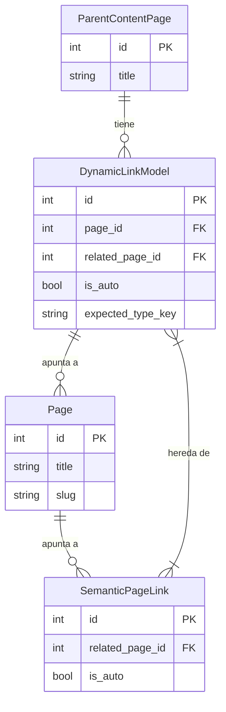
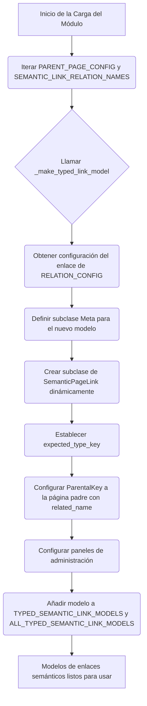
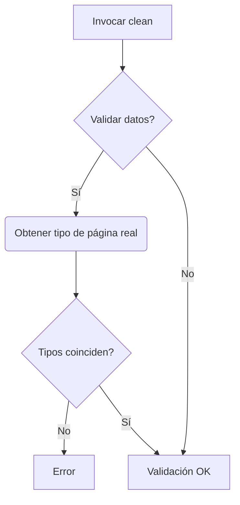

# Modelos de Enlaces Semánticos de Páginas de Contenido

Este módulo, `Content_Page_Models_Semantic_Links_Model`, define los modelos de datos para la gestión de enlaces semánticos internos entre las páginas de contenido en el sistema de gestión de contenido de Shopify. Estos enlaces son cruciales para establecer relaciones significativas entre diferentes piezas de contenido, mejorando la navegación, la relevancia del contenido y la optimización para motores de búsqueda (SEO).

Los enlaces semánticos pueden ser generados automáticamente por el sistema (por ejemplo, a través de algoritmos o servicios de contenido) o curados manualmente por los editores, ofreciendo flexibilidad y control sobre cómo se conecta el contenido.

## Componentes Principales

Los componentes centrales de este módulo son:

*   `SemanticPageLink`: El modelo base abstracto para todos los enlaces de páginas semánticos.
*   `SemanticPageLink.Meta`: La subclase Meta del modelo base, que define sus propiedades abstractas.

## Arquitectura y Relaciones de Componentes

### Clase Base `SemanticPageLink`

La clase `SemanticPageLink` (ubicada en `shopify_content/models/semantic_links.py`) sirve como el modelo base abstracto para todos los enlaces semánticos. Hereda de `wagtail.models.Orderable`, lo que permite que los enlaces relacionados con una página padre se ordenen de manera específica. Este modelo define las propiedades comunes a todos los enlaces semánticos:

*   **`related_page`**: Una clave foránea a `wagtailcore.Page` que apunta a la página de destino del enlace semántico.
*   **`is_auto`**: Un campo booleano que indica si el enlace fue creado automáticamente por un proceso de refresco semántico (`True`) o si fue curado manualmente por un editor (`False`).

El método `clean()` de `SemanticPageLink` realiza una validación importante para asegurar que la `related_page` apunte a un tipo de página esperado. Esta validación utiliza la función `page_type_key_for` del [servicio de enlaces semánticos](../Semantic_Links_Service.md) para determinar el tipo de la página relacionada y compararlo con el `expected_type_key` definido en la subclase específica del enlace.

### Creación Dinámica de Modelos de Enlaces Tipados

Una característica fundamental de este módulo es la creación dinámica de modelos de enlaces semánticos específicos. La función `_make_typed_link_model` actúa como una fábrica para generar subclases concretas de `SemanticPageLink` en tiempo de ejecución. Estas subclases especializadas se crean basándose en una configuración predefinida de tipos de páginas padre y nombres de relación.

Para cada combinación de una página padre (por ejemplo, `ArticlePage`, `CollectionPage`) y un tipo de relación (por ejemplo, `related_products`, `related_articles`), se genera un nuevo modelo. Estos modelos dinámicos incluyen:

*   **`expected_type_key`**: Una clave que representa el tipo de página que se espera que tenga la `related_page` (por ejemplo, "producto", "artículo").
*   **`page`**: Una `ParentalKey` al modelo de la página padre, estableciendo la relación inversa y permitiendo que Wagtail gestione los enlaces como elementos ordenables dentro de la página padre.
*   **`panels`**: Configuración para el panel de administración de Wagtail, utilizando `FieldPanel` para `related_page`.

Los modelos generados dinámicamente se almacenan en el diccionario `TYPED_SEMANTIC_LINK_MODELS` y en la lista `ALL_TYPED_SEMANTIC_LINK_MODELS`, lo que permite su recuperación y uso en otras partes del sistema.

### Diagrama ER: Modelo de Datos de Enlaces Semánticos

### Diagrama de Flujo: Creación Dinámica de Modelos

### Diagrama de Flujo: Proceso de Validación de Enlaces Semánticos

## Integración en el Sistema

Este módulo es fundamental para el funcionamiento del sistema de gestión de contenido, ya que permite establecer conexiones significativas entre diferentes tipos de páginas. A continuación, se detalla cómo se integra con otros componentes:

*   **[Modelos de Páginas de Contenido](../../Content_Page_Models.md)**: Los modelos de este módulo se utilizan para definir enlaces salientes desde diversas páginas de contenido, como [Páginas de Artículos y Blogs](../Content_Page_Models/Content_Page_Models_Blog_and_Article_Pages.md), [Páginas de Colecciones](../Content_Page_Models/Content_Page_Models_Collection_Pages.md), [Páginas de Términos de Glosario](../Content_Page_Models/Content_Page_Models_Glossary_Term_Pages.md) y [Páginas de Productos](../Content_Page_Models/Content_Page_Models_Product_Pages.md).

*   **[Servicio de Enlaces Semánticos](../../Semantic_Links_Service.md)**: El servicio (`shopify_content/semantic_links/service.py`) interactúa estrechamente con estos modelos, especialmente para la lógica de auto-generación y validación de enlaces. Funciones como `page_type_key_for` son consumidas directamente por los modelos de enlaces.

*   **Comandos de Gestión**: Varios [comandos de gestión](../../Management_Commands.md) interactúan con estos modelos para tareas como la reconstrucción de enlaces semánticos (`refresh_semantic_links_batch`) o la sincronización de revisiones (`sync_semantic_links_revisions`).

*   **API de Contenido**: La [API de Contenido](../../../Content_API.md) expone y consume enlaces semánticos a través de esquemas específicos (ver `api/schemas/semantic_links.py`), lo que permite que sistemas externos interactúen con esta funcionalidad.

## Funciones de Utilidad

El módulo también proporciona una serie de funciones de utilidad para trabajar con los enlaces semánticos:

*   **`get_typed_link_model(parent_page, relation_name: str)`**: Recupera un modelo de enlace tipado específico dado una página padre y un nombre de relación.
*   **`iter_semantic_link_relations(page)`**: Itera sobre los gestores de relaciones semánticas de una página.
*   **`iter_typed_link_models_for_page(page)`**: Itera sobre los modelos de enlaces tipados asociados a una página específica.
*   **`count_auto_semantic_links(page) -> int`**: Cuenta el número de enlaces semánticos generados automáticamente para una página.
*   **`delete_auto_semantic_links(page) -> int`**: Elimina todos los enlaces semánticos generados automáticamente para una página.
*   **`manual_related_page_pks(page) -> set[int]`**: Devuelve un conjunto de las claves primarias (PKs) de las páginas relacionadas manualmente para una página dada.
*   **`all_related_page_pks(page) -> set[int]`**: Devuelve un conjunto de las PKs de todas las páginas relacionadas (automáticas y manuales) para una página dada.
*   **`page_has_semantic_links(page) -> bool`**: Comprueba si una página tiene algún enlace semántico.
*   **`page_has_auto_semantic_links(page) -> bool`**: Comprueba si una página tiene enlaces semánticos generados automáticamente.
*   **`relation_for_page_type(type_key: str) -> str`**: Devuelve el nombre de la relación para una clave de tipo de página dada.
*   **`type_key_for_relation(relation_name: str) -> str`**: Devuelve la clave de tipo de página para un nombre de relación dado.
*   **`inbound_related_product_sources(product_page, *, limit_per_type: int, exclude_pks: set[int] | None = None) -> dict[str, list]`**: Identifica y devuelve las páginas que enlazan a una página de producto específica a través de la relación `related_products`, agrupadas por tipo de página (artículo, colección, glosario).