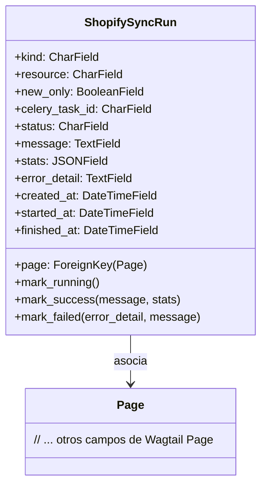
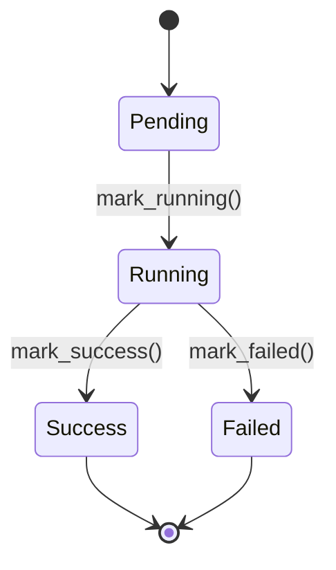

# Modelos de Ejecución de Sincronización de Shopify

Este módulo define el modelo `ShopifySyncRun`, que es fundamental para el seguimiento y la gestión de las operaciones de sincronización de datos entre Shopify y Wagtail. Proporciona una visión detallada del estado, los resultados y los errores de cada ejecución de sincronización, facilitando la depuración y el monitoreo.

## Propósito y Funcionalidad Principal

El modelo `ShopifySyncRun` tiene como objetivo registrar cada instancia de una operación de sincronización asíncrona entre el CMS de Wagtail y la plataforma Shopify. Estas operaciones pueden ser tanto de entrada (Shopify a Wagtail) como de salida (Wagtail a Shopify). Permite a los desarrolladores y mantenedores:

*   **Monitorear el progreso**: Seguir el estado actual de una sincronización (pendiente, en ejecución, éxito, fallo).
*   **Rastrear recursos**: Identificar qué tipo de recurso (productos, colecciones, blogs, etc.) se está sincronizando y, opcionalmente, la página específica de Wagtail asociada.
*   **Registrar resultados**: Almacenar mensajes, estadísticas y detalles de errores para cada ejecución.
*   **Auditoría**: Proporcionar un historial de todas las operaciones de sincronización, incluyendo cuándo se crearon, iniciaron y finalizaron.

## Arquitectura y Relaciones de Componentes

### Modelo `ShopifySyncRun`

El corazón de este módulo es la clase `ShopifySyncRun`, que es un modelo de Django que extiende `django.db.models.Model`. Contiene los siguientes campos clave:

*   `kind`: Define la dirección de la sincronización (`inbound` para Shopify → Wagtail o `outbound` para Wagtail → Shopify).
*   `resource`: Especifica el tipo de recurso de Shopify que se está sincronizando (por ejemplo, `products`, `collections`, `blogs`, o `all` para sincronizaciones de entrada completas).
*   `page`: Una `ForeignKey` opcional a `wagtail.models.Page`, vinculando la ejecución de sincronización a una página específica del CMS de Wagtail cuando sea relevante.
*   `new_only`: Un booleano que indica si la sincronización solo debe procesar elementos nuevos.
*   `celery_task_id`: El identificador de la tarea Celery que está ejecutando la sincronización, permitiendo el seguimiento del proceso asíncrono.
*   `status`: El estado actual de la sincronización (`pending`, `running`, `success`, `failed`).
*   `message`: Un campo de texto para mensajes informativos sobre la sincronización.
*   `stats`: Un campo `JSONField` para almacenar estadísticas detalladas de la ejecución (por ejemplo, número de elementos creados, actualizados, eliminados).
*   `error_detail`: Un campo de texto para almacenar detalles del error si la sincronización falla.
*   `created_at`, `started_at`, `finished_at`: Marcas de tiempo que registran el ciclo de vida de la ejecución de la sincronización.

### Relación con `wagtail.models.Page`

El modelo `ShopifySyncRun` puede estar directamente relacionado con una instancia de `wagtail.models.Page` a través de su campo `page`. Esto es útil cuando una operación de sincronización está específicamente dirigida o influenciada por una página particular en Wagtail, como la sincronización de contenido para una página de producto o blog específica. La eliminación de una página asociada establecerá este campo a `NULL`, preservando el registro de la sincronización.

### Flujo de Estados de Sincronización

El campo `status` es crucial para entender el ciclo de vida de una ejecución de sincronización. Las transiciones de estado se gestionan a través de métodos helper en el modelo:

*   `mark_running()`: Actualiza el estado a `running` y establece `started_at`.
*   `mark_success()`: Actualiza el estado a `success`, guarda un mensaje y estadísticas, borra cualquier `error_detail` previo y establece `finished_at`.
*   `mark_failed()`: Actualiza el estado a `failed`, guarda los detalles del error, opcionalmente un mensaje y establece `finished_at`.

### Integración con Celery

Las sincronizaciones entre Shopify y Wagtail son operaciones asíncronas, lo que significa que se ejecutan en segundo plano, típicamente utilizando una cola de tareas como Celery. El campo `celery_task_id` en el modelo `ShopifySyncRun` es la clave para esta integración, ya que almacena el ID único de la tarea Celery responsable de la ejecución de la sincronización. Esto permite que el sistema rastree la ejecución de la tarea externa y actualice el modelo `ShopifySyncRun` en consecuencia, reflejando el estado y los resultados de la tarea asíncrona.

## Diagramas

### Diagrama de Clases

*Diagrama 1: Relación entre ShopifySyncRun y Wagtail Page*

### Diagrama de Estados de Sincronización

*Diagrama 2: Ciclo de vida del estado de una Ejecución de Sincronización de Shopify*

## Cómo Encaja en el Sistema General

El módulo `Content_Page_Models_Shopify_Sync_Run_Models` es una parte integral de la funcionalidad de gestión de contenido de Shopify en Wagtail. Sirve como el registro histórico y el punto de monitoreo para todas las operaciones de sincronización que mantienen actualizados los datos entre ambas plataformas. Es utilizado por:

*   **Tareas de sincronización (Celery)**: Las tareas asíncronas de Celery que realizan la importación o exportación de datos de Shopify utilizan este modelo para registrar su progreso y resultados. Esto incluye comandos de gestión como `import_shopify_blogs` o `import_shopify_products` (ver [Comandos de Gestión](Management_Commands.md)).
*   **Panel de administración**: Los administradores pueden ver el historial de sincronizaciones y su estado a través de la interfaz de administración de Django/Wagtail. El [Panel de Administración](Admin_Interface.md) podría incluir una vista para este modelo, permitiendo la supervisión manual.
*   **Reportes y depuración**: Los datos almacenados en `ShopifySyncRun` son esenciales para generar informes sobre la calidad de los datos y para depurar problemas que puedan surgir durante las operaciones de sincronización.

Este modelo asegura la trazabilidad y la resiliencia del sistema de sincronización de contenido, permitiendo una gestión robusta de los datos entre Wagtail y Shopify. Forma parte de los [Modelos de Página de Contenido](Shopify_Content_Management/Content_Page_Models.md) dentro del módulo principal de [Gestión de Contenido de Shopify](Shopify_Content_Management.md).