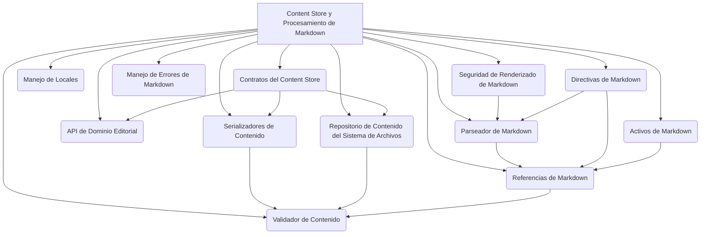

# Módulo Content Store y Procesamiento de Markdown

Este módulo es el núcleo para la gestión, almacenamiento y procesamiento del contenido editorial de Shopify. Define los contratos, implementaciones de almacenamiento y herramientas de procesamiento de Markdown para garantizar una gestión de contenido robusta y flexible.

## Propósito

El `Content_Store___Markdown_Processing` tiene como objetivo principal proporcionar una capa de abstracción para el almacenamiento y la manipulación del contenido editorial. Permite la serialización y deserialización de contenido, la resolución de referencias y la validación, asegurando la integridad y la consistencia del contenido en todo el sistema.

## Arquitectura General

El módulo se compone de varias sub-áreas clave, cada una con responsabilidades bien definidas:

*   **Repositorio de Contenido del Sistema de Archivos**: Implementa el almacenamiento físico del contenido editorial.
*   **Contratos del Content Store**: Define las interfaces y objetos de valor para la interacción con el almacén de contenido.
*   **API de Dominio Editorial**: Proporciona una interfaz canónica para acceder a los campos editoriales de las páginas.
*   **Manejo de Locales**: Centraliza la política de mapeo entre códigos de locale de Wagtail y segmentos de ruta de contenido.
*   **Activos de Markdown**: Define el contrato para referencias de activos y resoluciones de URL.
*   **Directivas de Markdown**: Maneja las directivas tipadas dentro del contenido Markdown.
*   **Manejo de Errores de Markdown**: Define excepciones específicas para errores durante el procesamiento de Markdown.
*   **Parseador de Markdown**: Proporciona una forma de inspeccionar la estructura de Markdown sin emitir HTML.
*   **Referencias de Markdown**: Extrae y resuelve referencias tipadas del contenido Markdown.
*   **Seguridad de Renderizado de Markdown**: Aplica perfiles de seguridad al HTML renderizado desde Markdown.
*   **Serializadores de Contenido**: Se encarga de la serialización y deserialización del contenido editorial.
*   **Validador de Contenido**: Realiza una validación determinista del árbol de contenido editorial desplegado.

## Sub-módulos

A continuación, se detallan los sub-módulos que componen `Content_Store___Markdown_Processing`:

*   [Repositorio del Sistema de Archivos](Content_Store___Markdown_Processing/Content_Store___Markdown_Processing_Filesystem_Repository.md)
*   [Contratos del Content Store](Content_Store___Markdown_Processing/Content_Store___Markdown_Processing_Contracts.md)
*   [API de Dominio Editorial](Content_Store___Markdown_Processing/Content_Store___Markdown_Processing_Domain_API.md)
*   [Manejo de Locales](Content_Store___Markdown_Processing/Content_Store___Markdown_Processing_Locales.md)
*   [Activos de Markdown](Content_Store___Markdown_Processing/Content_Store___Markdown_Processing_Markdown_Assets.md)
*   [Directivas de Markdown](Content_Store___Markdown_Processing/Content_Store___Markdown_Processing_Markdown_Directives.md)
*   [Errores de Markdown](Content_Store___Markdown_Processing/Content_Store___Markdown_Processing_Markdown_Errors.md)
*   [Parseador de Markdown](Content_Store___Markdown_Processing/Content_Store___Markdown_Processing_Markdown_Parser.md)
*   [Referencias de Markdown](Content_Store___Markdown_Processing/Content_Store___Markdown_Processing_Content_Store___Markdown_Processing_Markdown_References.md)
*   [Seguridad de Renderizado de Markdown](Content_Store___Markdown_Processing/Content_Store___Markdown_Processing_Markdown_Security.md)
*   [Serializadores de Contenido](Content_Store___Markdown_Processing/Content_Store___Markdown_Processing_Serializers.md)
*   [Validador de Contenido](Content_Store___Markdown_Processing/Content_Store___Markdown_Processing_Content_Store___Markdown_Processing_Validation_Runner.md)
