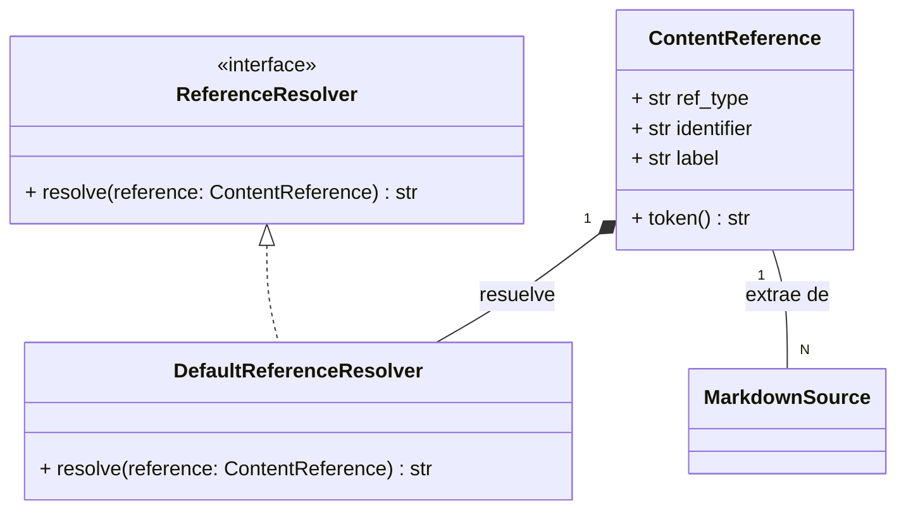

# Referencias de Markdown

Este módulo, `shopify_content/content_store/markdown/references.py`, es fundamental para gestionar las referencias estables y tipadas que se extraen de las directivas de Markdown dentro del sistema de gestión de contenido de Shopify. Proporciona las herramientas necesarias para identificar, representar y resolver enlaces a diversos tipos de contenido, como productos, colecciones, páginas y activos.

## Propósito y Funcionalidad Principal

El módulo se encarga de:
1.  **Definir un token de referencia de dominio (`ContentReference`)**: Una representación abstracta de un recurso de contenido, desacoplada de su URL final de storefront.
2.  **Establecer un contrato para la resolución de referencias (`ReferenceResolver`)**: Permite que diferentes implementaciones conviertan `ContentReference` en URLs de storefront o fragmentos HTML.
3.  **Proporcionar una implementación predeterminada para la resolución de referencias (`DefaultReferenceResolver`)**: Ofrece una forma básica de transformar los tokens de referencia en rutas URL.
4.  **Extraer referencias de texto Markdown**: Analiza el contenido de Markdown para identificar y extraer todas las `ContentReference` presentes.

Este mecanismo es crucial para mantener la integridad de los enlaces dentro del contenido, permitiendo que las referencias se definan de manera lógica y luego se resuelvan dinámicamente a las URLs correctas durante el renderizado o la publicación.

## Arquitectura y Relaciones de Componentes

Los componentes clave de este módulo interactúan de la siguiente manera:

### Componentes Core

#### `ContentReference`

`ContentReference` es un dataclass inmutable que representa un token de referencia de dominio. No es una URL de despliegue, sino una abstracción del recurso al que se hace referencia.

*   **`ref_type`**: El tipo de referencia (ej. `"product"`, `"collection"`, `"page"`, `"asset"`, `"callout"`).
*   **`identifier`**: El identificador único del recurso dentro de su `ref_type` (ej. un handle de producto, una ruta de página, un nombre de activo).
*   **`label`**: Una etiqueta opcional asociada a la referencia.
*   **`token()`**: Un método que devuelve una representación en cadena del token de referencia, útil para la serialización o almacenamiento (ej. `"asset:my_image.png"`).

#### `ReferenceResolver`

`ReferenceResolver` es un protocolo (`typing.Protocol`) que define una interfaz para resolver una `ContentReference` en una URL de storefront o un fragmento HTML. Cualquier clase que implemente este protocolo puede actuar como un resolvedor de referencias.

*   **`resolve(self, reference: ContentReference) -> str`**: El método principal que toma una `ContentReference` y devuelve su representación URL o fragmento HTML.

#### `DefaultReferenceResolver`

`DefaultReferenceResolver` es una implementación concreta del protocolo `ReferenceResolver`. Este resolvedor incorporado proporciona una lógica básica para convertir los tipos de referencia comunes (producto, colección, página, activo) en sus rutas de URL correspondientes sin depender de un ORM de Django u otras integraciones.

*   **`resolve(self, reference: ContentReference) -> str`**:
    *   Para `product`: devuelve `/products/{identifier}`.
    *   Para `collection`: devuelve `/collections/{identifier}`.
    *   Para `page`: devuelve `/{identifier}` (añade una barra inicial si no la tiene).
    *   Para `asset`: devuelve `/cdn/assets/{identifier}`.
    *   Para otros tipos, devuelve una cadena vacía.

### Funciones de Utilidad

#### `_refs_from_component(kind: str, attrs: dict[str, str]) -> Optional[ContentReference]`

Esta función auxiliar intenta extraer una `ContentReference` de los atributos de una directiva de componente de Markdown. Analiza los atributos `ref`, `handle`, o `path` para construir la referencia.

#### `extract_references(source: str) -> tuple[ContentReference, ...]`

Esta función es el núcleo de la extracción de referencias. Analiza una cadena de origen Markdown para encontrar todas las directivas de componente, directivas de `callout` y referencias de activos (`asset:`) incrustadas, y las convierte en una tupla de objetos `ContentReference`.

#### `extract_reference_tokens(source: str) -> tuple[str, ...]`

Una función de conveniencia que utiliza `extract_references` y luego devuelve una tupla de las representaciones en cadena (`token()`) de todas las referencias encontradas.

## Cómo el Módulo Encaja en el Sistema General

Este módulo es una parte integral del subsistema [Content_Store___Markdown_Processing](../Content_Store___Markdown_Processing.md) dentro de [Shopify_Content_Management](../../Shopify_Content_Management.md). Su función principal es proporcionar una capa de abstracción para las referencias de contenido dentro del Markdown, lo que permite:

*   **Desacoplamiento**: El contenido de Markdown puede hacer referencia a otros elementos de la tienda (productos, colecciones, páginas, activos) utilizando identificadores lógicos en lugar de URLs codificadas. Esto hace que el contenido sea más portátil y menos propenso a errores cuando cambian las estructuras de URL.
*   **Resolución dinámica**: Los `ReferenceResolver`s permiten que las URLs reales se generen en tiempo de ejecución, lo que puede tener en cuenta factores como el entorno de despliegue, la configuración de la tienda o las optimizaciones de CDN.
*   **Análisis y Validación**: Al extraer referencias tipadas, el sistema puede analizar y validar las dependencias del contenido, lo cual es fundamental para el mantenimiento, la detección de enlaces rotos y la creación de índices de contenido.

Las referencias extraídas por este módulo se pueden utilizar en procesos como la construcción de un [Content Index](../../Content_Page_Models/Content_Page_Models_Content_Indexing_Models.md) para búsquedas o para la resolución de URLs en el frontend. La flexibilidad proporcionada por `ReferenceResolver` permite que el sistema se adapte a diferentes necesidades de resolución, por ejemplo, resolviendo a URLs de desarrollo frente a URLs de producción, o integrándose con servicios de CDN específicos para activos.
