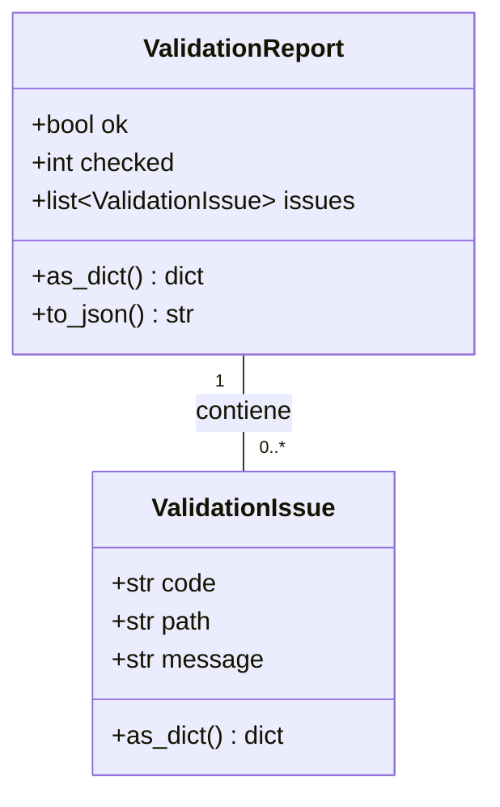
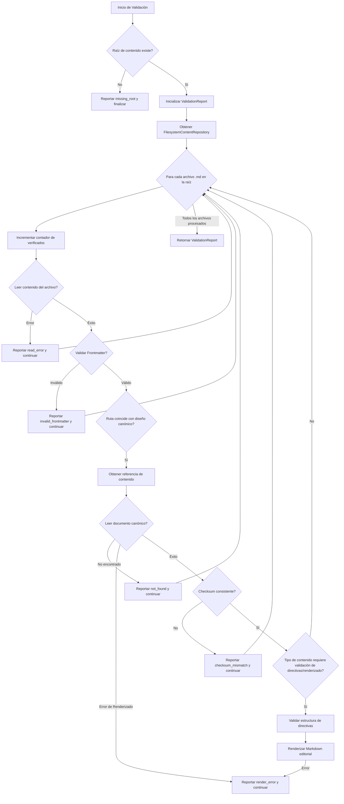

# Módulo Content_Store___Markdown_Processing_Validation_Runner

Este módulo, `shopify_content/content_store/validation_runner.py`, es fundamental para la validación determinista del árbol de contenido editorial desplegado. Proporciona las herramientas necesarias para identificar y reportar problemas en la estructura y el contenido de los archivos Markdown, asegurando la integridad y la calidad del contenido.

## Componentes Principales

### Clase `ValidationIssue`

La clase `ValidationIssue` representa un único problema de validación encontrado durante la verificación del contenido. Cada instancia encapsula detalles específicos sobre el error.

```python
@dataclass
class ValidationIssue:
    code: str
    path: str
    message: str

    def as_dict(self) -> dict[str, str]:
        return {"code": self.code, "path": self.path, "message": self.message}
```

**Atributos:**

*   `code` (str): Un código identificador del tipo de problema (ej. "missing_root", "read_error", "invalid_frontmatter", "checksum_mismatch", "not_found", "render_error").
*   `path` (str): La ruta relativa del archivo donde se encontró el problema.
*   `message` (str): Una descripción detallada del problema.

**Métodos:**

*   `as_dict()`: Devuelve una representación del problema como un diccionario, útil para serialización o logging.

### Clase `ValidationReport`

La clase `ValidationReport` consolida todos los problemas de validación encontrados durante una ejecución, junto con un resumen del estado general de la validación.

```python
@dataclass
class ValidationReport:
    ok: bool
    checked: int = 0
    issues: list[ValidationIssue] = field(default_factory=list)

    def as_dict(self) -> dict[str, Any]:
        return {
            "ok": self.ok,
            "checked": self.checked,
            "issues": [i.as_dict() for i in self.issues],
        }

    def to_json(self) -> str:
        return json.dumps(self.as_dict(), indent=2, sort_keys=True)
```

**Atributos:**

*   `ok` (bool): Un indicador booleano que es `True` si no se encontraron problemas críticos, `False` en caso contrario.
*   `checked` (int): El número total de archivos de contenido verificados.
*   `issues` (list[ValidationIssue]): Una lista de objetos `ValidationIssue` que describen cada problema encontrado.

**Métodos:**

*   `as_dict()`: Devuelve una representación del informe como un diccionario.
*   `to_json()`: Serializa el informe completo a una cadena JSON formateada.

### Función `validate_content_tree`

La función `validate_content_tree` es la lógica principal del módulo, encargada de recorrer un directorio raíz de contenido y realizar una serie de validaciones en cada archivo Markdown encontrado.

```python
def validate_content_tree(root: str | Path) -> ValidationReport:
    # ... implementación ...
```

Esta función realiza las siguientes validaciones:

1.  **Existencia de la raíz**: Verifica que la ruta raíz proporcionada exista y sea un directorio.
2.  **Lectura de archivos**: Intenta leer cada archivo Markdown en el árbol de contenido.
3.  **Frontmatter**: Valida la estructura del frontmatter de cada archivo utilizando `split_frontmatter` del módulo [Content_Store___Markdown_Processing_Serializers](../Content_Store___Markdown_Processing_Serializers.md).
4.  **Referencias Canónicas y Checksum**: Si la ruta del archivo coincide con un diseño canónico, intenta leer el documento canónico usando `FilesystemContentRepository` (ver [Content_Store___Markdown_Processing_Filesystem_Repository](../Content_Store___Markdown_Processing_Filesystem_Repository.md)) y verifica la consistencia del checksum.
5.  **Estructura de Directivas y Renderizado de Markdown**: Para ciertos tipos de contenido (ej. `articlepage` con `field_key == "body"`), valida la estructura de las directivas Markdown usando `validate_directive_structure` y renderiza el Markdown con `render_editorial_markdown` para detectar posibles errores de renderizado. Estos componentes se encuentran en el módulo principal [Content_Store___Markdown_Processing](../Content_Store___Markdown_Processing.md) bajo `markdown/validation.py` y `markdown/renderer.py`.

## Arquitectura y Relaciones

### Diagrama de Clases



### Diagrama de Flujo del Proceso de Validación



### Diagrama de Dependencias

```mermaid
graph TD
    subgraph shopify_content/content_store/validation_runner.py
        ValidationRunner[ValidationRunner]
    end

    subgraph shopify_content/content_store
        FilesystemContentRepository
        ContentNotFound
        InvalidEditorialFrontmatter
    end

    subgraph shopify_content/content_store/markdown
        MarkdownRenderError
        render_editorial_markdown
        validate_directive_structure
    end

    subgraph shopify_content/content_store/serializers
        split_frontmatter
    end

    ValidationRunner --> FilesystemContentRepository
    ValidationRunner --> ContentNotFound
    ValidationRunner --> InvalidEditorialFrontmatter
    ValidationRunner --> MarkdownRenderError
    ValidationRunner --> render_editorial_markdown
    ValidationRunner --> validate_directive_structure
    ValidationRunner --> split_frontmatter
    ValidationRunner --> _ref_from_relative[shopify_content/content_store/content_index_service.py::_ref_from_relative]

    click FilesystemContentRepository "Shopify_Content_Management/Content_Store___Markdown_Processing/Content_Store___Markdown_Processing_Filesystem_Repository.md"
    click split_frontmatter "Shopify_Content_Management/Content_Store___Markdown_Processing/Content_Store___Markdown_Processing_Serializers.md"
    click InvalidEditorialFrontmatter "Shopify_Content_Management/Content_Store___Markdown_Processing/Content_Store___Markdown_Processing_Contracts.md"
    click ContentNotFound "Shopify_Content_Management/Content_Store___Markdown_Processing/Content_Store___Markdown_Processing_Contracts.md"
    click MarkdownRenderError "Shopify_Content_Management/Content_Store___Markdown_Processing/Content_Store___Markdown_Processing_Markdown_Errors.md"
    linkStyle 0 stroke:#000,stroke-width:1px;
```



## Integración con el Sistema General

El `ValidationRunner` se integra en el flujo de gestión de contenido como un paso crucial para asegurar la calidad y consistencia del contenido editorial. Es probable que se utilice en flujos de CI/CD (Integración Continua/Despliegue Continuo) o como parte de comandos de gestión para verificar el contenido antes de su despliegue o después de una actualización. Un ejemplo de su uso en CI se puede ver en el archivo `.github/workflows/content-validate.yml`.

### Ejemplo de CI/CD

El archivo `.github/workflows/content-validate.yml` define un flujo de trabajo de GitHub Actions que ejecuta el comando de validación de contenido. Esto asegura que cualquier cambio en el contenido del repositorio sea validado automáticamente para detectar problemas antes de la integración.

Para ver el contenido de este archivo, puedes usar:
```bash
str_replace_editor view --working_dir repo --path .github/workflows/content-validate.yml
```

Este módulo es una parte vital del proceso de control de calidad del contenido, apoyando a los desarrolladores y mantenedores en la creación y mantenimiento de un árbol de contenido robusto y libre de errores.