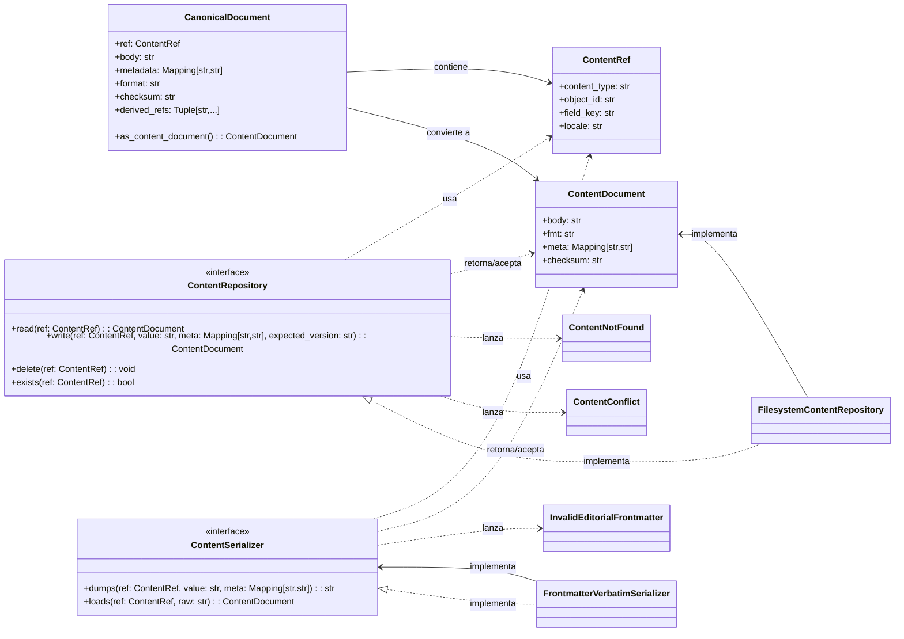
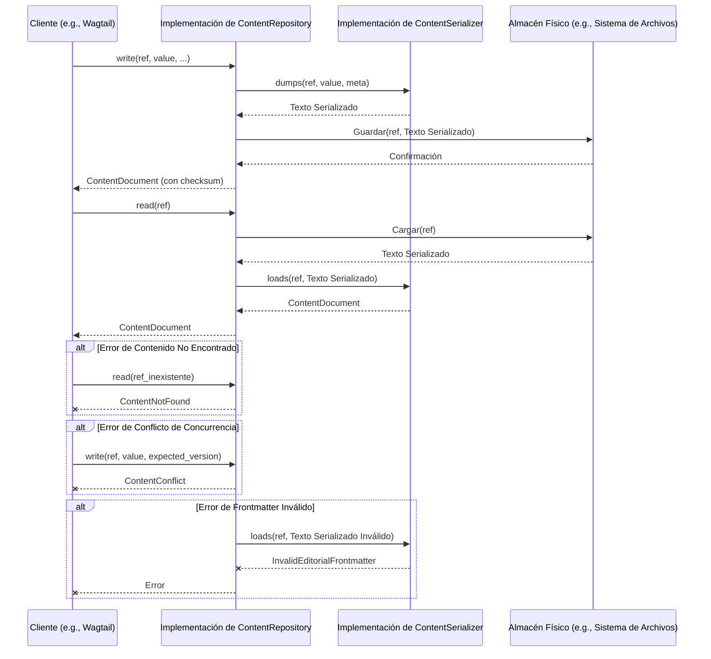

# Contratos del Procesamiento de Markdown y Almacén de Contenido

Este módulo, `shopify_content/content_store/contracts.py`, define los contratos fundamentales (interfaces y objetos de valor) para el almacén de contenido editorial y el procesamiento de Markdown. Su propósito principal es establecer un conjunto de abstracciones que permiten una interacción desacoplada con diferentes backends de almacenamiento y mecanismos de serialización de contenido. Este módulo no contiene ninguna lógica de backend; en su lugar, define cómo otros componentes deben interactuar con el almacenamiento y la serialización del contenido.

## Componentes Principales

Los siguientes son los componentes clave definidos en este módulo:

### `ContentRef`

`ContentRef` es un objeto de valor inmutable que proporciona una referencia determinista y estable a una carga útil editorial específica. Se deriva exclusivamente de la identidad duradera de la base de datos (tipo de contenido + clave primaria + campo + localización). Intencionalmente, no lleva la ruta física o el slug, ya que estos pueden cambiar, mientras que la identidad debe permanecer constante.

**Uso principal:** Identificación única y persistente de contenido dentro del sistema.

### `ContentDocument`

`ContentDocument` representa una vista normalizada e independiente del backend de una carga útil editorial. Contiene el cuerpo del contenido (valor de dominio), el formato (por ejemplo, "markdown" o "json"), metadatos opcionales y un checksum para la verificación de la integridad y la detección de desajustes entre la fila autoritativa de la base de datos y su espejo. Los consumidores operan sobre los valores de dominio (`body`), nunca sobre el formato de archivo subyacente.

**Uso principal:** Representación unificada del contenido para el procesamiento interno.

### `CanonicalDocument`

`CanonicalDocument` es un documento de dominio que está ligado a un `ContentRef`. Representa la capa "Git-nativa" del contenido, incluyendo el cuerpo, metadatos, formato, checksum y referencias derivadas (`derived_refs`) que se extraen cuando el cuerpo es parseado (por ejemplo, directivas de artículo). Proporciona una vista `as_content_document()` para compatibilidad con versiones anteriores.

**Uso principal:** Gestión de documentos de contenido en un contexto donde las referencias y la estructura son importantes, como en sistemas de control de versiones o generación de archivos.

### `ContentRepository` (Protocolo)

`ContentRepository` es un protocolo que define la interfaz para las operaciones de almacenamiento de contenido. Las implementaciones de este protocolo son responsables de leer, escribir, eliminar y verificar la existencia de documentos de contenido. Es crucial que las implementaciones de este protocolo no tengan conocimiento de los modelos de Django, manteniendo una clara separación de responsabilidades.

**Métodos clave:**
*   `read(ref: ContentRef)`: Recupera un `ContentDocument` dado un `ContentRef`, o lanza `ContentNotFound`.
*   `write(ref: ContentRef, value: str, *, meta: Optional[Mapping[str, str]] = None, expected_version: Optional[str] = None)`: Persiste el valor del contenido y devuelve el documento escrito. Puede lanzar `ContentConflict`.
*   `delete(ref: ContentRef)`: Elimina el documento de contenido.
*   `exists(ref: ContentRef)`: Verifica la existencia de un documento.

**Implementaciones:** Un ejemplo de implementación es `FilesystemContentRepository`, que se encuentra en [shopify_content/content_store/backends.py](../Content_Store___Markdown_Processing_Filesystem_Repository.md).

### `ContentSerializer` (Protocolo)

`ContentSerializer` es un protocolo que define la interfaz para serializar y deserializar valores de dominio de contenido. Cada implementación se encarga de un formato específico (por ejemplo, Markdown o JSON).

**Métodos clave:**
*   `dumps(ref: ContentRef, value: str, *, meta: Mapping[str, str]) -> str`: Serializa un valor de dominio a texto de archivo.
*   `loads(ref: ContentRef, raw: str) -> ContentDocument`: Parsea texto de archivo de vuelta a un `ContentDocument`.

**Implementaciones:** Un ejemplo de implementación es `FrontmatterVerbatimSerializer`, que se encuentra en [shopify_content/content_store/serializers.py](../Content_Store___Markdown_Processing_Serializers.md).

### Excepciones

*   **`ContentNotFound`**: Se lanza cuando una referencia de contenido no tiene un documento almacenado.
*   **`ContentConflict`**: Se lanza en caso de una discrepancia de concurrencia optimista (por ejemplo, `expected_version` no coincide).
*   **`InvalidEditorialFrontmatter`**: Se lanza cuando el frontmatter YAML está presente pero no puede ser parseado correctamente.

## Arquitectura y Relaciones de Componentes

Este módulo actúa como la capa de contrato para el almacén de contenido, definiendo cómo los datos son representados e interactuados. La separación entre los contratos y las implementaciones permite la flexibilidad para cambiar los backends de almacenamiento o los formatos de serialización sin afectar la lógica central del negocio.

## Flujo de Datos y Componentes Relacionados

El siguiente diagrama ilustra cómo los diferentes componentes interactúan utilizando los contratos definidos en este módulo.

## Integración en el Sistema General

Los contratos definidos en este módulo son fundamentales para la gestión de contenido en `Shopify_Content_Management`. Proporcionan una interfaz limpia y desacoplada para interactuar con el contenido, lo que permite a otras partes del sistema, como las interfaces de usuario (e.g., Wagtail), las tareas de sincronización o las APIs, manipular el contenido sin preocuparse por los detalles de implementación subyacentes.

Este diseño fomenta la intercambiabilidad de los backends de almacenamiento de contenido (por ejemplo, un sistema de archivos, una base de datos o un servicio en la nube) y los formatos de serialización (Markdown, JSON, etc.), lo que contribuye a un sistema robusto y mantenible. Constituyen la base sobre la cual se construyen los accesores de dominio, como `EditorialAccessor` y `EditorialMixin` ([shopify_content/content_store/domain.py](../Content_Store___Markdown_Processing_Domain_API.md)), que encapsulan la lógica de negocio para operar sobre este contenido abstracto.

Para más detalles sobre las implementaciones específicas de estos contratos, consulte:

*   [Backends del Almacén de Contenido](Content_Store___Markdown_Processing_Filesystem_Repository.md)
*   [Serializadores de Contenido](Content_Store___Markdown_Processing_Serializers.md)
*   [API de Dominio del Almacén de Contenido](Content_Store___Markdown_Processing_Domain_API.md)
