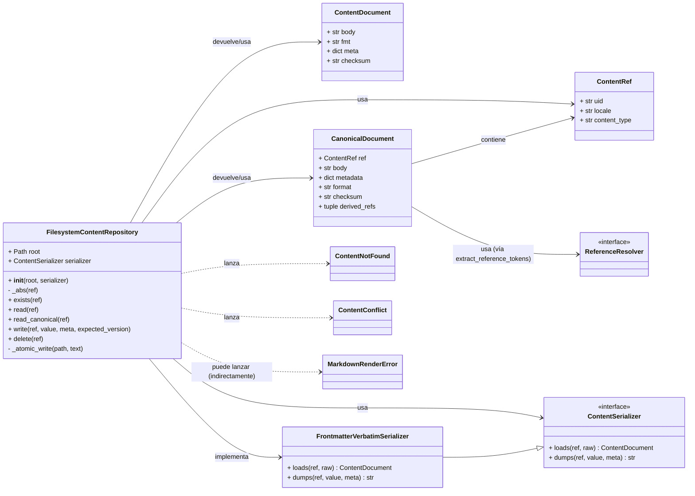
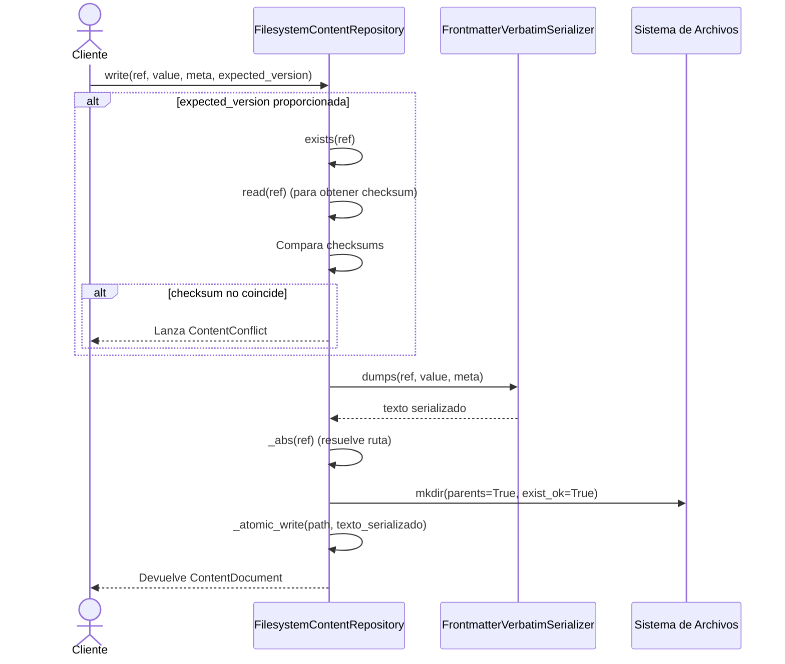

# Repositorio del Sistema de Archivos para el Almacenamiento y Procesamiento de Contenido Markdown

El módulo `Content_Store___Markdown_Processing_Filesystem_Repository` proporciona una implementación de repositorio de contenido basada en el sistema de archivos para almacenar y gestionar el contenido editorial en formato Markdown. Este repositorio opera con los conceptos de `ContentRef` y texto serializado, actuando como un espejo del contenido que puede ser considerado autoritativo en otras fases del sistema (e.g., base de datos).

## Funcionalidad Principal

El `FilesystemContentRepository` es responsable de las operaciones CRUD (Crear, Leer, Actualizar, Eliminar) de los documentos de contenido en el sistema de archivos. Utiliza una estrategia de escritura atómica para garantizar la integridad de los datos.

### `FilesystemContentRepository`

Almacena cada carga útil editorial como un archivo bajo un directorio raíz especificado. Soporta serialización de frontmatter y detección de conflictos de versión.

#### Métodos Clave:

*   `__init__(self, root: os.PathLike | str, serializer=None)`:
    Inicializa el repositorio con un directorio `root` y un `serializer` opcional. El directorio raíz se resuelve a una ruta absoluta.

*   `_abs(self, ref: ContentRef) -> Path`:
    Método interno que convierte un `ContentRef` en una ruta de sistema de archivos absoluta y resuelve la ruta. Incluye una defensa en profundidad para asegurar que la ruta resuelta permanezca dentro del directorio raíz del contenido.

*   `exists(self, ref: ContentRef) -> bool`:
    Verifica si un documento de contenido identificado por `ContentRef` existe en el sistema de archivos.

*   `read(self, ref: ContentRef) -> ContentDocument`:
    Lee un documento de contenido del sistema de archivos y lo devuelve como un objeto `ContentDocument`. Si el archivo no se encuentra, levanta un `ContentNotFound`.

*   `read_canonical(self, ref: ContentRef) -> CanonicalDocument`:
    Lee un documento de contenido y devuelve su representación canónica como un `CanonicalDocument`, incluyendo el cuerpo, metadatos, formato, checksum y referencias derivadas extraídas del cuerpo del Markdown.

*   `write(self, ref: ContentRef, value: str, *, meta: Optional[Mapping[str, str]] = None, expected_version: Optional[str] = None) -> ContentDocument`:
    Escribe un documento de contenido en el sistema de archivos. Permite especificar metadatos y una `expected_version` para controlar los conflictos de concurrencia. Si `expected_version` no coincide con la versión actual almacenada, levanta un `ContentConflict`.

*   `delete(self, ref: ContentRef) -> None`:
    Elimina un documento de contenido del sistema de archivos. Ignora `FileNotFoundError` si el archivo ya no existe.

*   `_atomic_write(path: Path, text: str) -> None`:
    Método estático interno que realiza una escritura atómica. Escribe el contenido en un archivo temporal en el mismo directorio y luego lo reemplaza con el archivo de destino para evitar estados inconsistentes durante la escritura.

## Arquitectura y Relaciones entre Componentes

El `FilesystemContentRepository` es un componente central en la gestión de contenido, interactuando con varias abstracciones de contrato y utilidades de serialización y referencia.

### Diagrama de Clases

### Diagrama de Flujo de Datos para la Operación de Escritura

## Cómo encaja en el Sistema General

El `FilesystemContentRepository` sirve como un backend de almacenamiento concreto para el contenido editorial dentro del módulo [Shopify_Content_Management](Shopify_Content_Management.md). Proporciona una forma fiable y eficiente de persistir el contenido Markdown en el sistema de archivos local, con soporte para metadatos y control de versiones básico a través de checksums.

Este repositorio implementa la interfaz `ContentRepository` (definida en [Content_Store___Markdown_Processing/Content_Store___Markdown_Processing_Contracts.md](Content_Store___Markdown_Processing/Content_Store___Markdown_Processing_Contracts.md)), lo que permite que el resto del sistema interactúe con el almacenamiento de contenido de una manera desacoplada. Es crucial para el proceso de materialización y serialización del contenido Markdown, trabajando en conjunto con el [Content_Store___Markdown_Processing/Content_Store___Markdown_Processing_Serializers.md](Content_Store___Markdown_Processing/Content_Store___Markdown_Processing_Serializers.md) para manejar el formato de los archivos.

Además, durante la lectura canónica, el repositorio intenta extraer referencias del cuerpo del contenido utilizando `extract_reference_tokens` del módulo [Content_Store___Markdown_Processing/Content_Store___Markdown_Processing_Markdown_References.md](Content_Store___Markdown_Processing/Content_Store___Markdown_Processing_Markdown_References.md), lo que indica su papel en la indexación y el mantenimiento de la integridad referencial del contenido. Esto es fundamental para construir un grafo de contenido interconectado.