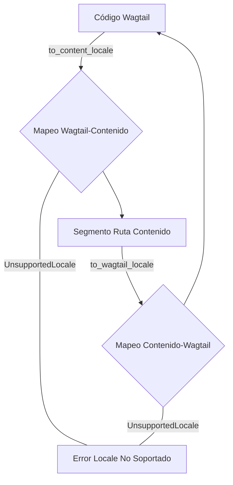

# Gestión de Locales para Procesamiento de Markdown en el Almacén de Contenido

Este módulo (`shopify_content/content_store/locales.py`) es el punto central para gestionar la política de asignación de locales a rutas de contenido dentro del sistema de gestión de contenido. Su propósito principal es normalizar los códigos de locales de Wagtail (por ejemplo, `en-US`) a segmentos de rutas de contenido en minúsculas y con guiones (por ejemplo, `en-us`), asegurando una coherencia en la estructura del contenido basado en Git.

## Componentes Principales

### `UnsupportedLocale`

`UnsupportedLocale` es una excepción que se lanza cuando se intenta utilizar un código de local que no tiene una asignación configurada para una ruta de contenido. Esto garantiza que solo los locales predefinidos y soportados se utilicen para la gestión del contenido.

### Asignación de Locales

El módulo define dos mapeos clave para la conversión entre códigos de local de Wagtail y segmentos de ruta de contenido:

*   `_WAGTAIL_TO_CONTENT`: Un diccionario que mapea códigos de local de Wagtail (ej. `en-US`) a sus correspondientes segmentos de ruta de contenido (ej. `en-us`). Este mapeo refleja los locales de storefront soportados, tal como se configuran en `config.settings.WAGTAIL_CONTENT_LANGUAGES`.
*   `_CONTENT_TO_WAGTAIL`: La inversa de `_WAGTAIL_TO_CONTENT`, mapeando segmentos de ruta de contenido a códigos de local de Wagtail.

#### Funciones de Utilidad

*   `supported_wagtail_locales() -> tuple[str, ...]`: Retorna una tupla de todos los códigos de local de Wagtail soportados.
*   `supported_content_locales() -> tuple[str, ...]`: Retorna una tupla de todos los segmentos de ruta de contenido soportados.
*   `to_content_locale(wagtail_code: str) -> str`: Convierte un código de local de Wagtail a su segmento de ruta de contenido correspondiente. Lanza `UnsupportedLocale` si el código de Wagtail no está soportado.
*   `to_wagtail_locale(content_code: str) -> str`: Convierte un segmento de ruta de contenido a su código de local de Wagtail correspondiente. Lanza `UnsupportedLocale` si el segmento de contenido no está mapeado a un local de Wagtail.

## Arquitectura y Relaciones

El módulo `locales.py` actúa como una capa de abstracción para la gestión de locales, desacoplando la representación de los locales en Wagtail de la forma en que se estructuran en el almacén de contenido.

### Diagrama de Flujo de Datos para la Conversión de Locales

### Cómo Encaja en el Sistema General

Este módulo es fundamental para la localización del contenido dentro del ecosistema de Shopify Content Management. Proporciona la lógica necesaria para garantizar que el contenido almacenado en el [Repositorio de Contenido del Sistema de Archivos](../Content_Store___Markdown_Processing/Content_Store___Markdown_Processing_Filesystem_Repository.md) sea accesible y gestionable por Wagtail utilizando convenciones de locales estandarizadas.

Se utiliza en componentes que necesitan resolver rutas de archivos de contenido basadas en locales o convertir de nuevo a locales de Wagtail para su visualización o procesamiento, como en la serialización y validación de contenido. Se integra con la lógica del [Domain API](../Content_Store___Markdown_Processing/Content_Store___Markdown_Processing_Domain_API.md) para acceder y manipular el contenido editorial, y potencialmente en procesos que gestionan los [Modelos de Páginas de Contenido](../../Content_Page_Models.md) donde la localización es un factor.
