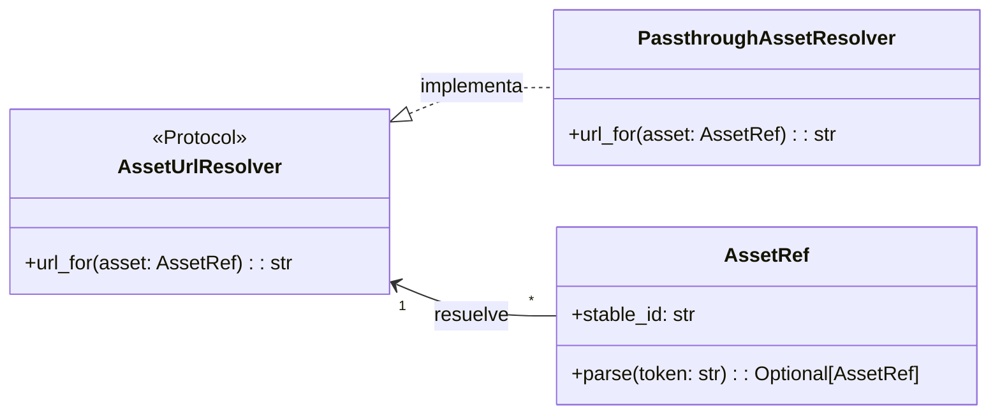

# Procesamiento de Markdown en el Almacén de Contenido - Activos Markdown

Este módulo, `shopify_content/content_store/markdown/assets.py`, es responsable de gestionar las referencias a activos incrustados dentro del contenido Markdown. Su objetivo principal es desacoplar la forma en que se referencian los activos (`asset:<id-estable>`) de cómo se resuelven sus URLs finales, permitiendo flexibilidad en la infraestructura de almacenamiento y entrega de activos.

## Propósito y Funcionalidad Principal

El módulo define las siguientes clases y protocolos clave:

### `AssetRef`

La clase `AssetRef` es una `dataclass` congelada que representa una referencia a un activo mediante un `stable_id`. Proporciona un método de clase `parse` para extraer un `AssetRef` de una cadena de texto con el formato `asset:<stable-id>`.

*   **`stable_id`**: Un identificador único e inmutable para el activo.
*   **`parse(token: str) -> Optional["AssetRef"]`**: Intenta parsear una cadena para crear una instancia de `AssetRef`. Devuelve `None` si la cadena no cumple con el formato esperado.

### `AssetUrlResolver`

`AssetUrlResolver` es un protocolo (`Protocol`) que define la interfaz para cualquier clase que desee resolver un `AssetRef` a una URL.

*   **`url_for(self, asset: AssetRef) -> str`**: Un método que toma una instancia de `AssetRef` y devuelve la URL absoluta del activo como una cadena.

### `PassthroughAssetResolver`

`PassthroughAssetResolver` es una implementación básica del protocolo `AssetUrlResolver`. Actualmente, genera URLs de activos prefijando el `stable_id` del activo con `/cdn/assets/`. Se describe como una implementación predeterminada "hasta que se conecte un mapa CDN específico de la tienda", lo que sugiere su naturaleza provisional y la posibilidad de futuras extensiones.

*   **`url_for(self, asset: AssetRef) -> str`**: Implementa el método del protocolo, construyendo una URL simple para el activo.

## Arquitectura y Relaciones de Componentes

Este módulo establece un patrón de diseño que separa la representación de una referencia de activo de la lógica para resolver esa referencia a una URL.

### Explicación del Diagrama:

*   **`AssetRef`**: Representa el concepto de una referencia a un activo.
*   **`AssetUrlResolver`**: Define el contrato o la interfaz que cualquier resolvedor de URL de activos debe seguir.
*   **`PassthroughAssetResolver`**: Es una implementación concreta de `AssetUrlResolver`, proporcionando una forma predeterminada de generar URLs de activos.

## Cómo el Módulo Encaja en el Sistema General

Este módulo es una parte integral del subsistema de [Procesamiento de Markdown del Almacén de Contenido](../Content_Store___Markdown_Processing.md). Cuando el contenido Markdown se procesa, las referencias a activos como `asset:some-image-id` se identifican y luego se pasan a un implementador de `AssetUrlResolver` para generar las URLs correctas que se incrustarán en el HTML final.

La capacidad de tener diferentes implementaciones de `AssetUrlResolver` permite al sistema:

*   **Flexibilidad**: Cambiar la estrategia de entrega de activos (por ejemplo, usar diferentes CDN o servicios de almacenamiento) sin modificar cómo se referencian los activos en el contenido Markdown.
*   **Pruebas**: Probar fácilmente la lógica de resolución de URLs con mocks o implementaciones simples.
*   **Escalabilidad**: Adaptarse a los requisitos cambiantes del alojamiento de activos.

Actualmente, `PassthroughAssetResolver` proporciona una solución funcional predeterminada, pero el diseño está preparado para la introducción de resolvedores más complejos que podrían interactuar con servicios de CDN reales o sistemas de gestión de activos.
