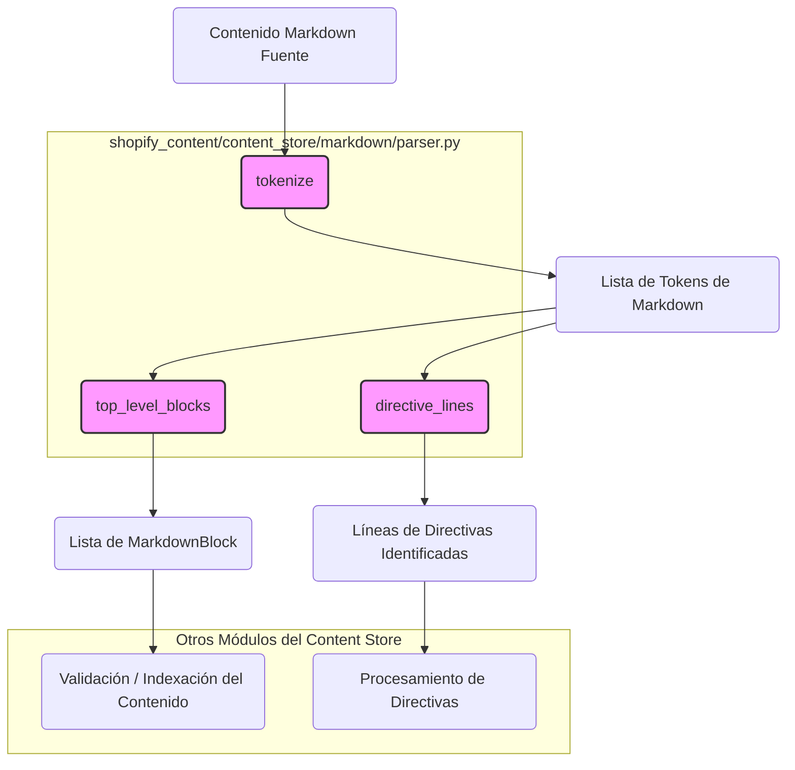

# Procesamiento de Markdown - Analizador Markdown

Este documento describe el módulo `Content_Store___Markdown_Processing_Markdown_Parser`, que forma parte del sistema de gestión de contenido de Shopify. Su función principal es analizar el contenido Markdown en una estructura inspeccionable utilizando la biblioteca `markdown-it-py`, sin emitir HTML directamente.

## Propósito y Funcionalidad Principal

El módulo `Markdown_Parser` es esencial para descomponer el contenido Markdown en bloques lógicos y líneas de directivas, facilitando su posterior procesamiento, validación e indexación dentro del sistema. Actúa como la primera etapa en la comprensión del formato de contenido editorial basado en Markdown.

### Componentes de Código Clave

El módulo incluye un componente clave:

*   `MarkdownBlock`: Una clase de datos que representa una vista ligera de un bloque de Markdown de nivel superior.

### Funciones Principales

Las funciones dentro de este módulo proporcionan la capacidad de analizar y extraer información estructurada del contenido Markdown:

*   `_md()`: Inicializa una instancia de `MarkdownIt` configurada para `commonmark` con soporte HTML y tablas.
*   `tokenize(source: str)`: Toma una cadena Markdown y la convierte en una lista de tokens de `markdown-it-py`.
*   `top_level_blocks(source: str)`: Procesa la lista de tokens para identificar y construir `MarkdownBlock`s de nivel superior.
*   `directive_lines(source: str)`: Itera sobre las líneas del código fuente Markdown e identifica aquellas que parecen ser directivas (es decir, que comienzan con `{%`).

## Arquitectura y Relaciones de Componentes

El módulo `Markdown_Parser` se integra con otros componentes dentro del subsistema `Content_Store___Markdown_Processing` para proporcionar una gestión integral del contenido Markdown.


*Captura: Diagrama de flujo de datos del analizador Markdown.*

El diagrama ilustra el flujo de cómo el contenido Markdown fuente es procesado por las funciones `tokenize`, `top_level_blocks` y `directive_lines`. Los resultados (`MarkdownBlock`s y líneas de directivas) son luego utilizados por otros módulos para validación, indexación o procesamiento de directivas específicas.

### Dependencias

*   **`markdown-it-py`**: Este módulo depende directamente de la biblioteca externa `markdown-it-py` para el análisis sintáctico subyacente del Markdown.

### Relaciones Internas

*   **`MarkdownBlock`**: Es la estructura de datos principal que utilizan las funciones `top_level_blocks` para encapsular la información extraída de los tokens de Markdown.
*   **`_md()`**: Una función interna para configurar el analizador `MarkdownIt`.

### Relaciones con Otros Módulos

*   **[Content_Store___Markdown_Processing_Markdown_References.md](../../Content_Store___Markdown_Processing/Content_Store___Markdown_Processing_Markdown_References.md)**: Los bloques de Markdown y las directivas extraídas pueden contener referencias a otros contenidos, que serían resueltas por el módulo de referencias.
*   **[Content_Store___Markdown_Processing_Validation_Runner.md](../../Content_Store___Markdown_Processing/Content_Store___Markdown_Processing_Validation_Runner.md)**: El `MarkdownBlock` y las líneas de directivas son entradas cruciales para el validador de contenido, que verifica la estructura y la integridad del Markdown.
*   **[Content_Store___Markdown_Processing_Markdown_Directives.md](../../Content_Store___Markdown_Processing/Content_Store___Markdown_Processing_Markdown_Directives.md)**: Las `directive_lines` identificadas por este módulo son el punto de entrada para el procesamiento y la interpretación de directivas personalizadas.
*   **[Content_Store___Markdown_Processing_Markdown_Security.md](../../Content_Store___Markdown_Processing/Content_Store___Markdown_Processing_Markdown_Security.md)**: El `RenderProfile` de seguridad podría influir en cómo se configuran las capacidades de análisis de Markdown o cómo se interpretan ciertos bloques.

## Cómo Encaja el Módulo en el Sistema General

El `Markdown_Parser` es un componente fundamental dentro de la arquitectura de gestión de contenido de Shopify, específicamente en el subsistema `Shopify_Content_Management/Content_Store___Markdown_Processing`.

```mermaid
graph LR
    A(Entrada de Contenido Editorial (Markdown)) --> B(Analizador Markdown);
    B --> C(Validador de Contenido);
    B --> D(Procesador de Directivas Markdown);
    C --> E(Contratos de Almacén de Contenido);
    D --> E;
    E --> F(Repositorio de Contenido de Sistema de Archivos);
    F --> G(Publicación de Contenido);

    subgraph "Shopify_Content_Management"
        subgraph "Content_Store___Markdown_Processing"
            B
            C
            D
            E
            F
        end
    end
```
*Captura: Integración del analizador Markdown en el flujo del Content Store.*

Este módulo proporciona la capacidad de interpretar el Markdown crudo en una forma estructurada que otros módulos pueden utilizar. Es una pieza central para cualquier funcionalidad que requiera una comprensión profunda del contenido Markdown, como:

*   **Validación de contenido**: Antes de que el contenido se guarde o publique, se analiza para asegurar que cumple con las reglas de formato y estructura.
*   **Indexación**: Los bloques de contenido de nivel superior pueden ser indexados para búsquedas o para construir una representación interna del documento.
*   **Procesamiento de directivas personalizadas**: Las directivas especiales incrustadas en el Markdown son identificadas aquí y luego procesadas para incluir componentes dinámicos o referencias de contenido.

En resumen, el `Markdown_Parser` es la capa que traduce el lenguaje de marcado legible por humanos (Markdown) a una estructura que el sistema puede entender y manipular programáticamente, siendo indispensable para la robustez y flexibilidad del sistema de gestión de contenido.
