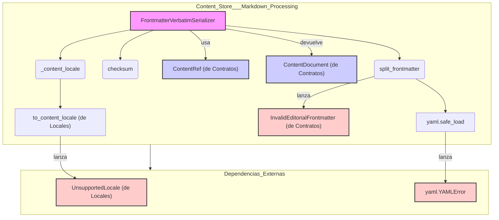

# Serializadores de Procesamiento de Markdown del Almacén de Contenido

Este módulo, `Content_Store___Markdown_Processing_Serializers`, es responsable de la serialización y deserialización de contenido editorial en el formato canónico que combina un *frontmatter* YAML con un cuerpo de Markdown. Su objetivo principal es garantizar la fidelidad del contenido, permitiendo la interoperabilidad con herramientas de edición externas sin pérdidas.

## Propósito y Funcionalidad

El módulo `shopify_content/content_store/serializers.py` define la clase `FrontmatterVerbatimSerializer`, que implementa la lógica para almacenar y recuperar contenido en un formato ``.md`` que incluye un bloque de *frontmatter* YAML seguido del cuerpo editorial en Markdown. Este formato es legible por editores externos como Keystatic y Obsidian, sin dependencias en tiempo de ejecución de ellos.

La clave de este serializador es su garantía de que ``loads(dumps(value)).body == value``, lo que significa que no se realizan transformaciones del valor (por ejemplo, de HTML a Markdown). El contenido se almacena y recupera *verbatim* (textualmente).

### `FrontmatterVerbatimSerializer`

Esta clase es el componente central del módulo, encargado de la serialización y deserialización del contenido.

*   **`fmt`**: Atributo de clase que especifica el formato del contenido como "markdown".

*   **`dumps(self, ref: ContentRef, value: str, *, meta: Mapping[str, str]) -> str`**:
    Serializa un objeto de contenido en una cadena de texto ``.md``. Toma un objeto `ContentRef` para metadatos esenciales (tipo de contenido, ID de objeto, clave de campo, local) y el valor del cuerpo del contenido (`value`). También acepta metadatos adicionales (`meta`). El resultado es una cadena que comienza con delimitadores `---`, seguidos por el *frontmatter* YAML (incluyendo los metadatos de `ContentRef` y `meta` proporcionados), otro conjunto de delimitadores `---` y finalmente el cuerpo del contenido.

*   **`loads(self, ref: ContentRef, raw: str) -> ContentDocument`**:
    Deserializa una cadena de texto ``.md`` en un objeto `ContentDocument`. Utiliza la función interna `split_frontmatter` para separar el *frontmatter* YAML del cuerpo del Markdown. El *frontmatter* se analiza en un diccionario de metadatos, y el cuerpo se devuelve tal cual. Se calcula un `checksum` para el cuerpo del contenido para verificar la integridad (pero no la autoridad del contenido).

### Funciones Auxiliares

*   **`checksum(value: str) -> str`**:
    Genera un *checksum* SHA256 para una cadena de valor dada. Se utiliza para la integridad/sincronización del contenido, pero no como una autoridad de contenido (C-002).

*   **`_content_locale(ref: ContentRef) -> str`**:
    Convierte el local de un `ContentRef` a un formato de local de contenido estandarizado, manejando `UnsupportedLocale` si es necesario y devolviendo el local original en ese caso.

*   **`_meta_to_strings(data: Mapping[str, Any]) -> dict[str, str]`**:
    Convierte los valores de un diccionario de metadatos a cadenas. Los diccionarios y listas se serializan en YAML de flujo, mientras que otros tipos se convierten directamente a cadenas. Los valores `None` se omiten.

*   **`split_frontmatter(raw: str) -> tuple[dict[str, str], str, bool]`**:
    Esta función es crucial para la deserialización. Analiza la cadena de contenido `raw` para separar el bloque de *frontmatter* YAML del cuerpo del Markdown. Si el *frontmatter* está presente pero es inválido, lanza una excepción `InvalidEditorialFrontmatter`. Maneja casos donde no hay delimitadores de apertura o cierre, o donde el *frontmatter* es vacío o nulo.

## Arquitectura y Relaciones entre Componentes

El módulo `Content_Store___Markdown_Processing_Serializers` es una parte integral del subsistema [Content_Store___Markdown_Processing](../Content_Store___Markdown_Processing.md).

*   **[Contratos del Almacén de Contenido (Content_Store___Markdown_Processing/Content_Store___Markdown_Processing_Contracts.md)](../Content_Store___Markdown_Processing/Content_Store___Markdown_Processing_Contracts.md)**: Este módulo define las interfaces y las estructuras de datos clave como `ContentDocument`, `ContentRef` e `InvalidEditorialFrontmatter`, que son fundamentales para la operación del serializador. `FrontmatterVerbatimSerializer` depende directamente de estas definiciones para la entrada y salida de sus métodos `dumps` y `loads`, y para el manejo de errores relacionados con el *frontmatter*.

*   **[Locales del Almacén de Contenido (Content_Store___Markdown_Processing/Content_Store___Markdown_Processing_Locales.md)](../Content_Store___Markdown_Processing/Content_Store___Markdown_Processing_Locales.md)**: El serializador interactúa con este módulo a través de la función `to_content_locale` y la excepción `UnsupportedLocale` para asegurar que los locales de contenido se manejen de manera consistente y para validar que solo se utilicen locales admitidos. La función interna `_content_locale` encapsula esta lógica.

*   **`PyYAML`**: El módulo utiliza la biblioteca `pyyaml` (importada como `yaml`) para analizar y generar el *frontmatter* YAML. La función `yaml.safe_load` se emplea para la deserialización y `yaml.safe_dump` para la serialización, garantizando una operación segura y eficiente con el formato YAML.

## Cómo encaja el módulo en el sistema general

Este módulo es un componente crítico dentro de la estrategia de gestión de contenido. Su capacidad para serializar contenido en un formato estándar y legible por humanos (Markdown con *frontmatter* YAML) lo convierte en el puente entre el sistema interno y las herramientas de edición externas. Asegura que el contenido pueda ser:

1.  **Gestionado externamente**: Los equipos de contenido pueden utilizar editores Markdown o CMS de terceros que entienden este formato, como Keystatic u Obsidian, para crear y modificar contenido. Esto mejora la flexibilidad y la adopción de herramientas.
2.  **Versionado y auditado**: Dado que el formato es de texto plano y "verbatim", se integra bien con sistemas de control de versiones como Git, facilitando el seguimiento de cambios, la auditoría y la reversión de versiones.
3.  **Procesado de forma predecible**: Al garantizar un `loads(dumps(value)).body == value`, se elimina la ambigüedad en cómo se interpreta y almacena el contenido, lo que es vital para la coherencia en diferentes entornos y pipelines de procesamiento.

En el contexto de [Shopify_Content_Management](../../Shopify_Content_Management.md), este serializador permite que los datos editoriales se almacenen y recuperen de una manera que es robusta, interoperable y amigable para el desarrollo y la edición de contenido, manteniendo la integridad de los datos a lo largo de su ciclo de vida.