# Migraciones de Base de Datos

Este módulo (`Database_Migrations`) dentro de `Shopify_Content_Management` gestiona las migraciones de la base de datos para la aplicación Shopify. Estas migraciones son scripts de Django que modifican el esquema de la base de datos y, en algunos casos, manipulan los datos existentes. Son cruciales para evolucionar la estructura de la base de datos a medida que se añaden nuevas características o se modifican las existentes en la gestión de contenido de Shopify.

## Propósito

El propósito principal de este módulo es aplicar cambios de esquema a la base de datos de manera controlada y versionada. Cada archivo de migración representa un conjunto específico de cambios, asegurando que la base de datos sea compatible con la versión actual del código de la aplicación. Esto incluye la creación de tablas iniciales, la adición de nuevos campos, la modificación de tipos de campo y la configuración de relaciones entre modelos.

## Arquitectura y Componentes

El módulo `Database_Migrations` se compone de una serie de archivos de migración de Django, ubicados en `shopify_content/migrations/`. Cada archivo lleva un prefijo numérico que indica el orden en que deben aplicarse. Las migraciones tienen dependencias entre sí, lo que asegura que se apliquen en la secuencia correcta.

### Diagrama de Dependencias de Migración

```mermaid
graph TD
    subgraph shopify_content/migrations/
        0001_initial[0001_initial.py - Migración Inicial]
        0002_blog_description_and_seo[0002_blog_description_and_seo.py - Descripción de Blog y SEO]
        0003_add_faq_items[0003_add_faq_items.py - Añadir FAQs]
        0004_add_location_page[0004_add_location_page.py - Página de Ubicación]
        0005_alter_locationpage_shopify_locale[0005_alter_locationpage_shopify_locale.py - Modificar Locale de Página de Ubicación]
        0006_product_image_urls[0006_product_image_urls.py - URLs de Imágenes de Producto]
        0007_shopify_sync_run[0007_shopify_sync_run.py - Ejecución de Sincronización Shopify]
        0008_content_index[0008_content_index.py - Índice de Contenido]
        0009_shopifyrootpage_operational_fields[0009_shopifyrootpage_operational_fields.py - Campos Operacionales de ShopifyRootPage]
        0010_catch_up_schema[0010_catch_up_schema.py - Actualización de Esquema]
    end

    0001_initial --> 0002_blog_description_and_seo
    0002_blog_description_and_seo --> 0003_add_faq_items
    0003_add_faq_items --> 0004_add_location_page
    0004_add_location_page --> 0005_alter_locationpage_shopify_locale
    0005_alter_locationpage_shopify_locale --> 0006_product_image_urls
    0006_product_image_urls --> 0007_shopify_sync_run
    0007_shopify_sync_run --> 0008_content_index
    0008_content_index --> 0009_shopifyrootpage_operational_fields
    0009_shopifyrootpage_operational_fields --> 0010_catch_up_schema
```

### Descripción de las Migraciones Individuales

A continuación, se detallan los cambios introducidos por cada archivo de migración:

*   **[0001_initial.py](Database_Migrations/Database_Migrations_shopify_content_migrations_0001_initial.md):** Esta migración establece la estructura inicial de la base de datos para varios modelos clave de contenido, incluyendo `BlogPage`, `CollectionPage`, `ProductPage` y `ShopifyRootPage`. Define campos básicos como `shopify_id`, `handle`, `sync_enabled`, `last_synced_at` y estructuras de `StreamField` para el contenido. También crea tablas para `ArticlePageMetafield`, `ArticlePageTag`, `CollectionPageMetafield`, `ProductPageMetafield` y `ProductPageTag` para gestionar metacampos y etiquetas. Depende de las migraciones iniciales de `taggit` y `wagtailcore`.

*   **[0002_blog_description_and_seo.py](Database_Migrations/Database_Migrations_0002_blog_description_and_seo.md):** Añade un campo `description` de tipo `TextField` al modelo `BlogPage` para permitir descripciones de blog con contenido HTML, que se sincronizan como metacampos descriptores de Shopify. Depende de `0001_initial.py`.

*   **[0003_add_faq_items.py](Database_Migrations/Database_Migrations_0003_add_faq_items.md):** Introduce modelos de preguntas frecuentes (`FAQ`) para `ArticlePage`, `BlogPage`, `CollectionPage` y `ProductPage`. Estos modelos (`ArticlePageFAQ`, `BlogPageFAQ`, `CollectionPageFAQ`, `ProductPageFAQ`) permiten asociar preguntas y respuestas a cada tipo de página de contenido. Depende de `0002_blog_description_and_seo.py`.

*   **[0004_add_location_page.py](Database_Migrations/Database_Migrations_0004_add_location_page.md):** Crea el modelo `LocationPage` para la gestión de páginas de ubicación, con campos como `shopify_id`, `handle`, `sync_enabled`, `last_synced_at`, y varios campos de contenido textual como `titulo`, `subtitulo`, `intro`, `country`, `state`, `city`, etc. También añade el modelo `LocationPageFAQ` para gestionar preguntas frecuentes específicas de las páginas de ubicación. Depende de `0003_add_faq_items.py`.

*   **[0005_alter_locationpage_shopify_locale.py](Database_Migrations/Database_Migrations_0005_alter_locationpage_shopify_locale.md):** Modifica el campo `shopify_locale` en el modelo `LocationPage` para usar un conjunto de opciones predefinidas de locales de Shopify (e.g., "en-US", "es-US", "en-CA", "fr-CA"), mejorando la coherencia y validación de los datos. Depende de `0004_add_location_page.py`.

*   **[0006_product_image_urls.py](Database_Migrations/Database_Migrations_shopify_content_migrations_0006_product_image_urls.md):** Añade campos relacionados con las URLs e IDs de imágenes de Shopify a `ArticlePage` (`featured_image_alt`, `featured_image_url`, `shopify_featured_image_id`) y `CollectionPage` (`image_alt_text`, `image_url`, `shopify_image_id`). Modifica el campo `featured_image` de `ArticlePage` para reflejar que las imágenes destacadas pueden provenir de Shopify. También introduce el modelo `ProductPageImage` para gestionar múltiples imágenes de producto con sus metadatos. Depende de `0005_alter_locationpage_shopify_locale.py`.

*   **[0007_shopify_sync_run.py](Database_Migrations/Database_Migrations_0007_shopify_sync_run.md):** Crea el modelo `ShopifySyncRun` para registrar y auditar las ejecuciones de sincronización con Shopify. Incluye campos como `kind` (inbound/outbound), `resource`, `status`, `celery_task_id`, `message`, `stats`, `error_detail`, y timestamps de creación, inicio y finalización. Depende de `0006_product_image_urls.py`.

*   **[0008_content_index.py](Database_Migrations/Database_Migrations_0008_content_index.md):** Introduce dos nuevos modelos para la indexación de contenido: `ContentIndex` y `ContentReferenceIndex`. `ContentIndex` almacena metadatos sobre fragmentos de contenido, incluyendo `content_type`, `object_id`, `field_key`, `locale`, `checksum`, `reference_count` y `relative_path`. `ContentReferenceIndex` registra referencias entre contenidos, con `ref_type`, `identifier` y `token`, y se vincula a `ContentIndex`. También añade restricciones e índices para optimizar la búsqueda y asegurar la unicidad. Depende de `0007_shopify_sync_run.py`.

*   **[0009_shopifyrootpage_operational_fields.py](Database_Migrations/Database_Migrations_0009_shopifyrootpage_operational_fields.md):** Añade campos operacionales al modelo `ShopifyRootPage` que estaban ausentes en la migración inicial, como `shopify_id`, `handle`, `sync_enabled`, `last_synced_at` y `export_config`. Estos campos son esenciales para la integración y sincronización de la página raíz con Shopify. Depende de `0008_content_index.py`.

*   **[0010_catch_up_schema.py](Database_Migrations/Database_Migrations_0010_catch_up_schema.md):** Esta es una migración de "puesta al día" que añade varias características y modelos. Introduce `EmbeddedCommandRun` para rastrear la ejecución de comandos incrustados. Añade `available_locales` a `ArticlePage` y `BlogPage`. Incorpora `theme_config` a `CollectionPage` y `ProductPage` para sobreescrituras de la interfaz. Ajusta `StreamField` de `ArticlePage` para incluir `product_banner`. Modifica `handle` en `LocationPage` para ser auto-derivado. Añade `GlossaryTermPage` y sus modelos de enlaces relacionados. Introduce `HomePage` y sus campos asociados, incluyendo `StreamField` para secciones de la página de inicio. Finalmente, crea `ContentUrlIndex` para gestionar URLs de contenido y sus variantes de locales, y añade varios modelos de enlaces (`ArticleRelated...Link`, `CollectionRelated...Link`, `GlossaryTermRelated...Link`, `ProductRelated...Link`) para gestionar las relaciones semánticas entre diferentes tipos de contenido. Depende de `0009_shopifyrootpage_operational_fields.py`.
