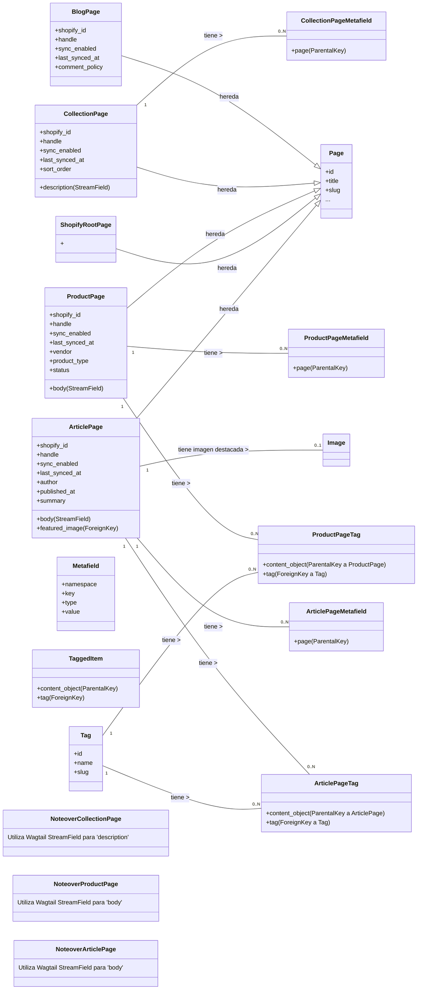
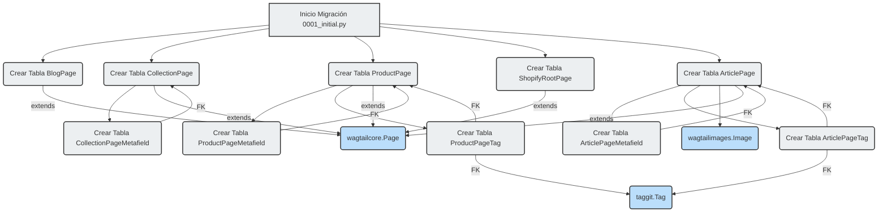

# Migración Inicial de la Base de Datos (0001_initial)

Este documento describe la migración inicial de la base de datos para el módulo `shopify_content`, ubicada en `shopify_content/migrations/0001_initial.py`. Esta migración establece las tablas fundamentales para la gestión de contenido en la aplicación Shopify, incluyendo modelos para páginas de blogs, colecciones, productos y artículos, así como sus metacampos y etiquetas asociados.

## Propósito y Funcionalidad Principal

La migración `0001_initial.py` es crucial para configurar el esquema de la base de datos necesario para el módulo de gestión de contenido. Define los modelos base que representan diferentes tipos de contenido en Shopify, permitiendo su almacenamiento y administración a través de Wagtail.

Los principales modelos creados por esta migración son:

*   **BlogPage**: Representa una página de blog de Shopify.
    *   `shopify_id`: GID de Shopify para el blog.
    *   `handle`: Identificador URL del blog.
    *   `sync_enabled`: Indica si la sincronización con Shopify está habilitada.
    *   `last_synced_at`: Marca de tiempo de la última sincronización.
    *   `comment_policy`: Política de comentarios del blog (Auto Publicado, Cerrado, Moderado).
*   **CollectionPage**: Representa una página de colección de Shopify.
    *   `shopify_id`: GID de Shopify para la colección.
    *   `handle`: Identificador URL de la colección.
    *   `sync_enabled`: Indica si la sincronización con Shopify está habilitada.
    *   `last_synced_at`: Marca de tiempo de la última sincronización.
    *   `sort_order`: Orden de clasificación de los productos en la colección.
    *   `description`: Contenido de la descripción de la colección usando un `StreamField` de Wagtail.
*   **ProductPage**: Representa una página de producto de Shopify.
    *   `shopify_id`: GID de Shopify para el producto.
    *   `handle`: Identificador URL del producto.
    *   `sync_enabled`: Indica si la sincronización con Shopify está habilitada.
    *   `last_synced_at`: Marca de tiempo de la última sincronización.
    *   `vendor`: Vendedor del producto.
    *   `product_type`: Tipo de producto.
    *   `status`: Estado del producto (Activo, Archivado, Borrador).
    *   `body`: Contenido del cuerpo del producto usando un `StreamField` de Wagtail.
*   **ShopifyRootPage**: Una página raíz que sirve como contenedor para todas las páginas de contenido de Shopify.
*   **ArticlePage**: Representa una página de artículo de blog de Shopify.
    *   `shopify_id`: GID de Shopify para el artículo.
    *   `handle`: Identificador URL del artículo.
    *   `sync_enabled`: Indica si la sincronización con Shopify está habilitada.
    *   `last_synced_at`: Marca de tiempo de la última sincronización.
    *   `author`: Autor del artículo.
    *   `published_at`: Fecha y hora de publicación.
    *   `summary`: Resumen corto del artículo.
    *   `body`: Contenido del cuerpo del artículo usando un `StreamField` de Wagtail.
    *   `featured_image`: Imagen destacada del artículo.
*   **ArticlePageMetafield**: Almacena metacampos personalizados para `ArticlePage`.
    *   `namespace`, `key`, `type`, `value`: Datos del metacampo.
    *   `page`: Clave foránea a `ArticlePage`.
*   **ArticlePageTag**: Relación Many-to-Many para etiquetas de `ArticlePage` usando `django-taggit`.
*   **CollectionPageMetafield**: Almacena metacampos personalizados para `CollectionPage`.
    *   `namespace`, `key`, `type`, `value`: Datos del metacampo.
    *   `page`: Clave foránea a `CollectionPage`.
*   **ProductPageMetafield**: Almacena metacampos personalizados para `ProductPage`.
    *   `namespace`, `key`, `type`, `value`: Datos del metacampo.
    *   `page`: Clave foránea a `ProductPage`.
*   **ProductPageTag**: Relación Many-to-Many para etiquetas de `ProductPage` usando `django-taggit`.

## Arquitectura y Relaciones entre Componentes

Esta migración establece la estructura de la base de datos para el contenido de Shopify, integrándose estrechamente con Wagtail y `django-taggit`.

### Relaciones Clave

*   **Herencia de Página Wagtail**: `BlogPage`, `CollectionPage`, `ProductPage`, `ShopifyRootPage`, y `ArticlePage` heredan de `wagtailcore.Page`, lo que les permite ser gestionadas dentro del CMS de Wagtail.
*   **Metacampos y Etiquetas**: Los modelos de metacampos (`ArticlePageMetafield`, `CollectionPageMetafield`, `ProductPageMetafield`) y etiquetas (`ArticlePageTag`, `ProductPageTag`) se relacionan con sus respectivas páginas a través de `ParentalKey` de `modelcluster.fields`, asegurando la eliminación en cascada y una fácil recuperación desde la página principal.
*   **StreamFields**: Los campos `body` y `description` en `ArticlePage`, `CollectionPage`, y `ProductPage` utilizan `wagtail.fields.StreamField`. Estos `StreamField`s permiten a los editores construir contenido complejo utilizando una serie de bloques predefinidos, como `HeadingBlock`, `ParagraphBlock`, `ImageBlock`, `VideoEmbedBlock`, `CalloutBlock`, `HtmlBlock`, `ProductFeatureBlock`, y `MetafieldBlock`. Estos bloques están definidos en submódulos como [shopify_content/blocks/content.py](../Wagtail_StreamField_Blocks/Wagtail_StreamField_Blocks_Content_Blocks.md) y [shopify_content/blocks/product.py](../Wagtail_StreamField_Blocks/Wagtail_StreamField_Blocks_Product_Blocks.md).

### Diagrama de Clases UML

### Diagrama de Flujo de Datos (Creación de Esquema)

## Cómo el Módulo Encaja en el Sistema General

Esta migración forma la base de datos para la funcionalidad de gestión de contenido en la aplicación Shopify. Al definir los modelos para los diferentes tipos de páginas (blogs, colecciones, productos, artículos), permite que el sistema:

*   **Almacene Contenido Editorial**: Utilizando los modelos de página Wagtail, se puede crear y editar contenido rico directamente en el CMS.
*   **Sincronice con Shopify**: Los campos `shopify_id`, `handle`, `sync_enabled` y `last_synced_at` en la mayoría de los modelos de página son fundamentales para la integración y sincronización de datos con la plataforma Shopify.
*   **Gestione Metadatos y Etiquetas**: Los metacampos y etiquetas permiten una categorización y enriquecimiento de contenido flexible, lo que es vital para SEO y organización.
*   **Utilice Bloques de Contenido Reutilizables**: Gracias a `StreamField`, los editores pueden construir layouts complejos utilizando bloques de contenido definidos en otros módulos como [Wagtail_StreamField_Blocks](Shopify_Content_Management/Wagtail_StreamField_Blocks.md), promoviendo la consistencia y la eficiencia en la creación de contenido.

En resumen, esta migración es el primer paso para establecer una robusta infraestructura de base de datos que soporta las capacidades de gestión de contenido de la aplicación Shopify.