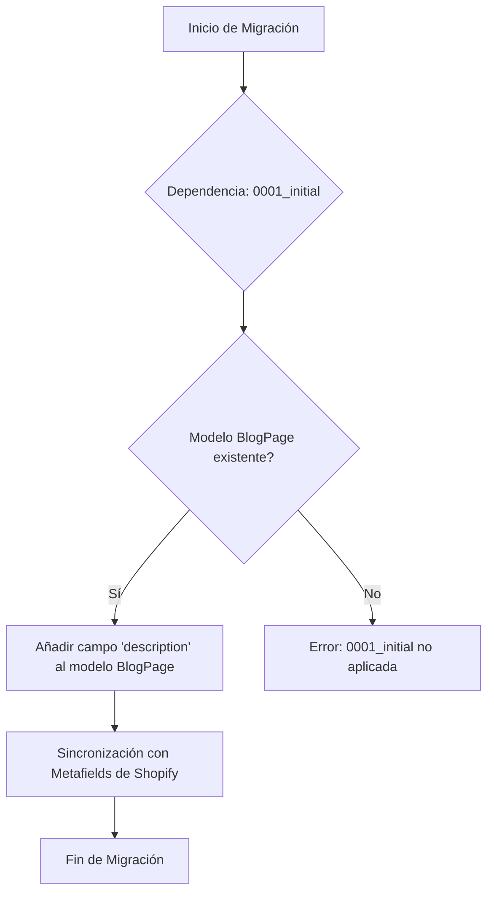

# Migración Database_Migrations_0002_blog_description_and_seo

Esta página documenta la migración de base de datos `0002_blog_description_and_seo` dentro del módulo `Shopify_Content_Management`. Esta migración específica se encarga de añadir un nuevo campo a la tabla `BlogPage` para almacenar la descripción del blog y metadatos relacionados con SEO.

## Propósito y Funcionalidad Principal

La migración `0002_blog_description_and_seo` tiene como objetivo mejorar la capacidad de gestión de contenido para las páginas de blog, permitiendo a los administradores de contenido añadir una descripción detallada y optimizada para motores de búsqueda (SEO) directamente a los modelos `BlogPage`.

## Arquitectura y Relaciones de Componentes

### Componentes de la Migración

La migración se define en el archivo `shopify_content/migrations/0002_blog_description_and_seo.py` y consta de la siguiente clase principal:

*   **Migration**: La clase principal de migración de Django que orquesta los cambios en la base de datos.

### Relaciones con Otros Componentes

Esta migración tiene una dependencia directa con la migración `0001_initial` del mismo módulo `shopify_content`, lo que asegura que la estructura inicial de la base de datos esté establecida antes de aplicar estos cambios.

El nuevo campo `description` se añade al modelo `BlogPage`, que forma parte de los [Modelos de Páginas de Contenido](Shopify_Content_Management/Content_Page_Models.md#content-page-models-blog-and-article-pages). Este campo está diseñado para ser sincronizado con los metafields de Shopify, específicamente con `descriptors.description`, lo que permite que la descripción del blog sea utilizada por la plataforma Shopify.

### Diagrama de Flujo de la Migración



## Cómo Encaja el Módulo en el Sistema General

Esta migración es una parte integral del módulo [Shopify_Content_Management](../../Shopify_Content_Management.md), que se encarga de la gestión de contenido en la aplicación. Al añadir el campo `description` al modelo `BlogPage`, el sistema mejora su capacidad para:

*   **Mejorar el SEO**: Proporcionar descripciones específicas para cada blog, mejorando su visibilidad en los resultados de búsqueda.
*   **Enriquecer el Contenido**: Permitir descripciones más detalladas y con formato HTML para los blogs.
*   **Integración con Shopify**: Facilitar la sincronización de las descripciones de los blogs con los metafields de Shopify, asegurando la coherencia del contenido en ambas plataformas.

Este cambio contribuye a la robustez y flexibilidad del sistema de gestión de contenido, permitiendo una administración más granular y efectiva de la información de los blogs.

## Detalles de Implementación

El campo `description` se añade al modelo `BlogPage` como un `models.TextField`. Se configura con `blank=True` para permitir descripciones opcionales y se incluye un `help_text` claro que indica su propósito y cómo se sincroniza con Shopify.

```python
# shopify_content/migrations/0002_blog_description_and_seo.py
class Migration(migrations.Migration):
    dependencies = [
        ("shopify_content", "0001_initial"),
    ]

    operations = [
        migrations.AddField(
            model_name="blogpage",
            name="description",
            field=models.TextField(
                blank=True,
                help_text="Blog description (HTML allowed). Synced as metafield descriptors.description.",
            ),
        ),
    ]
```

Este fragmento de código ilustra la operación `AddField` que se ejecuta para modificar el esquema de la base de datos.
