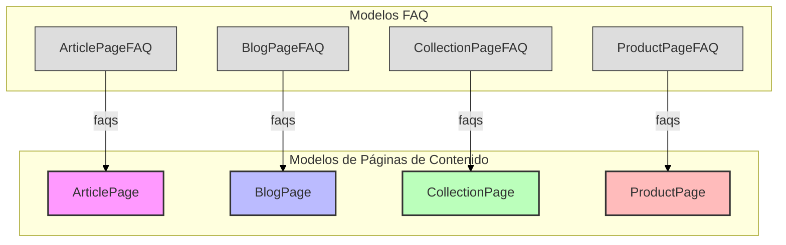

# Migración de Base de Datos 0003: Añadir Elementos FAQ

Esta documentación detalla la migración `0003_add_faq_items` dentro del módulo `Shopify_Content_Management/Database_Migrations`. Su propósito principal es introducir la funcionalidad de "Preguntas Frecuentes" (FAQ) en varios tipos de páginas de contenido existentes, como `ArticlePage`, `BlogPage`, `CollectionPage` y `ProductPage`, permitiendo a los editores asociar preguntas y respuestas directamente con estas páginas.

## Propósito y Funcionalidad Principal

La migración `0003_add_faq_items` es responsable de la creación de cuatro nuevos modelos en la base de datos, cada uno diseñado para almacenar elementos de FAQ asociados a un tipo específico de página de contenido:

*   `ArticlePageFAQ`: Para [ArticlePage](../Content_Page_Models/Content_Page_Models_Blog_and_Article_Pages.md)
*   `BlogPageFAQ`: Para [BlogPage](../Content_Page_Models/Content_Page_Models_Blog_and_Article_Pages.md)
*   `CollectionPageFAQ`: Para [CollectionPage](../Content_Page_Models/Content_Page_Models_Collection_Pages.md)
*   `ProductPageFAQ`: Para [ProductPage](../Content_Page_Models/Content_Page_Models_Product_Pages.md)

Estos modelos permiten a los administradores de contenido añadir, ordenar y gestionar una lista de preguntas y respuestas directamente relacionadas con el contenido de cada página, mejorando la experiencia del usuario al proporcionar información fácilmente accesible.

## Arquitectura y Relaciones de Componentes

Esta migración introduce los siguientes modelos en la base de datos, que se relacionan con las páginas de contenido existentes:

### Nuevos Modelos

*   `ArticlePageFAQ`:
    *   `id`: `BigAutoField` (clave primaria)
    *   `sort_order`: `IntegerField` (para ordenar los elementos FAQ)
    *   `question`: `CharField` (la pregunta en sí)
    *   `answer`: `TextField` (la respuesta a la pregunta)
    *   `page`: `ParentalKey` a `ArticlePage` (relación uno a muchos con `ArticlePage`)

*   `BlogPageFAQ`:
    *   `id`: `BigAutoField` (clave primaria)
    *   `sort_order`: `IntegerField`
    *   `question`: `CharField`
    *   `answer`: `TextField`
    *   `page`: `ParentalKey` a `BlogPage`

*   `CollectionPageFAQ`:
    *   `id`: `BigAutoField` (clave primaria)
    *   `sort_order`: `IntegerField`
    *   `question`: `CharField`
    *   `answer`: `TextField`
    *   `page`: `ParentalKey` a `CollectionPage`

*   `ProductPageFAQ`:
    *   `id`: `BigAutoField` (clave primaria)
    *   `sort_order`: `IntegerField`
    *   `question`: `CharField`
    *   `answer`: `TextField`
    *   `page`: `ParentalKey` a `ProductPage`

Todos estos modelos comparten una estructura similar para las preguntas y respuestas, y utilizan `modelcluster.fields.ParentalKey` para establecer una relación inversa (`related_name="faqs"`) con sus respectivas páginas padre. Esto significa que cada página de contenido puede tener múltiples elementos FAQ asociados, y estos elementos se ordenan según el campo `sort_order`.

### Diagrama de Relaciones

*Diagrama: Relaciones entre las Páginas de Contenido y los Modelos FAQ.*

## Cómo se Integra en el Sistema General

Esta migración es una parte fundamental del sistema de gestión de contenido de Shopify, ya que extiende la capacidad de las páginas de contenido existentes. Al añadir campos FAQ, el sistema permite a los equipos de contenido enriquecer las páginas de productos, artículos, blogs y colecciones con información adicional y relevante, mejorando la usabilidad y la capacidad de respuesta a las consultas comunes de los usuarios.

La integración de estos modelos FAQ en las páginas de contenido se gestiona a través de la relación `ParentalKey` de `modelcluster`, lo que facilita la gestión en el panel de administración de Wagtail.

## Dependencias

Esta migración depende de la migración anterior `0002_blog_description_and_seo`, asegurando que el esquema de la base de datos esté en un estado consistente antes de aplicar los cambios relacionados con los elementos FAQ.

Para una visión completa de todas las migraciones, consulte la documentación del módulo [Database_Migrations](../Database_Migrations.md).
