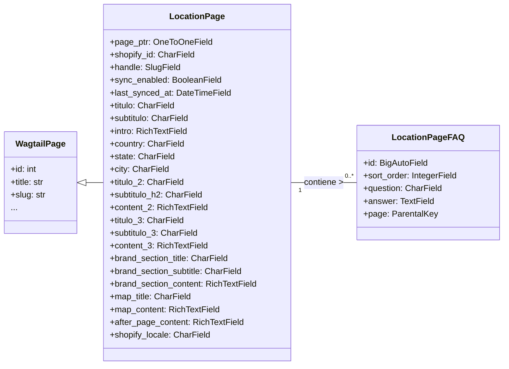

# Migración de Base de Datos 0004: Añadir Página de Ubicación

Este documento proporciona una descripción exhaustiva de la migración de base de datos `0004_add_location_page` dentro del módulo `Shopify_Content_Management`. Esta migración es crucial para introducir los modelos `LocationPage` y `LocationPageFAQ`, que permiten la creación y gestión de contenido específico de ubicaciones dentro del sistema de gestión de contenido de Shopify.

## Propósito y Funcionalidad Principal

La migración `0004_add_location_page` se encarga de extender el esquema de la base de datos para incluir dos nuevos modelos:

*   **`LocationPage`**: Un modelo de página de Wagtail diseñado para representar contenido asociado a una ubicación geográfica específica (país, estado, ciudad). Contiene varios campos para títulos, subtítulos, introducciones, contenido enriquecido, información de marca, detalles del mapa y un localizador de Shopify.
*   **`LocationPageFAQ`**: Un modelo para gestionar preguntas frecuentes (FAQ) asociadas a una `LocationPage` específica. Permite añadir preguntas y respuestas en un orden determinado.

### Componente Principal: `shopify_content/migrations/0004_add_location_page.py::Migration`

Este componente es la definición de la migración de Django. Sus `dependencies` aseguran que se ejecuta después de `0003_add_faq_items` del mismo módulo y `0097_baselogentry_uuid_action_timestamp_indexes` de `wagtailcore`, lo que garantiza la integridad del esquema de la base de datos. Las `operations` definen la creación de los dos modelos mencionados.

```python
class Migration(migrations.Migration):

    dependencies = [
        ("shopify_content", "0003_add_faq_items"),
        ("wagtailcore", "0097_baselogentry_uuid_action_timestamp_indexes"),
    ]

    operations = [
        migrations.CreateModel(
            name="LocationPage",
            fields=[
                (
                    "page_ptr",
                    models.OneToOneField(
                        auto_created=True,
                        on_delete=django.db.models.deletion.CASCADE,
                        parent_link=True,
                        primary_key=True,
                        serialize=False,
                        to="wagtailcore.page",
                    ),
                ),
                (
                    "shopify_id",
                    models.CharField(
                        blank=True,
                        db_index=True,
                        help_text="Shopify metaobject GID (populated after first upsert)",
                        max_length=255,
                    ),
                ),
                (
                    "handle",
                    models.SlugField(
                        blank=True,
                        help_text="Shopify metaobject handle (defaults to page slug)",
                        max_length=255,
                    ),
                ),
                ("sync_enabled", models.BooleanField(default=True)),
                ("last_synced_at", models.DateTimeField(blank=True, null=True)),
                ("titulo", models.CharField(max_length=255, verbose_name="Título")),
                (
                    "subtitulo",
                    models.CharField(
                        blank=True, max_length=255, verbose_name="Subtítulo"
                    ),
                ),
                (
                    "intro",
                    wagtail.fields.RichTextField(blank=True, verbose_name="Intro"),
                ),
                (
                    "country",
                    models.CharField(
                        blank=True, max_length=100, verbose_name="Country"
                    ),
                ),
                (
                    "state",
                    models.CharField(
                        blank=True, max_length=100, verbose_name="State / Province"
                    ),
                ),
                (
                    "city",
                    models.CharField(blank=True, max_length=100, verbose_name="City"),
                ),
                (
                    "titulo_2",
                    models.CharField(
                        blank=True, max_length=255, verbose_name="Título 2"
                    ),
                ),
                (
                    "subtitulo_h2",
                    models.CharField(
                        blank=True, max_length=255, verbose_name="Subtítulo H2"
                    ),
                ),
                (
                    "content_2",
                    wagtail.fields.RichTextField(blank=True, verbose_name="Content 2"),
                ),
                (
                    "titulo_3",
                    models.CharField(
                        blank=True, max_length=255, verbose_name="Título 3"
                    ),
                ),
                (
                    "subtitulo_3",
                    models.CharField(
                        blank=True, max_length=255, verbose_name="Subtítulo 3"
                    ),
                ),
                (
                    "content_3",
                    wagtail.fields.RichTextField(blank=True, verbose_name="Content 3"),
                ),
                (
                    "brand_section_title",
                    models.CharField(
                        blank=True, max_length=255, verbose_name="Brand Section Title"
                    ),
                ),
                (
                    "brand_section_subtitle",
                    models.CharField(
                        blank=True,
                        max_length=255,
                        verbose_name="Brand Section Subtitle",
                    ),
                ),
                (
                    "brand_section_content",
                    wagtail.fields.RichTextField(
                        blank=True, verbose_name="Brand Section Content"
                    ),
                ),
                (
                    "map_title",
                    models.CharField(
                        blank=True, max_length=255, verbose_name="Map Title"
                    ),
                ),
                (
                    "map_content",
                    wagtail.fields.RichTextField(
                        blank=True, verbose_name="Map Content"
                    ),
                ),
                (
                    "after_page_content",
                    wagtail.fields.RichTextField(
                        blank=True, verbose_name="After Page Content"
                    ),
                ),
                (
                    "shopify_locale",
                    models.CharField(
                        blank=True,
                        help_text='Shopify locale code pushed to the locale field (e.g. "es", "en-CA").',
                        max_length=20,
                        verbose_name="Shopify Locale",
                    ),
                ),
            ],
            options={
                "verbose_name": "Location Page",
                "verbose_name_plural": "Location Pages",
            },
            bases=("wagtailcore.page",),
        ),
        migrations.CreateModel(
            name="LocationPageFAQ",
            fields=[
                (
                    "id",
                    models.BigAutoField(
                        auto_created=True,
                        primary_key=True,
                        serialize=False,
                        verbose_name="ID",
                    ),
                ),
                (
                    "sort_order",
                    models.IntegerField(blank=True, editable=False, null=True),
                ),
                ("question", models.CharField(max_length=500, verbose_name="Question")),
                ("answer", models.TextField(verbose_name="Answer")),
                (
                    "page",
                    modelcluster.fields.ParentalKey(
                        on_delete=django.db.models.deletion.CASCADE,
                        related_name="faqs",
                        to="shopify_content.locationpage",
                    ),
                ),
            ],
            options={
                "ordering": ["sort_order"],
                "abstract": False,
            },
        ),
    ]
```

## Arquitectura y Relaciones entre Componentes

El módulo `0004_add_location_page` introduce dos nuevos modelos que se integran con la funcionalidad existente de Wagtail y con la gestión de contenido de Shopify:

*   **`LocationPage`**: Hereda directamente de `wagtailcore.Page`, lo que le permite aprovechar todas las características de las páginas de Wagtail, como el enrutamiento, la jerarquía y la integración con el CMS. Además, incluye campos específicos de Shopify como `shopify_id`, `handle` y `shopify_locale` para la sincronización con la plataforma.
*   **`LocationPageFAQ`**: Este modelo está relacionado con `LocationPage` a través de un `modelcluster.fields.ParentalKey`. Esto significa que cada `LocationPageFAQ` pertenece a una `LocationPage` y se gestiona como un elemento secundario dentro del contexto de esa página. Esto es una práctica común en Wagtail para manejar colecciones de elementos relacionados, como preguntas frecuentes o elementos de lista, dentro de una página principal.

Los campos `wagtail.fields.RichTextField` en `LocationPage` (`intro`, `content_2`, `content_3`, `brand_section_content`, `map_content`, `after_page_content`) indican que estas secciones de contenido pueden ser editadas utilizando el editor de texto enriquecido de Wagtail, lo que permite a los editores formatear el texto y añadir elementos multimedia.

### Diagrama de Clases de Modelos



## Cómo encaja el módulo en el sistema general

Esta migración es una pieza fundamental en el sistema de gestión de contenido de Shopify, ya que habilita la capacidad de crear y administrar páginas dedicadas a ubicaciones específicas. Esto es esencial para estrategias de SEO localizadas y para proporcionar información relevante a los usuarios basada en su ubicación geográfica.

*   **Gestión de Contenido Localizado**: Los campos `country`, `state`, `city` y `shopify_locale` permiten que las páginas de ubicación se orienten y sincronicen con configuraciones regionales específicas en Shopify. Esto es crucial para tiendas con presencia global o regional.
*   **Integración con Wagtail**: Al heredar de `wagtailcore.Page`, `LocationPage` se integra perfectamente en la estructura jerárquica y el flujo de trabajo de edición de Wagtail. Los editores pueden crear, publicar y gestionar páginas de ubicación como cualquier otra página del CMS.
*   **Sincronización con Shopify**: Los campos `shopify_id` y `handle` están diseñados para facilitar la sincronización bidireccional entre las `LocationPage` de Wagtail y los objetos de Shopify (probablemente metaobjetos personalizados), permitiendo que el contenido se gestione en Wagtail y se publique en Shopify. El campo `sync_enabled` y `last_synced_at` soportan este mecanismo de sincronización.
*   **Extensibilidad**: La inclusión de `LocationPageFAQ` demuestra un patrón extensible para añadir bloques de contenido estructurados relacionados con la página principal, lo cual es común en los modelos de contenido de Wagtail para gestionar información modular. Además, la presencia de múltiples campos de título y contenido (`titulo_2`, `content_2`, etc.) sugiere que estas páginas están diseñadas para soportar layouts de contenido complejos y se pueden mapear a diferentes secciones de un `template` de `frontend`.