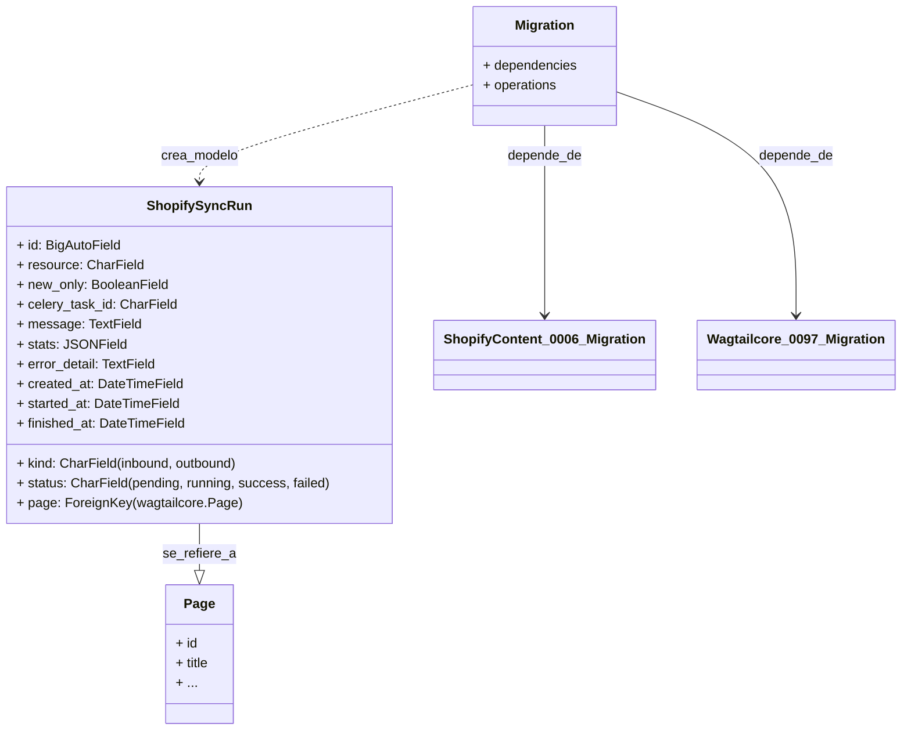

# Migración de Base de Datos 0007: Shopify Sync Run

Este documento detalla la migración de base de datos `0007_shopify_sync_run.py`, que introduce el modelo `ShopifySyncRun` para registrar y auditar las operaciones de sincronización de contenido entre Shopify y Wagtail.

## Propósito y Funcionalidad Principal

La migración `0007_shopify_sync_run.py` crea la tabla `shopify_content_shopifysyncrun` en la base de datos. Esta tabla está diseñada para almacenar un historial detallado de cada ejecución de sincronización, ya sea importando contenido de Shopify a Wagtail (inbound) o exportando de Wagtail a Shopify (outbound). El seguimiento de estas ejecuciones es fundamental para la observabilidad, depuración y auditoría del sistema de gestión de contenido.

El modelo `ShopifySyncRun` (`shopify_content/models/sync_run.py::ShopifySyncRun`) captura información vital sobre cada sincronización, incluyendo su tipo, los recursos afectados, el estado actual, mensajes asociados, estadísticas, y cualquier detalle de error, así como los tiempos de creación, inicio y finalización.

## Arquitectura y Relaciones de Componentes

La migración añade el modelo `ShopifySyncRun` que se relaciona con el modelo `Page` de Wagtail, permitiendo vincular una ejecución de sincronización a una página específica dentro del CMS. Esto es particularmente útil para las sincronizaciones que operan a nivel de página individual.

### Diagrama del Modelo ShopifySyncRun

### Dependencias

Esta migración tiene las siguientes dependencias:

*   `shopify_content.0006_product_image_urls`: Asegura que las migraciones previas dentro del módulo `shopify_content` se hayan aplicado.
*   `wagtailcore.0097_baselogentry_uuid_action_timestamp_indexes`: Establece la dependencia en una migración específica del módulo `wagtailcore` para asegurar la existencia de componentes fundamentales de Wagtail.

## Cómo encaja en el Sistema General

El modelo `ShopifySyncRun` es un componente integral del subsistema de gestión de contenido de Shopify, proporcionando la infraestructura para rastrear y monitorear la integridad y el progreso de las operaciones de sincronización. Facilita:

*   **Auditoría y Trazabilidad**: Permite a los administradores y desarrolladores ver cuándo se ejecutaron las sincronizaciones, qué recursos se vieron afectados y el resultado.
*   **Depuración**: En caso de fallos de sincronización, `error_detail` y `message` proporcionan información crucial para diagnosticar problemas.
*   **Monitoreo**: El campo `status` permite la construcción de herramientas de monitoreo para verificar la salud del proceso de sincronización.

Este modelo es utilizado por los comandos de gestión que inician las sincronizaciones, así como por la interfaz de administración para visualizar el estado y el historial de estas operaciones. Para más detalles sobre el modelo `ShopifySyncRun` en sí, consulte la documentación del modelo en [Modelos de Ejecución de Sincronización de Shopify](../../Content_Page_Models/Content_Page_Models_Shopify_Sync_Run_Models.md).