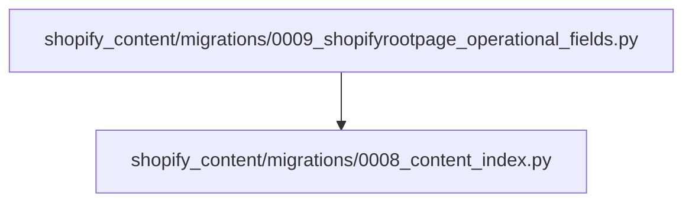
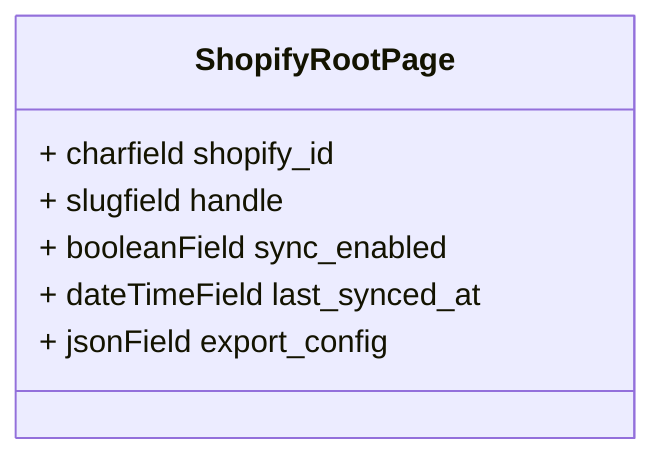

# Migración 0009: Campos Operacionales de ShopifyRootPage

Esta documentación detalla la migración de base de datos `0009_shopifyrootpage_operational_fields.py`, la cual añade campos operacionales esenciales al modelo `ShopifyRootPage`.

## Propósito y Funcionalidad

La migración `0009_shopifyrootpage_operational_fields.py` tiene como objetivo actualizar el modelo `ShopifyRootPage` con nuevos campos que son cruciales para la integración y la gestión de contenido con Shopify. Estos campos facilitan el seguimiento de la sincronización, la identificación de objetos en Shopify y la configuración de exportación.

### Componentes Principales

El componente principal en este módulo es la clase `Migration`, que define las operaciones de la base de datos para añadir los nuevos campos.

#### `Migration`

La clase `Migration` hereda de `django.db.migrations.Migration` y especifica las dependencias y operaciones de la migración.

-   **`dependencies`**: Esta migración depende de `0008_content_index`, asegurando que la tabla `ShopifyRootPage` exista antes de intentar añadirle campos.
-   **`operations`**: Define las siguientes operaciones:
    -   `AddField('shopifyrootpage', 'shopify_id', ...)`: Añade un campo para almacenar el GID del metaobjeto de Shopify.
    -   `AddField('shopifyrootpage', 'handle', ...)`: Añade un campo para almacenar el handle del metaobjeto de Shopify.
    -   `AddField('shopifyrootpage', 'sync_enabled', ...)`: Añade un campo booleano para controlar si la página raíz debe sincronizarse.
    -   `AddField('shopifyrootpage', 'last_synced_at', ...)`: Añade un campo de fecha y hora para registrar la última vez que la página fue sincronizada.
    -   `AddField('shopifyrootpage', 'export_config', ...)`: Añade un campo JSON para almacenar la configuración de exportación de la página.

### Nuevos Campos Añadidos a `ShopifyRootPage`

Esta migración introduce los siguientes campos en el modelo `ShopifyRootPage` (para más detalles sobre el modelo `ShopifyRootPage`, consulte [Content_Page_Models_Shopify_Root_Page](../Content_Page_Models/Content_Page_Models_Shopify_Root_Page.md)):

-   **`shopify_id`**:
    -   Tipo: `models.CharField`
    -   `blank=True`, `db_index=True`, `max_length=255`
    -   `help_text`: "Shopify metaobject GID (populated after first upsert)"
    -   Propósito: Almacena el identificador global de Shopify (GID) del metaobjeto correspondiente a la página raíz en Shopify. Esto es crucial para referenciar la página raíz en Shopify después de su primera creación o actualización (upsert).
-   **`handle`**:
    -   Tipo: `models.SlugField`
    -   `blank=True`, `max_length=255`
    -   `help_text`: "Shopify metaobject handle (defaults to Wagtail slug)"
    -   Propósito: Almacena el "handle" (identificador legible por humanos) del metaobjeto de Shopify. Por defecto, este valor se derivaría del slug de Wagtail de la página.
-   **`sync_enabled`**:
    -   Tipo: `models.BooleanField`
    -   `db_default=True`, `default=True`
    -   Propósito: Un indicador booleano que determina si esta `ShopifyRootPage` debe ser considerada para la sincronización con Shopify. Por defecto, está habilitada.
-   **`last_synced_at`**:
    -   Tipo: `models.DateTimeField`
    -   `blank=True`, `null=True`
    -   Propósito: Registra la fecha y hora de la última sincronización exitosa de esta página con Shopify. Es útil para auditorías y para determinar cuándo fue la última actualización.
-   **`export_config`**:
    -   Tipo: `models.JSONField`
    -   `blank=True`, `db_default={}``, `default=dict`
    -   Propósito: Un campo para almacenar configuraciones específicas de exportación como un objeto JSON. Esto permite una mayor flexibilidad en cómo se exporta el contenido de la página raíz a Shopify.

## Diagramas

### Relación de Dependencia

*Dependencia de la migración.*

### Impacto en el Modelo ShopifyRootPage

*Campos añadidos al modelo `ShopifyRootPage`.*
