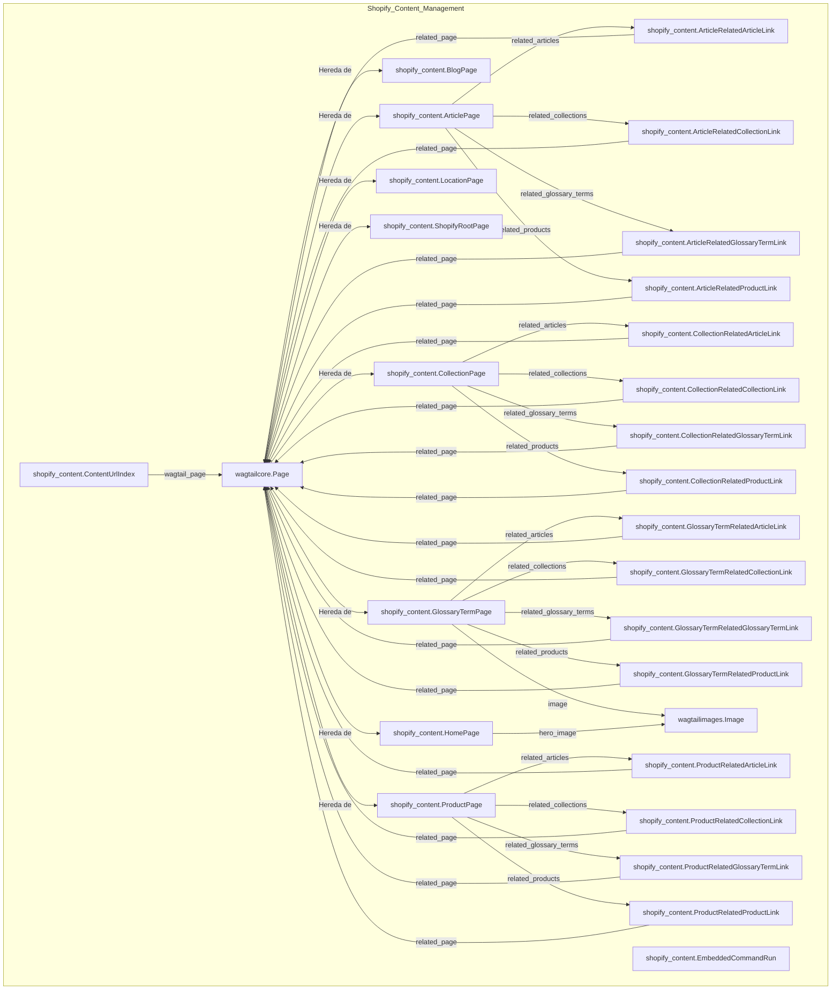

# Migración de Esquema 0010_catch_up_schema

Esta migración de base de datos (`0010_catch_up_schema`) es parte del módulo `Shopify_Content_Management/Database_Migrations` y es crucial para actualizar el esquema de la base de datos, introduciendo nuevas funcionalidades y mejorando las estructuras de datos existentes para el manejo de contenido en Shopify.

## Propósito y Funcionalidad Principal

El objetivo principal de esta migración es poner al día el esquema de la base de datos con una serie de adiciones y modificaciones importantes. Estas operaciones incluyen la creación de nuevos modelos para la gestión de comandos incrustados, términos de glosario y páginas de inicio, así como la mejora de los modelos de página existentes con campos adicionales para la localización, configuración de temas y la indexación de URLs de contenido. También introduce un conjunto robusto de modelos para gestionar enlaces semánticos entre diferentes tipos de contenido.

## Arquitectura y Relaciones entre Componentes

La migración realiza los siguientes cambios clave en el esquema:

### Nuevos Modelos

#### `EmbeddedCommandRun`
Este modelo se utiliza para registrar y rastrear la ejecución de comandos incrustados dentro de la aplicación.
*   `command_id`: Identificador único del comando.
*   `command_name`: Nombre del comando.
*   `kwargs`: Argumentos JSON para el comando.
*   `celery_task_id`: ID de la tarea Celery si el comando se ejecuta de forma asíncrona.
*   `status`: Estado actual de la ejecución (pendiente, en ejecución, éxito, fallido).
*   `message`, `stdout`, `stderr`, `error_detail`: Campos para registrar la salida y los errores del comando.
*   `created_at`, `started_at`, `finished_at`: Marcas de tiempo para el ciclo de vida de la ejecución.

#### `GlossaryTermPage`
Un nuevo modelo de página de Wagtail para gestionar términos de glosario, extendiendo `wagtailcore.page` e incorporando `shopify_content.content_store.domain.EditorialMixin`.
*   `shopify_id`: GID del metaobjeto de Shopify.
*   `handle`: Identificador único para Shopify (por defecto, el término slugificado).
*   `sync_enabled`, `last_synced_at`: Control de sincronización con Shopify.
*   `term`, `definition`: El término del glosario y su definición.
*   `image_alt_text`, `image_url`, `shopify_image_id`, `image`: Campos para la gestión de imágenes.
*   `locale_code`: Código de configuración regional (ej. 'en', 'es', 'fr').
*   `related_links`, `external_links`, `synonyms`, `same_as`: Campos JSON para enlaces y sinónimos.

#### `HomePage`
Un nuevo modelo de página de Wagtail para gestionar las páginas de inicio, extendiendo `wagtailcore.page`.
*   `shopify_id`, `handle`, `sync_enabled`, `last_synced_at`: Campos relacionados con la sincronización de Shopify.
*   `shopify_locale`: Código de configuración regional de Shopify.
*   Campos de `hero_*`: Encabezado, subtítulo, cuerpo, botones de llamada a la acción e imagen para la sección hero.
*   `body`: Un `StreamField` de Wagtail que permite la construcción de secciones de la página de inicio con varios bloques de contenido, como `promo_gateway`, `nav_collection_pills`, `trust_bar`, `featured_collections`, `editorial_intro`, `best_sellers`, `shop_by_need`, `educational_hub`, `brand_values`, `market_block`, `faq`, `internal_links`, `seo_schema`. Estos bloques están definidos en el módulo [Wagtail_StreamField_Blocks](../Wagtail_StreamField_Blocks.md).
*   `sections_json`: Una representación JSON de las secciones del cuerpo, derivada del `StreamField`.
*   `hero_image`: Clave foránea a `wagtailimages.Image` para la imagen hero.

#### Modelos de Enlaces Semánticos (e.g., `ArticleRelatedArticleLink`, `ProductRelatedCollectionLink`)
Se introducen varios modelos para gestionar las relaciones entre diferentes tipos de contenido (Artículo, Colección, Término de Glosario, Producto). Cada uno de estos modelos tiene:
*   `page`: Una clave parental a la página de origen (ej. `ArticlePage`).
*   `related_page`: Una clave foránea a `wagtailcore.page` que apunta a la página relacionada.
*   `is_auto`: Un booleano para indicar si el enlace fue generado automáticamente.
*   `sort_order`: Campo para ordenar los enlaces.

Estos incluyen:
*   `ArticleRelatedArticleLink`
*   `ArticleRelatedCollectionLink`
*   `ArticleRelatedGlossaryTermLink`
*   `ArticleRelatedProductLink`
*   `CollectionRelatedArticleLink`
*   `CollectionRelatedCollectionLink`
*   `CollectionRelatedGlossaryTermLink`
*   `CollectionRelatedProductLink`
*   `GlossaryTermRelatedArticleLink`
*   `GlossaryTermRelatedCollectionLink`
*   `GlossaryTermRelatedGlossaryTermLink`
*   `GlossaryTermRelatedProductLink`
*   `ProductRelatedArticleLink`
*   `ProductRelatedCollectionLink`
*   `ProductRelatedGlossaryTermLink`
*   `ProductRelatedProductLink`

Estos modelos son abstractos y se utilizan para definir la estructura de enlaces relacionados de forma flexible.

#### `ContentUrlIndex`
Un nuevo modelo para indexar las URLs de contenido, facilitando la resolución de URLs en el storefront.
*   `normalized_path`: Ruta del storefront normalizada.
*   `content_type`: Tipo de contenido (ej. 'product', 'collection').
*   `handle`, `blog_handle`: Identificadores de contenido.
*   `locale`, `locale_prefix`: Información de localización.
*   `is_canonical`: Indica si la URL es la variante canónica.
*   `wagtail_page`: Clave foránea a `wagtailcore.page`.

### Modificaciones a Modelos Existentes

*   **`ArticlePage`**:
    *   Se añade `available_locales` (JSONField): Códigos de locales de Wagtail donde el contenido está publicado.
    *   Se altera el `body` (StreamField): Se actualizan los tipos de bloques permitidos para incluir `heading`, `paragraph`, `image`, `video`, `callout`, `html`, `product_banner`.
    *   Se altera `sync_enabled` (BooleanField): Valor por defecto `True`.
*   **`BlogPage`**:
    *   Se añade `available_locales` (JSONField): Códigos de locales de Wagtail donde el contenido está publicado.
    *   Se altera `sync_enabled` (BooleanField): Valor por defecto `True`.
*   **`CollectionPage`**:
    *   Se añade `theme_config` (JSONField): Sobreescrituras de configuración del tema para metafields de Shopify.
    *   Se altera `sync_enabled` (BooleanField): Valor por defecto `True`.
*   **`ProductPage`**:
    *   Se añade `theme_config` (JSONField): Sobreescrituras de configuración del tema para metafields de Shopify.
    *   Se altera `sync_enabled` (BooleanField): Valor por defecto `True`, con ayuda adicional.
*   **`LocationPage`**:
    *   Se altera `handle` (SlugField): Ayuda y longitud máxima actualizadas.
    *   Se altera `sync_enabled` (BooleanField): Valor por defecto `True`.
*   **`ShopifyRootPage`**:
    *   Se altera `export_config` (JSONField): Valor por defecto y ayuda actualizados.

### Diagrama de Relaciones de Modelos

## Encaje en el Sistema General

Esta migración es fundamental para la evolución del sistema de gestión de contenido de Shopify.
*   **Gestión de Contenido Enriquecido**: Las mejoras en `StreamField` para `ArticlePage` y `HomePage` permiten una creación de contenido más flexible y rica, aprovechando los bloques definidos en [Wagtail_StreamField_Blocks](../Wagtail_StreamField_Blocks.md).
*   **Localización y Mercados**: La adición de `available_locales` y `shopify_locale` mejora la capacidad de la plataforma para gestionar contenido localizado para diferentes mercados de Shopify, un aspecto clave del módulo [Shopify_Content_Application_Core/Shopify_Content_Application_Core_Home_Page_Locale_Validation.md](../Shopify_Content_Application_Core/Shopify_Content_Application_Core_Home_Page_Locale_Validation.md).
*   **Sincronización con Shopify**: Los campos `shopify_id`, `handle`, `sync_enabled`, `last_synced_at` y `theme_config` son esenciales para la integración y sincronización bidireccional de contenido con la plataforma Shopify, lo que impacta directamente en cómo se exporta y consume el contenido en la tienda. Esto se relaciona con el módulo [Content_Synchronization_Specifications](../Content_Synchronization_Specifications.md) y los modelos de sincronización descritos en [Content_Page_Models/Content_Page_Models_Shopify_Sync_Run_Models.md](../Content_Page_Models/Content_Page_Models_Shopify_Sync_Run_Models.md).
*   **Comandos Incrustados**: El modelo `EmbeddedCommandRun` proporciona un mecanismo para ejecutar y rastrear tareas en segundo plano o comandos específicos del contenido, lo cual es relevante para el módulo [Embedded_Commands_Registry](../Embedded_Commands_Registry.md).
*   **Glosario y SEO**: La introducción de `GlossaryTermPage` y sus campos de enlaces relacionados, sinónimos y enlaces externos, junto con las capacidades SEO de `HomePage`, mejora la optimización para motores de búsqueda y la riqueza semántica del contenido.
*   **Indexación de URLs**: El `ContentUrlIndex` es vital para el sistema de enrutamiento y la resolución de URLs, asegurando que el contenido sea accesible correctamente en el storefront, como se detalla en [Content_URL_Resolver](../Content_URL_Resolver.md).
*   **Enlaces Semánticos**: Los numerosos modelos `RelatedLink` facilitan la creación y gestión de enlaces internos y externos, mejorando la navegación y la interconexión del contenido, y apoyando las funcionalidades descritas en [Semantic_Links_Service](../Semantic_Links_Service.md).
*   **Modelos de Página de Contenido**: Las modificaciones se basan y amplían los modelos definidos en [Content_Page_Models](../Content_Page_Models.md).

En resumen, esta migración sienta las bases para un sistema de gestión de contenido más avanzado, flexible y fuertemente integrado con Shopify, permitiendo la creación de experiencias de usuario más dinámicas y localizadas.
