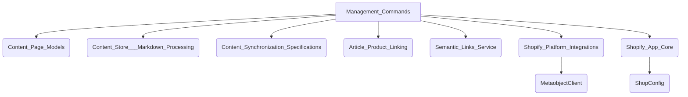

# Comandos de Gestión del Contenido de Shopify

Este módulo contiene una serie de comandos de gestión de Django diseñados para interactuar con el contenido de Shopify y el sistema de gestión de contenido (CMS) basado en Wagtail. Estos comandos facilitan tareas como la inicialización de páginas, la importación de datos de Shopify, la validación del contenido, la gestión de metacampos y la reconstrucción de índices.

## Arquitectura

El módulo `Management_Commands` opera como un conjunto de utilidades que interactúan directamente con la base de datos de Wagtail, la API de Shopify (a través de los módulos `Shopify_Platform_Integrations` y `Shopify_Content_Application_Core` para la configuración de la tienda) y el sistema de archivos para el almacenamiento de contenido (`Content_Store___Markdown_Processing`).

Se apoya en varios otros módulos para su funcionalidad:

*   **[Content_Page_Models](../Content_Page_Models.md)**: Para la manipulación de los modelos de página de Wagtail.
*   **[Content_Store___Markdown_Processing](../Content_Store___Markdown_Processing.md)**: Para la interacción con el repositorio de contenido basado en Git.
*   **[Content_Synchronization_Specifications](../Content_Synchronization_Specifications.md)**: Para definir y aplicar las especificaciones de sincronización.
*   **[Article_Product_Linking](../Article_Product_Linking.md)**: Para la lógica de reescritura de enlaces de productos en artículos.
*   **[Semantic_Links_Service](../Semantic_Links_Service.md)**: Para la gestión de enlaces semánticos internos.
*   **[Shopify_Platform_Integrations](../../Shopify_Platform_Integrations.md)**: Para interactuar con los metaobjetos de Shopify y las definiciones de metacampos.
*   **[Shopify_App_Core](../../Shopify_App_Core.md)**: Para acceder a la configuración de la tienda (ShopConfig).

## Comandos de Gestión

A continuación, se detallan los comandos de gestión disponibles en este módulo, organizados por su propósito.

*   **[Comandos de Configuración e Inicialización](Management_Commands/Management_Commands_Config_Setup_New.md)**: Este submódulo contiene comandos para la configuración inicial de páginas, la definición de metacampos y metaobjetos, y la configuración de tareas programadas.
*   **[Comandos de Importación y Sincronización de Shopify](Management_Commands/Management_Commands_Import_Synchronization.md)**: Este submódulo se encarga de la importación de datos desde Shopify y la sincronización de referencias y revisiones.
*   **[Comandos de Mantenimiento y Validación de Contenido](Management_Commands/Management_Commands_Content_Maint_Validation_New.md)**: Este submódulo contiene comandos para la reconstrucción de índices, la validación de contenido y la corrección de enlaces y formatos.
*   **[Comandos de Migración](Management_Commands/Management_Commands_Migration.md)**: Este submódulo agrupa los comandos para la migración de datos y configuraciones heredadas a nuevas estructuras.
*   **[Comandos de Indexación y Búsqueda](Management_Commands/Management_Commands_Indexing_Search.md)**: Este submódulo se enfoca en la gestión de índices de contenido y URL para mejorar el rendimiento y la capacidad de búsqueda.