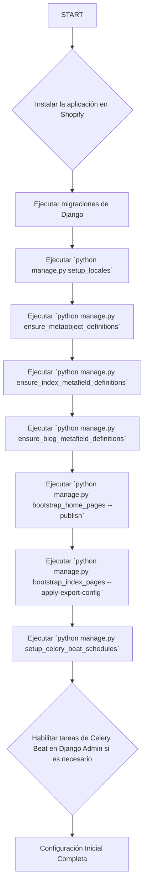

# Comandos de Configuración e Inicialización de Gestión

Este módulo contiene comandos de gestión de Django esenciales para la configuración inicial y el mantenimiento de la aplicación de gestión de contenido de Shopify. Estos comandos automatizan la creación de estructuras de página básicas, la configuración de definiciones de metacampos y metaobjetos en Shopify, y la configuración de tareas programadas.

## Propósito y Funcionalidad Principal

El objetivo principal de este módulo es proporcionar herramientas de línea de comandos para inicializar y mantener el entorno de gestión de contenido. Esto incluye:

*   **Inicialización de páginas base**: Creación de páginas raíz y de inicio para diferentes configuraciones regionales.
*   **Definición de metacampos y metaobjetos**: Asegurar que las definiciones de metacampos y metaobjetos necesarios existan en Shopify para la sincronización de contenido.
*   **Programación de tareas**: Configurar tareas periódicas para la importación y sincronización de contenido.

Estos comandos son cruciales para un despliegue y funcionamiento correctos del sistema de gestión de contenido, especialmente en tiendas Shopify nuevas o después de cambios estructurales.

## Comandos de Gestión

A continuación, se detallan los comandos de gestión incluidos en este módulo:

### `bootstrap_home_pages`

Este comando se asegura de que exista una `ShopifyRootPage` con el slug `cms-home` y una `HomePage` para cada configuración regional permitida, tal como se define en `settings.ALLOWED_LOCALE_CODES`.

*   **Ruta del archivo**: `shopify_content/management/commands/bootstrap_home_pages.py`
*   **Componente principal**: `Command`
*   **Funcionalidad**: Crea las páginas de inicio necesarias en Wagtail, inicializando su contenido con estructuras JSON normalizadas y datos de flujo. Puede publicar las páginas creadas, lo que activaría la sincronización con Shopify si está habilitada.
*   **Opciones**: `--publish` (publica las páginas creadas), `--dry-run` (simula las acciones sin guardar cambios).
*   **Relación con otros módulos**:
    *   Interactúa con [Content_Page_Models](../Content_Page_Models.md) para crear instancias de `HomePage` y `ShopifyRootPage`.
    *   Utiliza `normalize_sections_json` y `sections_json_to_stream_data` para la serialización del contenido de la página.

### `bootstrap_index_pages`

Este comando crea las páginas de índice de Shopify para diferentes tipos de contenido (blog, glosario, ubicaciones) y gestiona sus configuraciones de exportación.

*   **Ruta del archivo**: `shopify_content/management/commands/bootstrap_index_pages.py`
*   **Componente principal**: `Command`
*   **Funcionalidad**: Se asegura de que las páginas de índice para blogs, glosarios y ubicaciones existan en Shopify. Para el glosario y las ubicaciones, configura entradas de metaobjetos de página raíz en lugar de crear páginas nativas de Shopify. También puede aplicar la configuración de exportación generada a `ShopifyRootPage.export_config` en la base de datos de Wagtail.
*   **Opciones**: `--apply-export-config` (fusiona la configuración generada en `ShopifyRootPage.export_config`), `--skip-metafield-definitions` (omite la ejecución de comandos para asegurar definiciones de metacampos), `--legacy-pages` (también crea páginas de Shopify de glosario/ubicaciones en desuso).
*   **Relación con otros módulos**:
    *   Depende de [Shopify_Content_Application_Core_Application_Configuration](../../Shopify_Content_Application_Core/Shopify_Content_Application_Core_Application_Configuration.md) para `ShopConfig`.
    *   Interactúa con [Content_Page_Models](../Content_Page_Models.md) para `ShopifyRootPage`.
    *   Utiliza `ensure_index_metafield_definitions` de `shopify_content.sync.resource_metafield_definitions`.
    *   Utiliza `ensure_index_pages` y funciones `build_*_export_config` de `shopify_content.sync.index_pages_bootstrap`.

### `ensure_blog_metafield_definitions`

Este comando garantiza que las definiciones de metacampos de Shopify para el índice de blogs y las configuraciones regionales de blog/artículo existan.

*   **Ruta del archivo**: `shopify_content/management/commands/ensure_blog_metafield_definitions.py`
*   **Componente principal**: `Command`
*   **Funcionalidad**: Crea o verifica las definiciones de metacampos de Shopify para la lista de índices de blogs (tipo PAGE) y para los recursos BLOG y ARTICLE, asegurando la existencia de campos como `available_locales`.
*   **Relación con otros módulos**:
    *   Depende de [Shopify_Content_Application_Core_Application_Configuration](../../Shopify_Content_Application_Core/Shopify_Content_Application_Core_Application_Configuration.md) para `ShopConfig`.
    *   Utiliza `ensure_blog_metafield_definitions` de `shopify_content.sync.resource_metafield_definitions`.

### `ensure_index_metafield_definitions`

Un comando más completo para asegurar definiciones de metacampos de índice de CMS y de recursos de blog.

*   **Ruta del archivo**: `shopify_content/management/commands/ensure_index_metafield_definitions.py`
*   **Componente principal**: `Command`
*   **Funcionalidad**: Es una versión mejorada de `ensure_page_metafield_definitions`, ya que no solo se encarga de `custom.index_listings` (PAGE) sino también de las definiciones de `available_locales` para los recursos `BLOG` y `ARTICLE`. Admite la creación de definiciones de metacampos de índice por configuración regional en desuso mediante la opción `--legacy`.
*   **Opciones**: `--legacy` (también asegura definiciones de metacampos de índice por configuración regional en desuso).
*   **Relación con otros módulos**:
    *   Depende de [Shopify_Content_Application_Core_Application_Configuration](../../Shopify_Content_Application_Core/Shopify_Content_Application_Core_Application_Configuration.md) para `ShopConfig`.
    *   Utiliza `ensure_index_metafield_definitions` de `shopify_content.sync.resource_metafield_definitions` y `ensure_page_metafield_definitions` de `shopify_content.sync.page_metafield_definitions`.

### `ensure_metaobject_definitions`

Este comando inicializa o verifica las definiciones de metaobjetos propiedad del comerciante en Shopify.

*   **Ruta del archivo**: `shopify_content/management/commands/ensure_metaobject_definitions.py`
*   **Componente principal**: `Command`
*   **Funcionalidad**: Crea o actualiza las definiciones de metaobjetos de Shopify para `local_page`, `root_page`, `home_page` y `glossary_term`. Es crucial ejecutarlo una vez después de la instalación de la aplicación en una nueva tienda, o si una definición se elimina accidentalmente del Admin de Shopify. Es seguro ejecutarlo varias veces, ya que crea las definiciones que faltan y añade cualquier `fieldDefinitions` que falte a los tipos existentes.
*   **Relación con otros módulos**:
    *   Depende de [Shopify_Content_Application_Core_Application_Configuration](../../Shopify_Content_Application_Core/Shopify_Content_Application_Core_Application_Configuration.md) para `ShopConfig`.
    *   Interactúa directamente con la API de metaobjetos de Shopify a través de `MetaobjectClient` del módulo [Shopify_Platform_Integrations/Shopify_Metaobjects_Connector](../../Shopify_Platform_Integrations/Shopify_Metaobjects_Connector.md).
    *   Utiliza especificaciones de definición de metaobjetos de `shopify_content.sync.outbound`.

### `ensure_page_metafield_definitions`

Un comando para crear o verificar la definición de metacampos de página de Shopify para `custom.index_listings`.

*   **Ruta del archivo**: `shopify_content/management/commands/ensure_page_metafield_definitions.py`
*   **Componente principal**: `Command`
*   **Funcionalidad**: Se asegura de que la definición del metafield de página `custom.index_listings` exista en Shopify. Se recomienda usar `ensure_index_metafield_definitions` en su lugar, ya que este comando solo se enfoca en las definiciones de metacampos de página. Permite listar solo las definiciones existentes sin crear nuevas con la opción `--list-only`.
*   **Opciones**: `--list-only` (solo lista las definiciones existentes, no crea nuevas).
*   **Relación con otros módulos**:
    *   Depende de [Shopify_Content_Application_Core_Application_Configuration](../../Shopify_Content_Application_Core/Shopify_Content_Application_Core_Application_Configuration.md) para `ShopConfig`.
    *   Utiliza `ensure_page_metafield_definitions` de `shopify_content.sync.page_metafield_definitions`.

### `setup_celery_beat_schedules`

Crea las tareas periódicas predeterminadas de `django-celery-beat` para la sincronización de Shopify.

*   **Ruta del archivo**: `shopify_content/management/commands/setup_celery_beat_schedules.py`
*   **Componente principal**: `Command`
*   **Funcionalidad**: Configura dos tareas periódicas en `django-celery-beat`:
    1.  `Importar contenido nuevo desde Shopify`: Programada diariamente a las 3 AM (deshabilitada por defecto).
    2.  `Backfill semantic internal links`: Programada diariamente a las 4 AM. Su habilitación depende de las configuraciones `SEMANTIC_LINKS_ENABLED` y `SEMANTIC_LINKS_BACKFILL_SCHEDULE_ENABLED`.
*   **Relación con otros módulos**:
    *   Configura tareas que llaman a funciones en `shopify_content.tasks`.
    *   Depende de `django-celery-beat` para la programación de tareas.

### `setup_locales`

Crea los objetos `Wagtail Locale` necesarios para el soporte `hreflang`.

*   **Ruta del archivo**: `shopify_content/management/commands/setup_locales.py`
*   **Componente principal**: `Command`
*   **Funcionalidad**: Garantiza la existencia de los objetos `Wagtail Locale` para `en-US`, `es-US`, `en-CA` y `fr-CA`, que son fundamentales para el soporte de internacionalización y `hreflang` en Wagtail.
*   **Relación con otros módulos**:
    *   Interactúa directamente con el modelo `Locale` de Wagtail.

## Arquitectura y Relaciones de Componentes

Este módulo se integra con varios componentes de la aplicación y de Shopify para realizar sus tareas de configuración. El siguiente diagrama ilustra las interacciones clave:

```mermaid
graph TD
    A[Comandos de Gestión de Configuración] --> B(Inicialización de Wagtail)
    A --> C(Configuración de Shopify)
    A --> D(Programación de Celery Beat)

    subgraph Django/Wagtail
        B --> B1[bootstrap_home_pages]
        B --> B2[setup_locales]
        B1 -- Crea/Actualiza --> E[Páginas de Inicio Wagtail]
        B2 -- Crea/Actualiza --> F[Objetos Locale de Wagtail]
        E --> N[Contenido Serializado]
    end

    subgraph Plataforma Shopify
        C --> C1[bootstrap_index_pages]
        C --> C2[ensure_blog_metafield_definitions]
        C --> C3[ensure_index_metafield_definitions]
        C --> C4[ensure_metaobject_definitions]
        C --> C5[ensure_page_metafield_definitions]
        C1 -- Configura --> G[Páginas de Índice de Shopify]
        C1 -- Actualiza --> H[ShopifyRootPage.export_config]
        C2 -- Crea/Actualiza --> I[Definiciones de Metafield de Blog/Artículo]
        C3 -- Crea/Actualiza --> J[Definiciones de Metafield de Índice]
        C4 -- Crea/Actualiza --> K[Definiciones de Metaobjetos]
        C5 -- Crea/Actualiza --> L[Definiciones de Metafield de Página]
        H --> O[Configuración de Exportación]
        I --> P[Sincronización de Contenido]
        J --> P
        K --> P
        L --> P
    end

    subgraph Celery
        D --> D1[setup_celery_beat_schedules]
        D1 -- Crea/Actualiza --> M[Tareas Periódicas de Celery Beat]
        M --> Q[Ejecución de Tareas Asíncronas]
    end

    style B fill:#f9f,stroke:#333,stroke-width:2px
    style C fill:#ccf,stroke:#333,stroke-width:2px
    style D fill:#cfc,stroke:#333,stroke-width:2px
    style E fill:#f9f,stroke:#333,stroke-width:2px
    style F fill:#f9f,stroke:#333,stroke-width:2px
    style G fill:#ccf,stroke:#333,stroke-width:2px
    style H fill:#ccf,stroke:#333,stroke-width:2px
    style I fill:#ccf,stroke:#333,stroke-width:2px
    style J fill:#ccf,stroke:#333,stroke-width:2px
    style K fill:#ccf,stroke:#333,stroke-width:2px
    style L fill:#ccf,stroke:#333,stroke-width:2px
    style M fill:#cfc,stroke:#333,stroke-width:2px
    style N fill:#f9f,stroke:#333,stroke-width:2px
    style O fill:#ccf,stroke:#333,stroke-width:2px
    style P fill:#ccf,stroke:#333,stroke-width:2px
    style Q fill:#cfc,stroke:#333,stroke-width:2px
```

## Flujo de Configuración Inicial

El siguiente diagrama de flujo describe el proceso recomendado para la configuración inicial de este módulo en una nueva instancia de la aplicación:

## Cómo encaja el módulo en el sistema general

El módulo `Management_Commands_Config_And_Setup` es fundamental para el despliegue y la operabilidad del sistema de gestión de contenido de Shopify. Actúa como el puente inicial entre la configuración de Django/Wagtail y la plataforma Shopify, estableciendo las estructuras de datos y las definiciones necesarias para que la sincronización de contenido funcione correctamente.

Sin estos comandos, la aplicación no podría:

*   Tener páginas de inicio básicas configuradas para cada configuración regional.
*   Sincronizar el contenido de las páginas de índice (blogs, glosarios, ubicaciones) con Shopify.
*   Utilizar los metacampos y metaobjetos personalizados en Shopify que son esenciales para el almacenamiento y la visualización de contenido enriquecido.
*   Programar automáticamente tareas de importación y sincronización de contenido.

Por lo tanto, este módulo es una parte crítica del proceso de "puesta en marcha" y asegura que la aplicación esté correctamente preparada para gestionar y sincronizar contenido con Shopify. Se integra con:

*   **Shopify_App_Core**: Para la configuración de la tienda (`ShopConfig`).
*   **Content_Page_Models**: Para la creación y manipulación de los modelos de páginas Wagtail.
*   **Shopify_Platform_Integrations/Shopify_Metaobjects_Connector**: Para interactuar con la API de metaobjetos de Shopify.
*   **Celery**: Para la programación de tareas asíncronas.
