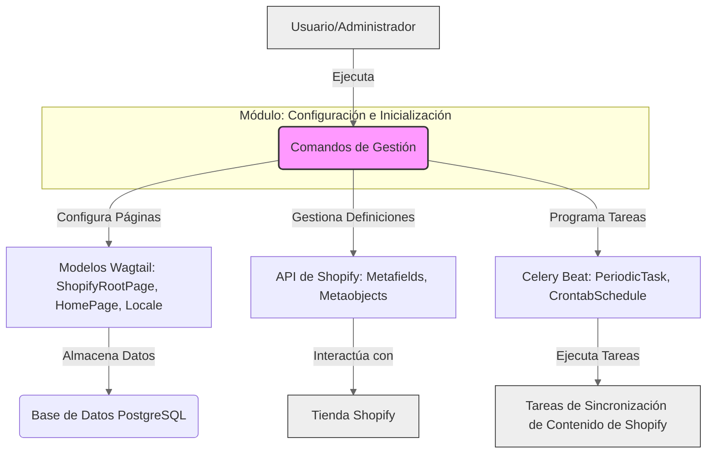

# Comandos de Gestión: Configuración e Inicialización de Shopify Content

Este módulo contiene comandos de gestión de Django esenciales para la configuración inicial y el mantenimiento de las definiciones de contenido y las configuraciones de sincronización dentro del sistema de gestión de contenido de Shopify. Estos comandos automatizan tareas repetitivas de configuración, asegurando que la estructura base de las páginas, las definiciones de metacampos y metaobjetos en Shopify, y las tareas programadas de sincronización estén correctamente establecidas.

## Propósito y Funcionalidad

El propósito principal de este módulo es proporcionar un conjunto de herramientas de línea de comandos para inicializar y mantener los aspectos fundamentales del sistema de gestión de contenido, incluyendo:

*   **Inicialización de Estructuras de Páginas:** Creación de páginas raíz y de inicio para diferentes configuraciones regionales en Wagtail.
*   **Configuración de Metacampos y Metaobjetos de Shopify:** Garantizar que las definiciones de metacampos para páginas e índices, así como las definiciones de metaobjetos para tipos de contenido personalizados, existan y estén correctamente configuradas en Shopify.
*   **Configuración de Tareas Programadas:** Establecer tareas periódicas de Celery Beat para la importación y sincronización de contenido.
*   **Gestión de Localidades:** Asegurar que las localidades de Wagtail requeridas para el soporte multi-idioma estén presentes.

## Arquitectura y Relaciones de Componentes

Los comandos de gestión en este módulo interactúan con varios componentes clave del sistema, incluyendo los modelos de Wagtail para el contenido, la API de Shopify para la gestión de metacampos y metaobjetos, y la configuración de Celery Beat para la programación de tareas.

### Diagrama de Contexto del Módulo



### Diagrama de Flujo de Configuración

```mermaid
graph TD
    start(Inicio) --> C1{Ejecutar Comando de Gestión}
    C1 --> C2{Comando: setup_locales}
    C2 -- Crea/Verifica Localidades Wagtail --> DB_WAGTAIL(Base de Datos Wagtail)
    C1 --> C3{Comando: ensure_metaobject_definitions}
    C3 -- Crea/Actualiza Definiciones de Metaobjetos --> SHOPIFY_API(API de Shopify)
    C1 --> C4{Comando: ensure_page_metafield_definitions}
    C4 -- Crea/Actualiza Definiciones de Metacampos de Páginas --> SHOPIFY_API
    C1 --> C5{Comando: ensure_blog_metafield_definitions}
    C5 -- Crea/Actualiza Definiciones de Metacampos de Blog/Artículo --> SHOPIFY_API
    C1 --> C6{Comando: ensure_index_metafield_definitions}
    C6 -- Crea/Actualiza Definiciones de Metacampos de Índices --> SHOPIFY_API
    C1 --> C7{Comando: bootstrap_home_pages}
    C7 -- Crea/Publica Páginas de Inicio en Wagtail --> DB_WAGTAIL
    C1 --> C8{Comando: bootstrap_index_pages}
    C8 -- Crea Páginas de Índice en Shopify & Actualiza Configuración de Wagtail --> SHOPIFY_API
    C8 -- Actualiza Configuración de Exportación --> DB_WAGTAIL
    C1 --> C9{Comando: setup_celery_beat_schedules}
    C9 -- Crea/Actualiza Tareas Programadas --> DB_CELERY(Base de Datos Celery Beat)
    DB_WAGTAIL --> end(Configuración Completada)
    SHOPIFY_API --> end
    DB_CELERY --> end

    style start fill:#ace,stroke:#333,stroke-width:2px
    style end fill:#ace,stroke:#333,stroke-width:2px
```

## Comandos Individuales

A continuación se detalla la funcionalidad de cada comando de gestión incluido en este módulo.

### `bootstrap_home_pages`

*   **Fichero**: `shopify_content/management/commands/bootstrap_home_pages.py`
*   **Descripción**: Este comando asegura la existencia de la `ShopifyRootPage` con el slug `cms-home` y crea una `HomePage` para cada código de localidad permitido definido en `settings.ALLOWED_LOCALE_CODES`. Es fundamental para establecer la estructura de las páginas de inicio multi-idioma en Wagtail.
*   **Argumentos clave**:
    *   `--publish`: Publica las filas de `HomePage` creadas, lo que puede desencadenar una sincronización con Shopify si la sincronización está habilitada.
    *   `--dry-run`: Informa sobre las acciones que se tomarían sin guardar ningún cambio.
*   **Interacciones**: Interactúa con [Content_Page_Models/Content_Page_Models_Shopify_Root_Page.md](../../Content_Page_Models/Content_Page_Models_Shopify_Root_Page.md#shopifyrootpage) y [Content_Page_Models/Content_Page_Models_Home_Pages.md](../../Content_Page_Models/Content_Page_Models_Home_Pages.md#homepage) de Wagtail. Utiliza lógica de normalización y serialización de contenido (`normalize_sections_json`, `sections_json_to_stream_data`) y resolución de padres (`resolve_shopify_import_parent`).

### `bootstrap_index_pages`

*   **Fichero**: `shopify_content/management/commands/bootstrap_index_pages.py`
*   **Descripción**: Este comando crea las páginas de índice de blog en Shopify y genera/aplica la configuración de exportación para los índices de glosario y ubicaciones. También puede crear páginas Shopify obsoletas para glosarios y ubicaciones con el argumento `--legacy-pages`.
*   **Argumentos clave**:
    *   `--apply-export-config`: Fusiona la configuración generada en `ShopifyRootPage.export_config` en la base de datos de Wagtail.
    *   `--skip-metafield-definitions`: Omite la ejecución de los comandos de aseguramiento de la definición de metacampos.
    *   `--legacy-pages`: Crea también páginas Shopify de glosario/ubicaciones en desuso.
*   **Interacciones**: Depende de `core.models.ShopConfig`. Interactúa con [Content_Page_Models/Content_Page_Models_Shopify_Root_Page.md](../../Content_Page_Models/Content_Page_Models_Shopify_Root_Page.md#shopifyrootpage). Utiliza funciones de `shopify_content.sync.index_pages_bootstrap` para construir la configuración y `shopify_content.sync.resource_metafield_definitions.ensure_index_metafield_definitions` para asegurar las definiciones de metacampos.

### `ensure_blog_metafield_definitions`

*   **Fichero**: `shopify_content/management/commands/ensure_blog_metafield_definitions.py`
*   **Descripción**: Este comando crea o verifica las definiciones de metacampos de Shopify para las listas de índices de blog (tipo PAGE) y para los recursos BLOG y ARTICLE, específicamente los metacampos `available_locales`. Es crucial para que los blogs y artículos gestionados por Wagtail puedan sincronizar correctamente sus metadatos con Shopify.
*   **Interacciones**: Depende de `core.models.ShopConfig` y utiliza `shopify_content.sync.resource_metafield_definitions.ensure_blog_metafield_definitions` para interactuar con la API de Shopify y gestionar las definiciones de metacampos.

### `ensure_index_metafield_definitions`

*   **Fichero**: `shopify_content/management/commands/ensure_index_metafield_definitions.py`
*   **Descripción**: Un comando más general que asegura las definiciones de metacampos de Shopify para `custom.index_listings` (PAGE) y las definiciones de `available_locales` para blog/artículos. Es la opción preferida para asegurar las definiciones de metacampos relacionadas con índices.
*   **Argumentos clave**:
    *   `--legacy`: También asegura las definiciones de metacampos de índice por localidad en desuso.
*   **Interacciones**: Depende de `core.models.ShopConfig`. Utiliza `shopify_content.sync.page_metafield_definitions.ensure_page_metafield_definitions` y `shopify_content.sync.resource_metafield_definitions.ensure_index_metafield_definitions`.

### `ensure_metaobject_definitions`

*   **Fichero**: `shopify_content/management/commands/ensure_metaobject_definitions.py`
*   **Descripción**: Este comando crea o verifica las definiciones de metaobjetos de Shopify propiedad del comerciante. Se debe ejecutar después de instalar la aplicación en una nueva tienda o si una definición se elimina accidentalmente. Asegura que los tipos de metaobjetos para páginas de ubicación, páginas raíz y páginas de inicio, así como los términos del glosario, estén correctamente definidos en Shopify.
*   **Interacciones**: Depende de `core.models.ShopConfig` y utiliza el [Shopify_Platform_Integrations/Shopify_Metaobjects_Connector.md](../../Shopify_Platform_Integrations/Shopify_Metaobjects_Connector.md) (`MetaobjectClient`) para interactuar con la API de Shopify. También depende de funciones específicas de definición de metaobjetos en `shopify_content.sync.outbound`.

### `ensure_page_metafield_definitions`

*   **Fichero**: `shopify_content/management/commands/ensure_page_metafield_definitions.py`
*   **Descripción**: Crea o verifica las definiciones de metacampos de la página de Shopify para `custom.index_listings`. Este comando es un subconjunto de `ensure_index_metafield_definitions`.
*   **Argumentos clave**:
    *   `--list-only`: Solo lista las definiciones de metacampos PAGE existentes; no crea ninguna.
*   **Interacciones**: Depende de `core.models.ShopConfig` y utiliza `shopify_content.sync.page_metafield_definitions.ensure_page_metafield_definitions`.

### `setup_celery_beat_schedules`

*   **Fichero**: `shopify_content/management/commands/setup_celery_beat_schedules.py`
*   **Descripción**: Este comando crea o actualiza las tareas periódicas predeterminadas de `django-celery-beat` para la sincronización de Shopify. Configura tareas para importar contenido nuevo y para rellenar enlaces internos semánticos.
*   **Interacciones**: Interactúa con los modelos `django_celery_beat.models.CrontabSchedule` y `django_celery_beat.models.PeriodicTask`. Las tareas programadas invocan funciones en `shopify_content.tasks`.

### `setup_locales`

*   **Fichero**: `shopify_content/management/commands/setup_locales.py`
*   **Descripción**: Crea los objetos `Wagtail Locale` necesarios (`en-US`, `es-US`, `en-CA`, `fr-CA`) para admitir la funcionalidad `hreflang` en el sistema de gestión de contenido. Debe ejecutarse una vez después de las migraciones iniciales.
*   **Interacciones**: Interactúa directamente con el modelo `wagtail.models.Locale`.

## Cómo encaja el módulo en el sistema general

El módulo `Management_Commands_Config_Setup_New` es la columna vertebral para la configuración y el aprovisionamiento inicial del sistema de gestión de contenido de Shopify. Actúa como el puente entre el entorno Django/Wagtail y la plataforma Shopify, asegurando que las estructuras de datos y los metadatos necesarios estén correctamente configurados en ambos lados. Sin estos comandos, la sincronización de contenido y la gestión multi-idioma no funcionarían de manera efectiva.

Se complementa con los comandos de [Management_Commands_Import_and_Synchronization.md](../Management_Commands_Import_and_Synchronization.md) para la importación y sincronización de contenido en curso, y con [Management_Commands_Maintenance_and_Validation.md](../Management_Commands_Maintenance_and_Validation.md) para el mantenimiento y la validación del contenido. Juntos, estos módulos de comandos de gestión proporcionan un conjunto completo de herramientas para operar la aplicación de contenido de Shopify.
