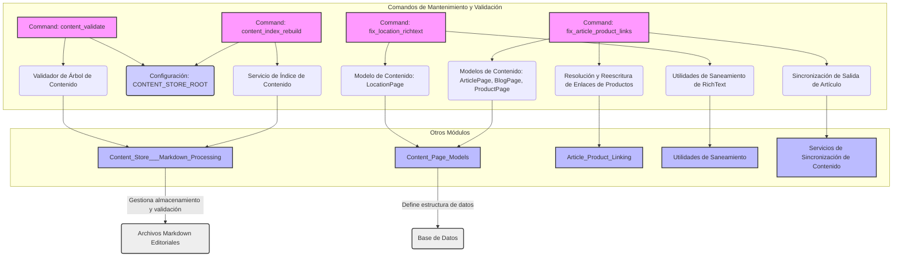

# Comandos de Gestión: Mantenimiento y Validación de Contenido

Este módulo agrupa comandos de gestión de Django dedicados al mantenimiento y la validación del contenido dentro del sistema de gestión de contenido de Shopify. Estos comandos son herramientas esenciales para garantizar la integridad, coherencia y corrección del contenido editorial almacenado y presentado.

## Propósito y Funcionalidad Principal

Los comandos de este módulo proporcionan funcionalidades críticas para:
*   Reconstruir índices de contenido para mejorar el rendimiento de las búsquedas y referencias.
*   Validar la estructura y el contenido de los archivos Markdown editoriales.
*   Corregir automáticamente enlaces de productos rotos en artículos.
*   Sanear y reparar HTML mal formado en páginas de ubicación.

Este conjunto de herramientas asegura que el contenido se mantenga saludable y actualizado, previniendo errores de visualización y enlaces rotos.

## Arquitectura y Relaciones de Componentes

Los comandos de gestión en este módulo interactúan con varios componentes del sistema, incluyendo modelos de contenido, servicios de indexación, y utilidades de saneamiento.


*Diagrama 1: Arquitectura de los Comandos de Mantenimiento y Validación de Contenido.*

### Detalles de Componentes

#### `shopify_content/management/commands/content_index_rebuild.py::Command`
Este comando es responsable de reconstruir los índices de contenido, `ContentIndex` y `ContentReferenceIndex`, a partir del árbol de contenido definido por `CONTENT_STORE_ROOT`. Es crucial para mantener la información de búsqueda y referencia actualizada.
*   **Dependencias Clave**:
    *   `shopify_content.content_store.content_index_service.rebuild_content_index`: La lógica central para la reconstrucción del índice.
    *   Configuración `CONTENT_STORE_ROOT`: Determina la ubicación raíz de los archivos de contenido.
*   **Uso**: `python manage.py content_index_rebuild [--root <path>]`

#### `shopify_content/management/commands/content_validate.py::Command`
Este comando realiza una validación exhaustiva del contenido editorial en formato Markdown. Opera en modo de solo lectura y es determinista, lo que lo hace ideal para su uso en entornos de CI/CD (ver `.github/workflows/content-validate.yml`).
*   **Dependencias Clave**:
    *   `shopify_content.content_store.validation_runner.validate_content_tree`: Ejecuta la lógica de validación.
    *   Configuración `CONTENT_STORE_ROOT`: Especifica la ruta base para los archivos a validar.
    *   [Content_Store___Markdown_Processing](../Content_Store___Markdown_Processing.md): Este módulo es el origen de las utilidades de validación y gestión del contenido Markdown.
*   **Argumentos**:
    *   `--json`: Emite el informe de validación en formato JSON.
    *   `--root`: Permite anular la ruta `CONTENT_STORE_ROOT` por defecto.
*   **Uso**: `python manage.py content_validate [--json] [--root <path>]`

#### `shopify_content/management/commands/fix_article_product_links.py::Command`
Este comando se encarga de corregir los enlaces a productos dentro del cuerpo de los artículos de blog, específicamente aquellos que usan la estructura `/products/{handle}`. Su objetivo es asegurar que estos enlaces apunten a los `ProductPage` correctos y en vivo.
*   **Dependencias Clave**:
    *   [Article_Product_Linking](../Article_Product_Linking.md): Proporciona la lógica para la resolución de *handles* de productos y la reescritura del `StreamField` HTML.
    *   [Content_Page_Models](../Content_Page_Models.md): Accede a los modelos `ArticlePage`, `BlogPage` y `ProductPage` para operar sobre ellos.
    *   `shopify_content.sync.outbound.sync_article_page`: Utilizado para sincronizar los cambios de los artículos con Shopify después de la corrección, si se especifica la opción `--push`.
*   **Argumentos**:
    *   `--dry-run`: Informa los cambios sin guardarlos ni enviarlos.
    *   `--blog-handle`: Limita la corrección a artículos bajo un `BlogPage` específico.
    *   `--page-id`: Limita la corrección a IDs específicos de `ArticlePage`.
    *   `--map-file`: Proporciona un archivo JSON para resolver casos ambiguos de *handles*.
    *   `--push`: Sincroniza los artículos modificados con Shopify.
    *   `--no-unwrap-missing`: Deja los enlaces de productos no mapeados sin cambios en lugar de desenvolver las etiquetas `<a>`.
    *   `--include-drafts`: Incluye artículos no publicados en la corrección.
*   **Uso**: `python manage.py fix_article_product_links [--dry-run] [...]`

#### `shopify_content/management/commands/fix_location_richtext.py::Command`
Este comando está diseñado para reparar el contenido HTML mal formado en los campos `RichTextField` de los registros `LocationPage`. Busca y corrige problemas comunes que podrían surgir de ediciones manuales o importaciones.
*   **Dependencias Clave**:
    *   [Content_Page_Models/Content_Page_Models_Location_Pages.md](../Content_Page_Models/Content_Page_Models_Location_Pages.md): Opera directamente sobre el modelo `LocationPage`.
    *   `shopify_content.richtext_sanitize`: Contiene las funciones `sanitize_richtext_html` y `validate_richtext_html` para limpiar y verificar el HTML.
*   **Argumentos**:
    *   `--page-id`: Limita la reparación a IDs específicos de `LocationPage`.
    *   `--dry-run`: Informa los cambios sin guardarlos.
*   **Uso**: `python manage.py fix_location_richtext [--dry-run] [--page-id <id>]`

## Flujo de Datos y Procesos

### Proceso de Validación de Contenido (`content_validate`)

```mermaid
flowchart TD
    A[Inicio: Ejecutar content_validate] --> B{CONTENT_STORE_ROOT configurado?};
    B -- No --> C[Error: CONTENT_STORE_ROOT no configurado];
    B -- Sí --> D[Leer archivos Markdown del repositorio];
    D --> E[Ejecutar validación de contenido editorial];
    E --> F{Reporte en JSON?};
    F -- Sí --> G[Emitir reporte JSON en stdout];
    F -- No --> H[Emitir reporte legible en stdout/stderr];
    H --> I{Contenido OK?};
    G --> I;
    I -- No --> J[Salir con código de error (1)];
    I -- Sí --> K[Salir con éxito (0)];
```
*Diagrama 2: Flujo de Proceso del comando `content_validate`.*

### Proceso de Corrección de Enlaces de Artículo (`fix_article_product_links`)

```mermaid
flowchart TD
    A[Inicio: Ejecutar fix_article_product_links] --> B[Cargar mapa manual de handles (opcional)];
    B --> C[Resolver handles de ProductPage en vivo];
    C --> D[Filtrar ArticlePages según argumentos (--blog-handle, --page-id, --include-drafts)];
    D --> E{Iterar sobre cada ArticlePage};
    E -- Por cada Artículo --> F[Obtener raw_data de StreamField];
    F --> G[Reescribir enlaces de productos en raw_data];
    G --> H{Cambios realizados?};
    H -- Sí --> I[Reportar cambios para el artículo];
    I --> J{Dry-run?};
    J -- No --> K[Guardar nueva revisión del artículo];
    K --> L{Artículo Live y --push?};
    L -- Sí --> M[Sincronizar artículo con Shopify];
    M --> N{Sincronización exitosa?};
    N -- Sí --> O[Reportar éxito de push];
    N -- No --> P[Reportar fallo de push];
    O --> E;
    P --> E;
    J -- Sí --> E;
    H -- No --> E;
    E -- Fin --> Q[Reportar resumen final de la ejecución];
    Q --> R[Listar handles ambiguos (si existen)];
```
*Diagrama 3: Flujo de Proceso del comando `fix_article_product_links`.*

## Cómo el Módulo Encaja en el Sistema General

Este módulo de comandos de gestión es una parte integral del ecosistema de [Shopify_Content_Management](../Shopify_Content_Management.md). Actúa como la capa de mantenimiento y control de calidad para el contenido editorial.

*   **Integración con el Almacén de Contenido**: Los comandos `content_index_rebuild` y `content_validate` trabajan directamente con el [Content_Store___Markdown_Processing](../Content_Store___Markdown_Processing.md), asegurando que el contenido almacenado esté correctamente estructurado y sea válido.
*   **Mantenimiento de Modelos de Contenido**: `fix_article_product_links` y `fix_location_richtext` operan sobre los modelos de página definidos en [Content_Page_Models](../Content_Page_Models.md), corrigiendo y actualizando datos clave.
*   **Flujos de CI/CD**: La capacidad de validación del contenido puede integrarse en flujos de integración continua, como se sugiere en `.github/workflows/content-validate.yml`, para detectar problemas antes de que el contenido sea desplegado o publicado. Esto es crucial para un proceso de publicación robusto y sin errores.
*   **Sincronización con Shopify**: `fix_article_product_links` puede, opcionalmente, sincronizar los cambios directamente con Shopify, cerrando el ciclo de edición y publicación de contenido corregido.
*   **Herramientas para Desarrolladores y Administradores**: Estos comandos proporcionan utilidades de línea de comandos para que los desarrolladores y administradores puedan diagnosticar, reparar y mantener el contenido sin necesidad de interacción manual a través de interfaces de usuario.

En resumen, los comandos de mantenimiento y validación son esenciales para la resiliencia y la confiabilidad del sistema de gestión de contenido, actuando como guardianes de la calidad del contenido y facilitando su adaptación y corrección a lo largo del tiempo.
