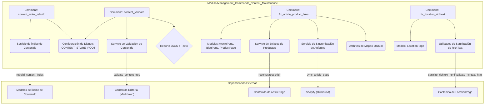
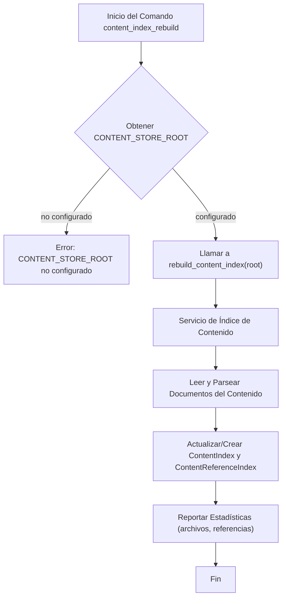
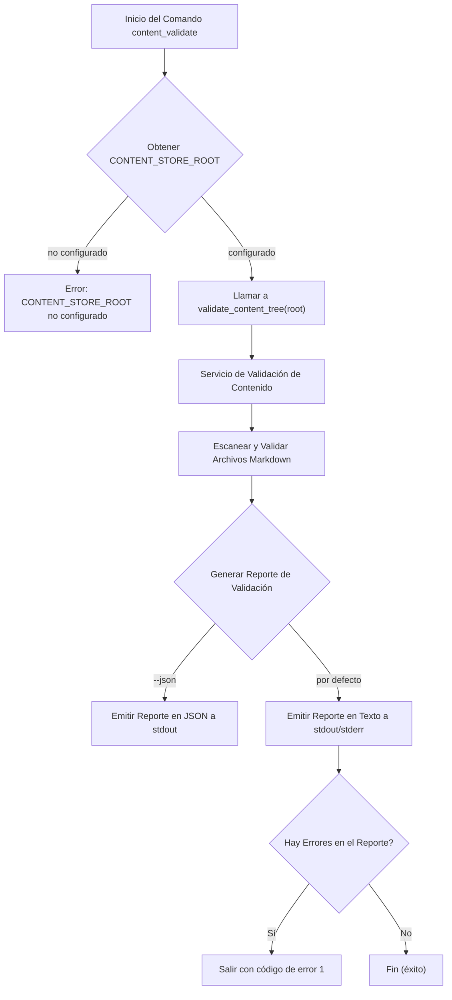
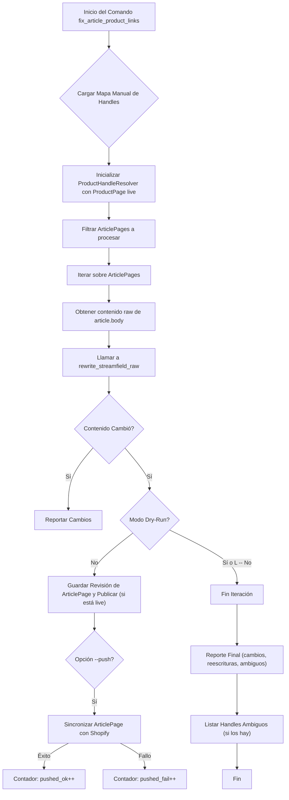
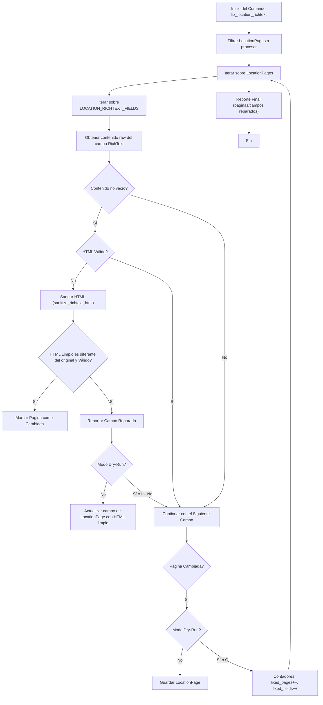

# Módulo Management_Commands_Content_Maintenance

Este módulo contiene comandos de gestión de Django diseñados para tareas de mantenimiento y validación del contenido dentro del sistema de gestión de contenido de Shopify. Estos comandos son esenciales para asegurar la integridad, consistencia y correcto formato del contenido editorial, así como para la reconstrucción de índices críticos.

## Arquitectura y Componentes

El módulo `Management_Commands_Content_Maintenance` agrupa varios comandos de gestión de Django, cada uno con una responsabilidad específica en el mantenimiento del contenido. Todos los comandos extienden `django.core.management.base.BaseCommand`.

### `shopify_content/management/commands/content_index_rebuild.py::Command`

Este comando es responsable de reconstruir las tablas `ContentIndex` y `ContentReferenceIndex` a partir del árbol de contenido desplegado. Esto asegura que el índice de contenido esté siempre actualizado con la estructura y las referencias del contenido editorial.

-   **Propósito**: Reconstruir el índice de contenido para documentos y referencias.
-   **Uso**: `python manage.py content_index_rebuild [--root <path>]`

#### Componentes Clave:

-   `Command` (en `shopify_content/management/commands/content_index_rebuild.py`): Implementa la lógica para invocar el servicio de reconstrucción del índice.
-   `rebuild_content_index` (en `shopify_content.content_store.content_index_service`): La función principal que realiza la reconstrucción del índice. Depende del módulo [Content_Store___Markdown_Processing](../../Content_Store___Markdown_Processing.md).
-   `settings.CONTENT_STORE_ROOT`: La ruta raíz del almacén de contenido, que puede ser sobrescrita con el argumento `--root`.

#### Proceso de Reconstrucción del Índice de Contenido

### `shopify_content/management/commands/content_validate.py::Command`

Este comando valida el contenido editorial basado en Git, asegurando que el Markdown y la estructura del contenido cumplan con las reglas predefinidas. Es una operación de solo lectura y determinista, crucial para la calidad del contenido.

-   **Propósito**: Validar el contenido editorial Markdown para detectar errores o inconsistencias.
-   **Uso**: `python manage.py content_validate [--json] [--root <path>]`

#### Componentes Clave:

-   `Command` (en `shopify_content/management/commands/content_validate.py`): Contiene la lógica para ejecutar la validación.
-   `validate_content_tree` (en `shopify_content.content_store.validation_runner`): La función que ejecuta el proceso de validación. Para más detalles, consulte [Content_Store___Markdown_Processing/Content_Store___Markdown_Processing_Validation_Runner.md](../../Content_Store___Markdown_Processing/Content_Store___Markdown_Processing_Validation_Runner.md).
-   `settings.CONTENT_STORE_ROOT`: Define la ubicación del contenido a validar.
-   `ValidationReport` (en `shopify_content.content_store.validation_runner`): Objeto que encapsula los resultados de la validación, incluyendo el número de archivos revisados y los problemas encontrados.

#### Flujo de Validación de Contenido

### `shopify_content/management/commands/fix_article_product_links.py::Command`

Este comando se encarga de corregir los enlaces a productos rotos (`/products/{handle}`) dentro del contenido HTML de los `StreamField` de las páginas de artículos (`ArticlePage`). Revisa y reescribe los enlaces para apuntar a los `ProductPage.handle` correctos, opcionalmente desenvolviendo enlaces no mapeados.

-   **Propósito**: Normalizar y corregir enlaces de productos en artículos.
-   **Uso**: `python manage.py fix_article_product_links [--dry-run] [--blog-handle <handle>] [--page-id <id>] [--map-file <file>] [--push] [--no-unwrap-missing] [--include-drafts]`

#### Componentes Clave:

-   `Command` (en `shopify_content/management/commands/fix_article_product_links.py`): Orquesta el proceso de reescritura de enlaces.
-   `ProductHandleResolver` (en `shopify_content.article_product_links`): Resuelve `handle` de productos a partir de `ProductPage` en la base de datos y un mapa manual. Consulte [Article_Product_Linking](../../Article_Product_Linking.md) para más detalles.
-   `rewrite_streamfield_raw` (en `shopify_content.article_product_links`): La función que realiza la lógica de reescritura en el contenido del `StreamField`.
-   Modelos: `ArticlePage`, `BlogPage`, `ProductPage` (en [Content_Page_Models](../../Content_Page_Models.md)): Representan las páginas de contenido en el sistema.
-   `sync_article_page` (en `shopify_content.sync.outbound`): Utilizado para sincronizar los cambios de artículos con Shopify si se usa la opción `--push`.

#### Flujo de Reparación de Enlaces de Artículos a Productos

### `shopify_content/management/commands/fix_location_richtext.py::Command`

Este comando tiene como objetivo reparar el HTML malformado en los campos `RichTextField` de los registros de `LocationPage`. Valida y sanea el HTML, lo que es crucial para la correcta visualización del contenido en la interfaz de usuario.

-   **Propósito**: Sanear y reparar HTML malformado en los campos de texto enriquecido de `LocationPage`.
-   **Uso**: `python manage.py fix_location_richtext [--page-id <id>] [--dry-run]`

#### Componentes Clave:

-   `Command` (en `shopify_content/management/commands/fix_location_richtext.py`): Coordina la reparación de los campos de texto enriquecido.
-   `LocationPage` (en [Content_Page_Models](../../Content_Page_Models.md)): El modelo de página cuyos campos `RichTextField` necesitan ser reparados.
-   `LOCATION_RICHTEXT_FIELDS`, `_richtext_source`, `sanitize_richtext_html`, `validate_richtext_html` (en `shopify_content.richtext_sanitize`): Utilidades para identificar, extraer, limpiar y validar el HTML de los campos de texto enriquecido.

#### Proceso de Reparación de RichText de LocationPage

