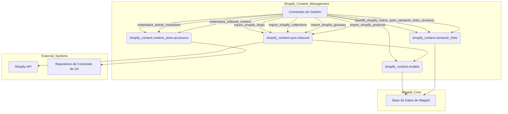
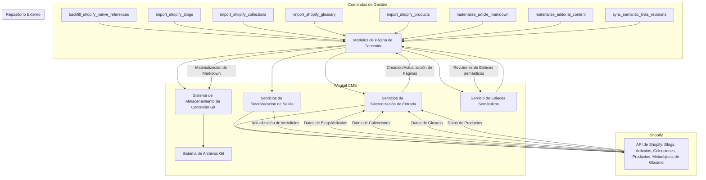

# Comandos de Gestión: Importación y Sincronización

El módulo `Management_Commands_Import_and_Synchronization` dentro de `shopify_content.management.commands` proporciona un conjunto de comandos de gestión de Django diseñados para facilitar la importación de datos desde Shopify a Wagtail, la sincronización de referencias y la materialización de contenido editorial en el sistema de gestión de contenido basado en Git. Estos comandos son esenciales para mantener la coherencia entre Shopify y Wagtail, asegurando que los datos de productos, colecciones, blogs, artículos y términos de glosario se reflejen correctamente en el CMS.

## Propósito y Funcionalidad Principal

Este módulo centraliza las operaciones de importación y sincronización de contenido, permitiendo a los desarrolladores y administradores:

*   Importar y actualizar automáticamente blogs, artículos, colecciones y productos desde Shopify.
*   Importar términos de glosario definidos como metaobjetos en Shopify.
*   Respaldar referencias nativas de Shopify desde enlaces semánticos.
*   Materializar contenido StreamField y campos editoriales enriquecidos en archivos Markdown autorizados por Git.
*   Sincronizar revisiones de enlaces semánticos para la visibilidad en la interfaz de administración de Wagtail.

## Arquitectura y Relaciones de Componentes

Los comandos de gestión en este módulo interactúan con varios componentes clave del sistema:

*   **Modelos de Wagtail**: Los comandos importan y actualizan instancias de modelos de páginas de Wagtail como `ArticlePage`, `CollectionPage`, `ProductPage`, `GlossaryTermPage`, y `ShopifyRootPage`.
*   **Shopify API**: A través de las funciones de sincronización (`shopify_content.sync.inbound`), los comandos se comunican con Shopify para recuperar datos.
*   **Sistema de Contenido Autorizado por Git**: Comandos como `materialize_article_markdown` y `materialize_editorial_content` escriben directamente en el repositorio de contenido configurado a través de `shopify_content.content_store.accessors`.
*   **Enlaces Semánticos**: El módulo `shopify_content.semantic_links` es fundamental para comandos que gestionan referencias y enlaces entre páginas.

Aquí se presenta un diagrama de componentes que ilustra las principales interacciones:

## Comandos Individuales

### `backfill_shopify_native_references`

Este comando rellena los metacampos de referencia nativos de Shopify a partir de las filas de clave foránea (FK) de enlaces semánticos tipados existentes en la base de datos de Wagtail. Su objetivo es asegurar que las referencias entre páginas de Wagtail se reflejen correctamente como metacampos de referencia de lista en Shopify, lo que es crucial para la integración bidireccional de contenido.

*   **Ruta del Componente**: `shopify_content/management/commands/backfill_shopify_native_references.py::Command`
*   **Parámetros**: `--model` (product, collection, article, glossary, all), `--dry-run`.
*   **Uso**: Después de que los enlaces semánticos se hayan establecido en Wagtail, este comando se ejecuta para empujar esas referencias a Shopify.
*   **Relacionado con**: [Content Page Models](../Content_Page_Models.md#Content_Page_Models_Semantic_Links_Models), [Semantic Links Service](../Semantic_Links_Service.md)

### `import_shopify_blogs`

Este comando importa todos los blogs y artículos de Shopify en instancias de `BlogPage` y `ArticlePage` de Wagtail. Permite especificar una página padre en Wagtail para organizar el contenido importado.

*   **Ruta del Componente**: `shopify_content/management/commands/import_shopify_blogs.py::Command`
*   **Parámetros**: `--parent-page-id`.
*   **Uso**: Se ejecuta para realizar una importación inicial de contenido de blog o para actualizar blogs y artículos existentes.
*   **Relacionado con**: [Content Page Models/Blog and Article Pages](../Content_Page_Models/Content_Page_Models_Blog_and_Article_Pages.md), [Shopify_Content_Application_Core/Application_Configuration](../Shopify_Content_Application_Core/Shopify_Content_Application_Core_Application_Configuration.md)

### `import_shopify_collections`

Importa todas las colecciones de Shopify como instancias de `CollectionPage` en Wagtail. Similar al comando de blogs, permite definir una página padre para la estructura.

*   **Ruta del Componente**: `shopify_content/management/commands/import_shopify_collections.py::Command`
*   **Parámetros**: `--parent-page-id`.
*   **Uso**: Importa o actualiza colecciones de productos de Shopify en Wagtail.
*   **Relacionado con**: [Content Page Models/Collection Pages](../Content_Page_Models/Content_Page_Models_Collection_Pages.md)

### `import_shopify_glossary`

Este comando importa los metaobjetos `glossary_term` de Shopify a instancias de `GlossaryTermPage` de Wagtail. Ofrece una opción para importar solo términos nuevos.

*   **Ruta del Componente**: `shopify_content/management/commands/import_shopify_glossary.py::Command`
*   **Parámetros**: `--parent-page-id`, `--new-only`.
*   **Uso**: Mantiene el glosario de términos sincronizado entre Shopify y Wagtail.
*   **Relacionado con**: [Content Page Models/Glossary Term Pages](../Content_Page_Models/Content_Page_Models_Glossary_Term_Pages.md), [Shopify Metaobjects Connector](../../Shopify_Platform_Integrations/Shopify_Metaobjects_Connector.md)

### `import_shopify_products`

Importa todos los productos de Shopify como instancias de `ProductPage` en Wagtail. También permite especificar una página padre para la organización.

*   **Ruta del Componente**: `shopify_content/management/commands/import_shopify_products.py::Command`
*   **Parámetros**: `--parent-page-id`.
*   **Uso**: Importa o actualiza la información del producto de Shopify en Wagtail.
*   **Relacionado con**: [Content Page Models/Product Pages](../Content_Page_Models/Content_Page_Models_Product_Pages.md)

### `materialize_article_markdown`

Este comando migra el contenido de `StreamField` de `ArticlePage` a documentos Markdown nativos de Git (`body.md`). Preserva el HTML renderizado existente, permitiendo una transición sin pérdidas a la autoridad de Git para el contenido, donde los editores pueden refinarlo a Markdown semántico con el tiempo.

*   **Ruta del Componente**: `shopify_content/management/commands/materialize_article_markdown.py::Command`
*   **Parámetros**: `--locale`, `--force`, `--dry-run`.
*   **Uso**: Una migración operativa para cambiar la autoridad del contenido del StreamField de Wagtail a un archivo Markdown gestionado por Git.
*   **Relacionado con**: [Content Page Models/Blog and Article Pages](../Content_Page_Models/Content_Page_Models_Blog_and_Article_Pages.md), [Content Store - Markdown Processing](../Content_Store___Markdown_Processing.md)

### `materialize_editorial_content`

Materializa campos editoriales migrados (como descripciones de blogs, definiciones de glosarios y contenido de páginas de ubicación) en el árbol de contenido autorizado por Git. El contenido se escribe verbatim, incluyendo HTML existente, para una migración sin pérdidas.

*   **Ruta del Componente**: `shopify_content/management/commands/materialize_editorial_content.py::Command`
*   **Parámetros**: `--field`, `--locale`, `--force`, `--dry-run`.
*   **Uso**: Herramienta de migración para consolidar campos editoriales en el sistema de archivos de contenido de Git.
*   **Relacionado con**: [Content Page Models](../Content_Page_Models.md), [Content Store - Markdown Processing](../Content_Store___Markdown_Processing.md)

### `sync_semantic_links_revisions`

Sincroniza las filas de clave foránea (FK) de enlaces semánticos tipados existentes en las revisiones de Wagtail. Esto corrige la visibilidad de los enlaces semánticos en la interfaz de administración de Wagtail si existen en la base de datos pero no se muestran en la UI después de una operación como `refresh_semantic_links_batch`.

*   **Ruta del Componente**: `shopify_content/management/commands/sync_semantic_links_revisions.py::Command`
*   **Parámetros**: `--model` (article, product, collection, glossary, all).
*   **Uso**: Utilizado para asegurar que los enlaces semánticos se representen correctamente en el editor de Wagtail.
*   **Relacionado con**: [Content Page Models/Semantic Links Models](../Content_Page_Models/Content_Page_Models_Semantic_Links_Models.md), [Semantic Links Service](../Semantic_Links_Service.md)

## Cómo encaja el módulo en el sistema general

Este módulo es un puente crítico entre Shopify y Wagtail, y también una herramienta esencial para la transición a un sistema de contenido autorizado por Git. Permite la ingesta masiva de contenido de Shopify, asegurando que las páginas de productos, colecciones y contenido editorial estén disponibles en Wagtail para su edición y publicación. Además, los comandos de materialización son clave para adoptar un flujo de trabajo de "Git-first" para el contenido, donde los archivos Markdown son la fuente de verdad. Los comandos de sincronización de enlaces semánticos mantienen la integridad y la usabilidad de las referencias de contenido dentro de Wagtail y con Shopify. En resumen, este módulo garantiza que el contenido se pueda importar, sincronizar y gestionar eficientemente entre las plataformas, manteniendo una fuente de verdad unificada para el contenido editorial.
do en Git (`shopify_content.content_store`).

## Cómo encaja el Módulo en el Sistema General

Este módulo es un puente vital entre Shopify y Wagtail, permitiendo la ingesta de contenido desde Shopify hacia el CMS para su gestión centralizada. Los comandos de importación inicializan las páginas de Wagtail con datos de Shopify, mientras que los comandos de materialización y sincronización aseguran que las ediciones realizadas en Wagtail o las estructuras internas (como los enlaces semánticos) se reflejen en los metafields de Shopify o se persistan en un repositorio Git para una fuente de verdad autoritativa. Esto integra el contenido de comercio electrónico con el contenido editorial, creando una experiencia de usuario cohesionada y facilitando la gestión por parte de los equipos de contenido.

Para más detalles sobre los modelos de página, consulte [Modelos de Página de Contenido](../Content_Page_Models.md). Para entender los servicios de sincronización, revise [Especificaciones de Sincronización de Contenido](../Content_Synchronization_Specifications.md).
