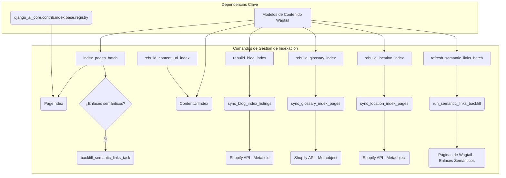

# Comandos de Gestión de Indexación

El módulo `Management_Commands_Indexing` contiene una colección de comandos de gestión de Django diseñados para la indexación y reconstrucción de diversos índices de contenido dentro del sistema de gestión de contenido de Shopify. Estos comandos son cruciales para mantener la integridad y la capacidad de búsqueda del contenido, así como para la sincronización de datos con la plataforma Shopify.

## Arquitectura y Componentes

Este módulo agrupa varios comandos de gestión, cada uno con una responsabilidad específica en el proceso de indexación.

### Componentes principales:

*   [`shopify_content/management/commands/index_pages_batch.py::Command`](#command---index_pages_batch)
*   [`shopify_content/management/commands/rebuild_blog_index.py::Command`](#command---rebuild_blog_index)
*   [`shopify_content/management/commands/rebuild_content_url_index.py::Command`](#command---rebuild_content_url_index)
*   [`shopify_content/management/commands/rebuild_glossary_index.py::Command`](#command---rebuild_glossary_index)
*   [`shopify_content/management/commands/rebuild_location_index.py::Command`](#command---rebuild_location_index)
*   [`shopify_content/management/commands/refresh_semantic_links_batch.py::Command`](#command---refresh_semantic_links_batch)

### Diagrama de Flujo de Indexación y Reconstrucción

A continuación, se presenta un diagrama que ilustra la relación general y el flujo de trabajo de los comandos de indexación.

### `Command` - `index_pages_batch`

Este comando se encarga de indexar páginas de Wagtail en el `PageIndex` en lotes, lo que ayuda a mitigar picos de memoria. Es una alternativa segura para la memoria a `rebuild_indexes` y permite reanudar el proceso desde un punto específico.

*   **Ruta del archivo:** `shopify_content/management/commands/index_pages_batch.py`
*   **Funcionalidad principal:**
    *   Procesa páginas en lotes configurables (`--batch-size`).
    *   Permite especificar el tipo de página a indexar (`--model`: `article`, `product`, `collection`, `glossary`, `all`).
    *   Puede reanudarse desde un `pk` específico (`--start-pk`).
    *   Incluye una pausa configurable entre lotes (`--pause`).
    *   Opcionalmente, encola una tarea para la retroalimentación de enlaces semánticos al finalizar (`--skip-semantic-backfill`).
*   **Dependencias clave:**
    *   `django_ai_core.contrib.index.base.registry`: Para acceder al `PageIndex`.
    *   `shopify_content.indexing.INDEX_MODELS`, `shopify_content.indexing.model_source_for`: Para obtener los modelos y fuentes de datos.
    *   `shopify_content.tasks.backfill_semantic_links_task`: Tarea asíncrona para rellenar enlaces semánticos.
*   **Relación con otros módulos:** Interactúa con los [Modelos de Contenido de Página](../Content_Page_Models.md) y el servicio de [Enlaces Semánticos](../Semantic_Links_Service.md).

### `Command` - `rebuild_blog_index`

Este comando reconstruye el metaobjeto `custom.index_listings` del índice de blogs en los blogs manejados por la página de Shopify. Es esencial para mantener los listados de blogs actualizados en Shopify.

*   **Ruta del archivo:** `shopify_content/management/commands/rebuild_blog_index.py`
*   **Funcionalidad principal:**
    *   Sincroniza el índice de blogs con Shopify.
    *   Soporta un modo de "ejecución en seco" (`--dry-run`) para previsualizar el JSON que se enviaría a Shopify sin realizar cambios.
    *   Proporciona mensajes de advertencia detallados si la configuración del índice de blogs no es correcta.
*   **Dependencias clave:**
    *   `shopify_content.sync.blog_index.sync_blog_index_listings`: Lógica para sincronizar el índice.
    *   `shopify_content.blogs.index.build_blog_index_listings`: Para construir el JSON del índice de blogs.
*   **Relación con otros módulos:** Depende de la configuración de exportación en [Content_Indexing___Export_Configuration](../Content_Indexing___Export_Configuration.md) y se comunica con la API de Shopify.

### `Command` - `rebuild_content_url_index`

Este comando se utiliza para reconstruir el `ContentUrlIndex`, que es un mapeo de las URLs de las páginas de Wagtail que tienen un `shopify_id`. Esto es vital para asegurar que las URLs de contenido estén correctamente indexadas y sean accesibles.

*   **Ruta del archivo:** `shopify_content/management/commands/rebuild_content_url_index.py`
*   **Funcionalidad principal:**
    *   Puede reconstruir el índice completo de URLs de contenido.
    *   Permite reconstruir el índice para una única página de Wagtail específica utilizando `--page-id`.
*   **Dependencias clave:**
    *   `shopify_content.content_url_index.rebuild_full_index`, `shopify_content.content_url_index.rebuild_index_for_page`: Funciones para la lógica de reconstrucción del índice.
    *   `wagtail.models.Page`: Para acceder a las páginas de Wagtail.
*   **Relación con otros módulos:** Trabaja estrechamente con el módulo [Content_URL_Resolver](../../Content_URL_Resolver.md) y los [Modelos de Contenido de Página](../Content_Page_Models.md).

### `Command` - `rebuild_glossary_index`

Este comando reconstruye las entradas del metaobjeto `root_page` del índice del glosario, una por cada configuración regional (locale) definida. Asegura que los términos del glosario estén correctamente indexados y disponibles en diferentes idiomas.

*   **Ruta del archivo:** `shopify_content/management/commands/rebuild_glossary_index.py`
*   **Funcionalidad principal:**
    *   Sincroniza las páginas del índice del glosario con Shopify.
    *   Ofrece un modo de "ejecución en seco" (`--dry-run`) para previsualizar el JSON por locale.
    *   Permite limitar la reconstrucción a uno o más locales específicos (`--locale`).
    *   Proporciona mensajes de advertencia si la configuración del índice del glosario no es correcta.
*   **Dependencias clave:**
    *   `shopify_content.glossary.index.build_glossary_index_json`: Para construir el JSON del índice del glosario por locale.
    *   `shopify_content.sync.glossary_index.sync_glossary_index_pages`: Lógica para sincronizar el índice.
*   **Relación con otros módulos:** Depende de la configuración de exportación en [Content_Indexing___Export_Configuration](../Content_Indexing___Export_Configuration.md) y se comunica con la API de Shopify.

### `Command` - `rebuild_location_index`

Similar al índice del glosario, este comando reconstruye las entradas del metaobjeto `root_page` del índice de ubicaciones, una por cada configuración regional. Esto es crucial para la gestión de contenido basado en la ubicación.

*   **Ruta del archivo:** `shopify_content/management/commands/rebuild_location_index.py`
*   **Funcionalidad principal:**
    *   Sincroniza las páginas del índice de ubicaciones con Shopify.
    *   Soporta un modo de "ejecución en seco" (`--dry-run`) para previsualizar el JSON por locale.
    *   Permite limitar la reconstrucción a uno o más locales específicos (`--locale`).
    *   Proporciona mensajes de advertencia si la configuración del índice de ubicaciones no es correcta.
*   **Dependencias clave:**
    *   `shopify_content.locations.index.build_location_index_json`: Para construir el JSON del índice de ubicaciones por locale.
    *   `shopify_content.sync.location_index.sync_location_index_pages`: Lógica para sincronizar el índice.
*   **Relación con otros módulos:** Depende de la configuración de exportación en [Content_Indexing___Export_Configuration](../Content_Indexing___Export_Configuration.md) y se comunica con la API de Shopify.

### `Command` - `refresh_semantic_links_batch`

Este comando se utiliza para rellenar (backfill) los enlaces internos semánticos para todas las páginas "en vivo" que sean enlazables. Mejora la navegación y el SEO al crear automáticamente enlaces relevantes.

*   **Ruta del archivo:** `shopify_content/management/commands/refresh_semantic_links_batch.py`
*   **Funcionalidad principal:**
    *   Genera enlaces internos semánticos automáticos para los tipos de páginas especificados (`--model`).
    *   Soporta un modo de "ejecución en seco" (`--dry-run`) para informar sobre los recuentos sin escribir los enlaces.
    *   Puede optar por procesar solo las páginas que no tienen enlaces automáticos (`--only-missing`).
    *   Permite omitir la creación de revisiones de Wagtail después de actualizar los enlaces (`--skip-revision-sync`).
*   **Dependencias clave:**
    *   `shopify_content.semantic_links.backfill.run_semantic_links_backfill`: Contiene la lógica principal para el relleno de enlaces semánticos.
*   **Relación con otros módulos:** Interactúa directamente con el módulo [Semantic_Links_Service](../../Semantic_Links_Service.md) para gestionar los enlaces semánticos.
